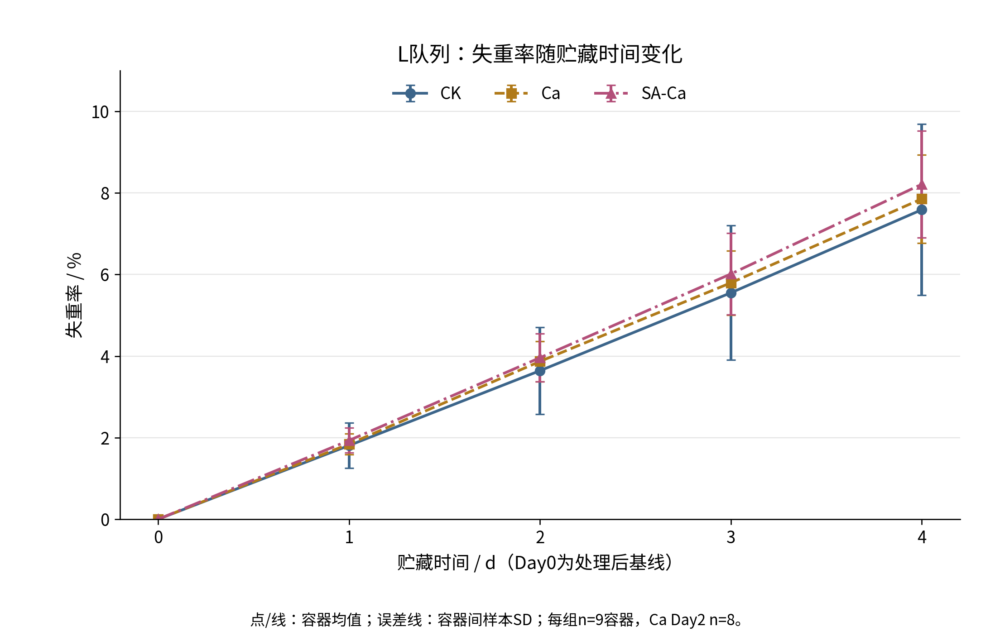
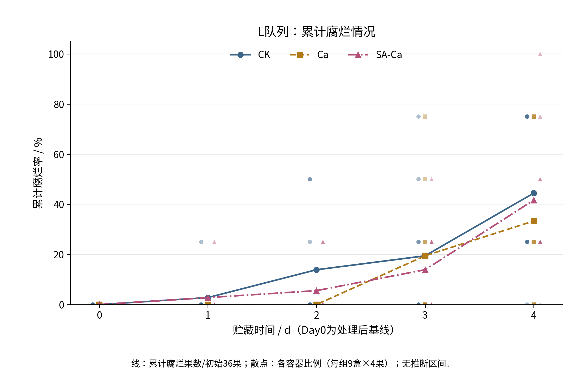
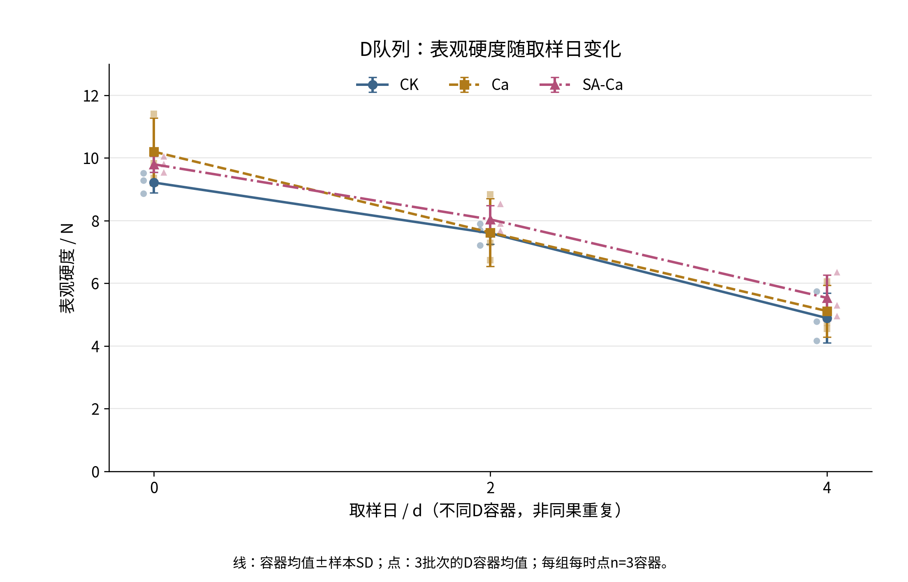
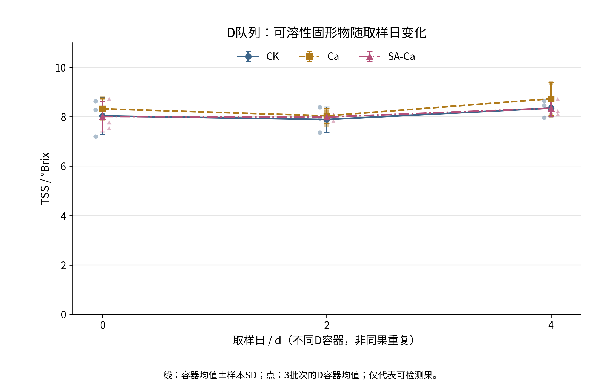
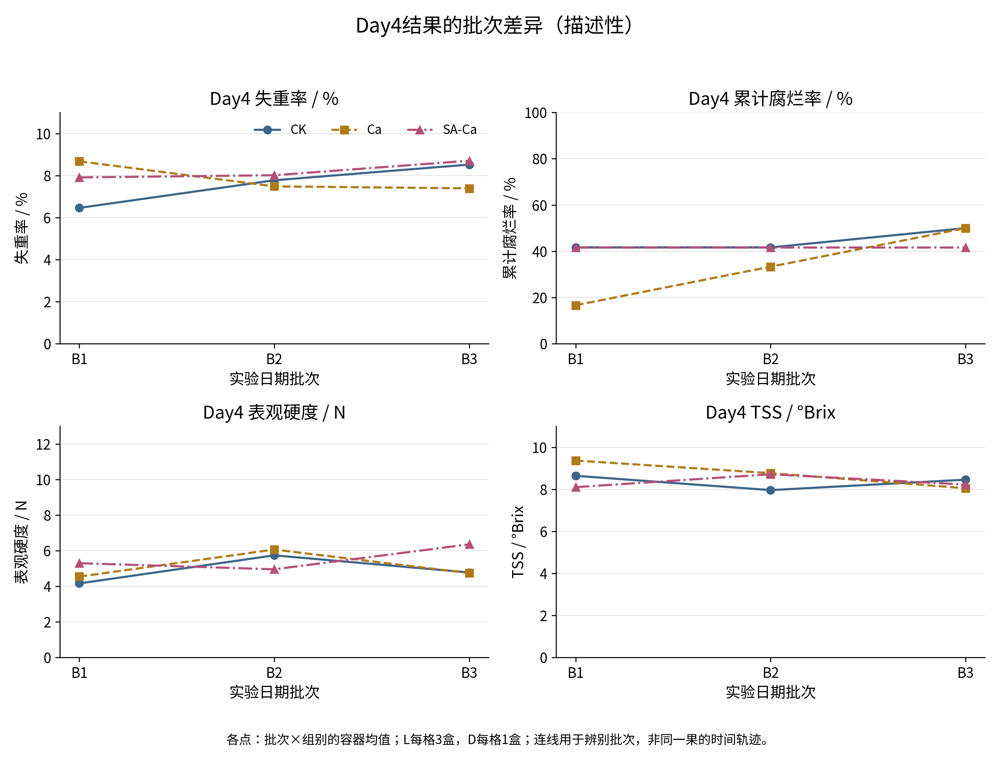
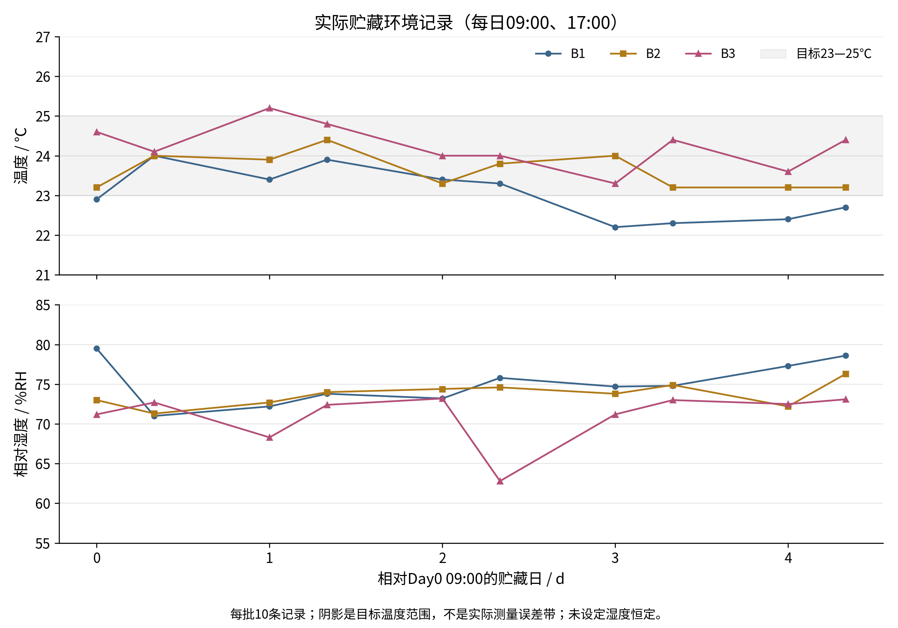

# Phase 02｜实验数据统计分析

正式题目：《可食性海藻酸钠膜对草莓常温保鲜效果的研究》
学校：四川工业科技学院｜本科毕业实验研究
日期：2026-11-10（UTC+8）｜状态：Phase 02交付，等待外部人工审核

## 1. 主要结果与适用范围

本轮按用户TASK Phase 02及正式补充指令开展描述统计、批次对比与方法整理。该新授权适用于本轮，优先于AGENTS/旧档案中“仅Phase 01”的阶段范围；不改写旧报告或其历史验收结论，不将本轮视为来源认证通过。原始记录册据研究者说明已交导师、暂不可获取，部分照片不能恢复；这些限制保留为结果边界，不阻断已有数据的分析。

**STATISTICAL_RESULT（描述统计）**：Day4失重率CK、Ca、SA-Ca分别为7.588±2.096%、7.853±1.083%、8.212±1.309%（各9个L容器）。本数据未呈现SA-Ca降低失重率的整体优势；SA-Ca相对Ca的差为+0.359个百分点。

**DATA_OBSERVATION / STATISTICAL_RESULT（描述统计）**：Day4 L队列累计腐烂为CK 16/36（44.44%）、Ca 12/36（33.33%）、SA-Ca 15/36（41.67%）；SA-Ca仅比CK少1果。对应可检测D果的容器平均表观硬度为4.894±0.795、5.118±0.826、5.538±0.730 N；TSS为8.352±0.352、8.728±0.659、8.346±0.324 °Brix（各组各日3个D容器）。指标未形成一致的综合优效结论。

**LIMITATION**：以上均为现有工作簿内的观察和计算，没有p值、显著性字母或置信区间。共享母液、仅3日期批次、Day0品质不平衡及腐坏相关缺测限制因果与总体推断；不能写成“无显著差异”或“已证实无效”。

## 2. 输入、计算与可复现路径

主数据为[公式修复核验副本](研究数据_公式修复核验副本.xlsx)，原始[研究数据S1.xlsx](../研究数据S1.xlsx)只作版本/出处留存，未写入。前置依据为[Phase 01报告](../audit/PHASE_01_资料与数据可用性审核.md)、[Phase 01B整改报告](../audit/PHASE_01B_关键问题整改报告.md)、项目档案和AGENTS，以及本轮“已粘贴的文本.txt”正式补充。没有再次逐公式重算582处，也未调用表格引擎；直接读取已核验缓存，按本轮口径作新统计汇总。

|输入|SHA-256|
|---|---|
|研究数据S1.xlsx|`7ffc712bbfd8648fbd359a3bf26e6af75af2a21fde7b7be801c862546d3cb550`|
|analysis/研究数据_公式修复核验副本.xlsx|`9167c63e20dc6f9d6a454981620644897a631c653f861309bb90d66da0f298f2`|

代码：[analyze_phase02.py](scripts/analyze_phase02.py)、[build_phase02_reports.py](scripts/build_phase02_reports.py)、[validate_phase02.py](scripts/validate_phase02.py)。全精度数据、容器结果、源行号、批次对比、图表数据及216图片状态存于[phase02_results.json](scripts/phase02_results.json)。运行环境版本：python 3.12.14, openpyxl 3.1.5, numpy 2.3.5, matplotlib 3.10.8。

```bash
python analysis/scripts/analyze_phase02.py
python analysis/scripts/build_phase02_reports.py
python analysis/scripts/validate_phase02.py
```

统计表保留3位小数（个数为整数）；计算和JSON保留浮点精度，不以显示位数增加仪器精度。输入哈希不符时脚本停止，避免无声切换来源。脚本不安装依赖、不写Excel，不依赖/tmp中未交付的脚本或数据。原始已核验来源提交为`6f07d97c71e989898af45dd2d93597f109bfbe00`。

## 3. 实验结构与统计方法

### 3.1 层级与样本量

|层级|规模|本轮处理|
|---|---|---|
|日期批次|B1 10/05、B2 10/13、B3 10/21|每批18容器；处理组内共享当天母液；非54次独立配制|
|组别|CK、Ca、SA-Ca|CK水→新水；Ca水→1.0%CaCl₂；SA-Ca 1.5%SA→1.0%CaCl₂（w/w）|
|处理容器|54（L27、D27）|候选处理单位；独立容器/浸渍与母液制备层级分开|
|果实|189（L108、D81）|嵌套于容器；不是189个独立处理重复|
|L队列|每批×组3容器，每盒4果|Day0—4同单位重复；质量135计划记录、134有效；腐烂540果日事件|
|D队列|每批×组×日1容器，每盒3果|D0/2/4不同容器破坏性取样；组×日跨批3容器|
|技术读数|硬度每果2次、TSS每果1次|243计划、237有效；先同果重复均值，再容器等权，再组间容器等权|
|缺失|质量1条；品质6读数=2果×3|不补0、不插值、不删除异常容器；D两果不可测均发生在Day4|

### 3.2 指标定义与汇总

失重率以处理、沥液后的同一L容器Day0质量M0为基线：`100×(M0−Mt)/M0`。分析沿用修复副本04表J列的单位层失重率（原记录按2位小数派生），不混用02表处理前单果质量、不把不同容器质量相减。各组每时点均值为可观测容器百分比的等权平均，不按容器初始质量加权；SD为容器间样本标准差（ddof=1）。Day0值0及SD0由基线定义产生，不能当成“处理效果一致”的证据。

腐烂仅用L队列：每果累计状态，以初始果数为分母；组水平为累计腐烂果数/36×100。每容器的腐烂比例=累计数/4×100；9个容器等权均值在当前每盒4果且全部持续观察时等于组总比例。表中SD反映容器比例离散，不是二项置信区间。首次腐烂只计一次；L果腐坏后不移除，D退出不进入该分母。

表观硬度先同一fruit_id的2次有效技术读数取均值，再将同容器可测果等权平均；TSS先按每果有效读数，再按容器平均。不同容器再等权汇总均值/SD。当前每个有效果有2硬度读数，2个缺测果均无硬度/TSS有效值。Day4 CK和SA-Ca各8可测D果，Ca9果；各组仍有3个非空容器。均值仅代表可检测果，不能无条件代表腐坏到不可测的果实。

范围主表是“容器结果”的min—max；另列仪器原读数范围，不混为一层。中位数与全量容器/果实汇总见JSON。温湿度按各批10时点、全体30时点计算均值/SD/范围，30次时间记录不等于30次独立环境实验。

### 3.3 探索性比较与推断选择

主结果为描述统计。附加两项不依赖显著性筛选的敏感性描述：（1）各日期批次先汇总，再等权平均，与容器等权口径比较；（2）Day4在每个批次内做组间差，再列3个差值、平均差及留一批次后两批差的范围。留一批次范围仅衡量批次敏感性，非置信区间，不删除任何主分析样本。品质另比较“容器等权”与“可测果等权”的均值，评估单盒缺果导致的权重差；后者不代替主结果，也不解决信息性缺失。

未强行使用逐日独立样本t检验、把全部fruit-day输入普通ANOVA、对百分比简单正态检验或把技术读数扩充n。日期、母液、处理存在共享层级，只有3批次且D每批每组每时点1盒；本轮不拟合不稳定的复杂混合模型以制造p值。

未来若进一步推断：L失重可考虑以day为分类因子、容器重复测量、日期区组及batch×group母液共享层级的模型；组间对比可在日期批次内成对汇总，但只有3个日期对比，功效及分布估计很有限。累计腐烂可用保留果/容器层级的离散时间首次事件或聚类二项模型，不能把已腐烂果的后续累计状态当新的独立事件。D品质可在容器层用日期区组、group×day比较，关注batch×group×day无格内重复的局限；不能把D0/2/4当同果纵向，也不能把D0果当Day4果的协变量。共享母液误差与处理差异的分离依赖真实制备设计，而非仅增加果数。以上均是候选方法，未执行、未据观察结果挑选“最显著”的方法。

## 4. 失重率：各组均随时间增加

|组别|Day|有效L容器n|均值±SD / %|容器范围 / %|包含果数（非独立n）|
|---|---|---|---|---|---|
|CK|0|9|0.000 ± 0.000|0.000—0.000|36|
|CK|1|9|1.808 ± 0.557|0.540—2.430|36|
|CK|2|9|3.641 ± 1.066|1.150—4.780|36|
|CK|3|9|5.551 ± 1.649|1.590—7.280|36|
|CK|4|9|7.588 ± 2.096|2.600—9.830|36|
|Ca|0|9|0.000 ± 0.000|0.000—0.000|36|
|Ca|1|9|1.843 ± 0.256|1.500—2.340|36|
|Ca|2|8|3.869 ± 0.490|3.300—4.610|32|
|Ca|3|9|5.796 ± 0.789|4.650—7.000|36|
|Ca|4|9|7.853 ± 1.083|6.520—9.500|36|
|SA-Ca|0|9|0.000 ± 0.000|0.000—0.000|36|
|SA-Ca|1|9|1.932 ± 0.305|1.560—2.360|36|
|SA-Ca|2|9|3.959 ± 0.587|3.110—4.880|36|
|SA-Ca|3|9|6.013 ± 0.997|4.570—7.570|36|
|SA-Ca|4|9|8.212 ± 1.309|6.220—10.200|36|



图P02-1　L队列单位层失重率均值±容器间样本SD；Ca Day2 n=8，其余各组时点n=9。SVG矢量版本见[同名文件](figures/P02_F01_失重率.svg)。

**DATA_OBSERVATION**：三个组各时点组均值递增，SA-Ca在Day1—4的组均值均高于CK；Day4相对CK多0.624个百分点，不能写作“降低失重”。CK的Day4容器间SD最大，其中B1-CK-L2低失重记录保留（DV-001），不能为了使CK均值更高而删除它。

**LIMITATION**：失重表示称重对象的质量净变化，不是单独测得的蒸腾速率、呼吸速率或膜透湿系数；未单独量化残留液、基线干燥程度及膜层质量，不能由此断言某一机制。

## 5. 腐烂：Ca终点比例最低，SA-Ca未形成稳定优势

|组别|Day|累计腐烂/初始果数|组总比例 / %|容器比例均值±SD / %|容器范围 / %|容器n|
|---|---|---|---|---|---|---|
|CK|0|0/36|0.000|0.000 ± 0.000|0.000—0.000|9|
|CK|1|1/36|2.778|2.778 ± 8.333|0.000—25.000|9|
|CK|2|5/36|13.889|13.889 ± 22.048|0.000—50.000|9|
|CK|3|7/36|19.444|19.444 ± 27.323|0.000—75.000|9|
|CK|4|16/36|44.444|44.444 ± 30.046|0.000—75.000|9|
|Ca|0|0/36|0.000|0.000 ± 0.000|0.000—0.000|9|
|Ca|1|0/36|0.000|0.000 ± 0.000|0.000—0.000|9|
|Ca|2|0/36|0.000|0.000 ± 0.000|0.000—0.000|9|
|Ca|3|7/36|19.444|19.444 ± 27.323|0.000—75.000|9|
|Ca|4|12/36|33.333|33.333 ± 33.072|0.000—75.000|9|
|SA-Ca|0|0/36|0.000|0.000 ± 0.000|0.000—0.000|9|
|SA-Ca|1|1/36|2.778|2.778 ± 8.333|0.000—25.000|9|
|SA-Ca|2|2/36|5.556|5.556 ± 11.024|0.000—25.000|9|
|SA-Ca|3|5/36|13.889|13.889 ± 18.162|0.000—50.000|9|
|SA-Ca|4|15/36|41.667|41.667 ± 30.619|0.000—100.000|9|



图P02-2　线表示组累计比例；散点为各容器比例（水平轻微错开便于辨识），无误差线或推断区间。SVG矢量版本见[同名文件](figures/P02_F02_累计腐烂.svg)。

|组别|Day0首次|Day1首次|Day2首次|Day3首次|Day4首次|
|---|---|---|---|---|---|
|CK|0|1|4|2|9|
|Ca|0|0|0|7|5|
|SA-Ca|0|1|1|3|10|

Day4 SA-Ca较Ca高8.333个百分点，较CK低2.778个百分点。Ca在Day1—2为0，Day3已有7果、Day4共12果；“早期未观察到”不等于完全抑菌或整个贮藏期防腐有效。未按果数作独立二项显著性检验。

## 6. 表观硬度与TSS：不同D容器的截面变化

### 表观硬度 / N

|组别|取样日|容器n|可测果数|有效原读数|容器均值±SD|容器均值范围|
|---|---|---|---|---|---|---|
|CK|0|3|9|18|9.218 ± 0.330|8.862—9.513|
|CK|2|3|9|18|7.601 ± 0.353|7.210—7.895|
|CK|4|3|8|16|4.894 ± 0.795|4.163—5.740|
|Ca|0|3|9|18|10.203 ± 1.074|9.362—11.413|
|Ca|2|3|9|18|7.624 ± 1.086|6.747—8.838|
|Ca|4|3|9|18|5.118 ± 0.826|4.547—6.065|
|SA-Ca|0|3|9|18|9.801 ± 0.256|9.542—10.053|
|SA-Ca|2|3|9|18|8.041 ± 0.445|7.675—8.537|
|SA-Ca|4|3|8|16|5.538 ± 0.730|4.957—6.357|



图P02-3　D队列表观硬度 / N；线为容器均值±SD，散点为各批次容器均值，每组每时点n=3。SVG矢量版本见[同名文件](figures/P02_F03_表观硬度.svg)。

### TSS / °Brix

|组别|取样日|容器n|可测果数|有效原读数|容器均值±SD|容器均值范围|
|---|---|---|---|---|---|---|
|CK|0|3|9|9|8.033 ± 0.745|7.197—8.627|
|CK|2|3|9|9|7.888 ± 0.516|7.353—8.383|
|CK|4|3|8|8|8.352 ± 0.352|7.960—8.640|
|Ca|0|3|9|9|8.323 ± 0.410|7.937—8.753|
|Ca|2|3|9|9|8.039 ± 0.303|7.690—8.233|
|Ca|4|3|9|9|8.728 ± 0.659|8.050—9.367|
|SA-Ca|0|3|9|9|8.011 ± 0.626|7.537—8.720|
|SA-Ca|2|3|9|9|7.988 ± 0.137|7.830—8.067|
|SA-Ca|4|3|8|8|8.346 ± 0.324|8.100—8.713|



图P02-4　D队列TSS / °Brix；线为容器均值±SD，散点为各批次容器均值，每组每时点n=3。SVG矢量版本见[同名文件](figures/P02_F04_TSS.svg)。

|指标|全期有效仪器原读数n|原读数min|原读数max|
|---|---|---|---|
|表观硬度 / N|158|2.150|12.690|
|TSS / °Brix|79|6.580|9.770|

**STATISTICAL_RESULT（描述统计）**：三个组Day0→Day2→Day4表观硬度组均值均下降；Day4 SA-Ca均值较Ca高0.420 N，较CK高0.644 N。但Day0均值已分别为CK9.218、Ca10.203、SA-Ca9.801 N，且B2终点组差方向与另两批不同，不能把终点排名直接解释为膜保持硬度的确定因果效应。

TSS三个组均在Day2较Day0略低、Day4较Day2回升；Day4 SA-Ca与CK几乎相同（差−0.006 °Brix）。不能将TSS写成总糖，不把升高单独判为“保鲜更好”，也不能由折光读数证明呼吸或糖代谢机制。

下表列Day4组均值减Day0组均值。硬度/TSS取自不同D容器，**不是同果损失量或配对变化**；不将其比值称为个体保留率。

|指标|组别|Day4−Day0（对应指标单位）|
|---|---|---|
|失重率 / %|CK|7.588|
|失重率 / %|Ca|7.853|
|失重率 / %|SA-Ca|8.212|
|累计腐烂率 / %|CK|44.444|
|累计腐烂率 / %|Ca|33.333|
|累计腐烂率 / %|SA-Ca|41.667|
|表观硬度 / N|CK|-4.324|
|表观硬度 / N|Ca|-5.085|
|表观硬度 / N|SA-Ca|-4.263|
|TSS / °Brix|CK|0.319|
|TSS / °Brix|Ca|0.404|
|TSS / °Brix|SA-Ca|0.335|

## 7. 批次、加权与敏感性



图P02-5　Day4按批次分层的组均值；L每批每组3盒，D每批每组1盒，跨批连线不表示同果时间变化。SVG矢量版本见[同名文件](figures/P02_F05_批次差异.svg)。

### 7.1 Day4批次内组差（描述性）

差定义“前组−后组”；失重及腐烂单位为百分点，硬度N，TSS °Brix。平均差的SD是3个批次差值的离散；留一批次范围不是置信区间。

|指标|对比|B1差|B2差|B3差|平均差±SD|留一批次后平均差范围|
|---|---|---|---|---|---|---|
|失重率 / %|SA-Ca - Ca|-0.767|0.530|1.313|0.359 ± 1.051|-0.118—0.922|
|失重率 / %|SA-Ca - CK|1.450|0.240|0.183|0.624 ± 0.716|0.212—0.845|
|失重率 / %|Ca - CK|2.217|-0.290|-1.130|0.266 ± 1.741|-0.710—0.963|
|累计腐烂率 / %|SA-Ca - Ca|25.000|8.333|-8.333|8.333 ± 16.667|0.000—16.667|
|累计腐烂率 / %|SA-Ca - CK|0.000|0.000|-8.333|-2.778 ± 4.811|-4.167—0.000|
|累计腐烂率 / %|Ca - CK|-25.000|-8.333|0.000|-11.111 ± 12.729|-16.667—-4.167|
|表观硬度 / N|SA-Ca - Ca|0.753|-1.108|1.614|0.420 ± 1.392|-0.178—1.184|
|表观硬度 / N|SA-Ca - CK|1.137|-0.783|1.579|0.644 ± 1.256|0.177—1.358|
|表观硬度 / N|Ca - CK|0.383|0.325|-0.035|0.224 ± 0.227|0.145—0.354|
|TSS / °Brix|SA-Ca - Ca|-1.267|-0.053|0.175|-0.382 ± 0.775|-0.660—0.061|
|TSS / °Brix|SA-Ca - CK|-0.540|0.753|-0.232|-0.006 ± 0.676|-0.386—0.261|
|TSS / °Brix|Ca - CK|0.727|0.807|-0.407|0.376 ± 0.679|0.160—0.767|

SA-Ca−Ca的Day4失重差在B1为−0.767个百分点，在B2/B3分别为+0.530/+1.313；硬度差为+0.753、−1.108、+1.614 N。终点差异随批次改变，不能据总体单一排名宣布稳定优效。Ca−CK腐烂差在B1/B2较低、B3相同，但仍是3批观察，未作推广性的显著性推断。环境、原料成熟分布、人员参与与母液配制共同随批次变化，未能把其中某项单独识别为原因。

### 7.2 权重口径

容器等权与日期批次等权在均衡时一致。唯一缺测使Ca Day2分别为3.868750%与3.855556%，差−0.013194个百分点；其余组时点在浮点精度内一致。这是可见样本的加权敏感性，不证明漏测无偏。

|指标|组别/日|容器等权均值|可测果等权均值|差（果−容器）|可测果数|
|---|---|---|---|---|---|
|表观硬度 / N|CK/D4|4.893889|4.788125|-0.105764|8|
|表观硬度 / N|SA-Ca/D4|5.538056|5.435625|-0.102431|8|
|TSS / °Brix|CK/D4|8.352222|8.401250|0.049028|8|
|TSS / °Brix|SA-Ca/D4|8.346111|8.361250|0.015139|8|

仅展示存在非零加权差的Day4组；其余差约0。主结果保留容器等权，不用果数增加的权重掩盖实验单位。两种加权均无法恢复未测果的品质，未生成补值或用“完整样本”无条件代替全部样本。

## 8. 温湿度实测与目标设置

|批次|指标|时间记录n|均值±时间SD|min—max|目标23—25℃外条数|
|---|---|---|---|---|---|
|B1|temperature_C|10|23.050 ± 0.649|22.200—24.000|5|
|B1|relative_humidity_pct|10|75.090 ± 2.743|71.000—79.500|—|
|B2|temperature_C|10|23.620 ± 0.449|23.200—24.400|0|
|B2|relative_humidity_pct|10|73.720 ± 1.457|71.300—76.300|—|
|B3|temperature_C|10|24.240 ± 0.562|23.300—25.200|1|
|B3|relative_humidity_pct|10|71.040 ± 3.248|62.800—73.200|—|
|ALL|temperature_C|30|23.637 ± 0.732|22.200—25.200|6|
|ALL|relative_humidity_pct|30|73.283 ± 3.032|62.800—79.500|—|



图P02-6　实际环境记录；温度目标23—25℃用阴影标识，湿度未设恒定值，线连接每批每日09/17时记录。SVG矢量版本见[同名文件](figures/P02_F06_温湿度.svg)。

实际温度22.2—25.2℃，30次中6次在目标23—25℃外（B1低于23℃5次，B3高于25℃1次）。这只是离散监测点比例，不是“20%贮藏时间超温”。B1→B3平均温度23.050→24.240℃、湿度75.090→71.040%RH；B3 Day2 17:00湿度62.8%RH对应DV-004。不能据日期批次趋势做温度—处理效果的因果回归，也不能声称恒温箱维持了恒湿环境。

## 9. 缺失与偏离记录

质量I114缺1/135=0.741%；品质I107:I109及I239:I241缺6/243=2.469%，代表2/81=2.469%D果。主分析保留所有容器及偏离记录，不插补、不按结果删样。品质缺失与Day4腐坏/过软相关，属于需要考虑的信息性缺失，而非有证据的完全随机缺失。

|编号/源行|记录时间|涉及单位/果|事件|指标|统计影响|
|---|---|---|---|---|---|
|DV-001/08!2|2026-10-05 12:00:00|B1-CK-L2|该单元前期失重速度较低|失重率|CK低失重容器扩大组间离散；首日“前期速度”描述的发生/录入时间仍待确认|
|DV-002/08!3|2026-10-13 12:00:00|B2-SA-Ca-L3|个别果面出现附着不均|失重/腐烂|涂层不均可能影响处理一致性，但未定量成膜，实际因果影响未验证|
|DV-003/08!4|2026-10-07 15:00:00|B1-Ca-L2|局部沥液时间延长|基线与失重|沥液差异可能改变基线/残留水，影响大小未验证|
|DV-004/08!5|2026-10-23 17:00:00|B3-ALL|第三批第2天相对湿度短暂下降|所有B3指标|B3全18单位共享环境事件，非单个果；单独湿度效应未验证|
|DV-005/08!6|2026-10-23 10:00:00|B3-Ca-L2|第2天连续称重缺失1条|质量|B3-Ca-L2 Day2漏测，n=8；不补值|
|DV-006/08!7|2026-10-17 14:00:00|B2-CK-D4/B2-CK-D4-F03|样本过软，硬度与TSS不可靠|硬度/TSS|B2-CK-D4-F03不可测，所属容器按另2果均值|
|DV-007/08!8|2026-10-25 14:00:00|B3-SA-Ca-D4/B3-SA-Ca-D4-F02|果实腐坏，硬度与TSS未测|硬度/TSS|B3-SA-Ca-D4-F02不可测，所属容器按另2果均值|

两果在其Day4腐烂观察均记录首次且累计腐烂（05第481、771行），与“无法检测”说明内部一致，但未获得原图独立复核。硬度固定参数/折光校准来自研究者说明，不从有效值的外观反推仪器精度。异常时长、风干偏离和4对相同硬度重复读数保留，不以“统计异常”名义剔除。

## 10. 图表规范、QA与限制

图P02-1—6为阶段图号，不是论文正式章号。图中配色/点形/线型保持组别一致；误差线为样本SD，不是SEM/CI。图P02-2及批次图不绘制伪独立的推断区间。PNG用于预览，SVG用于后续排版；各图均有单位、统计层级和来源数据。学校模板P141的按章编号、图名不跨页、表头/字体等在正式Word阶段落实，当前不生成论文Word或章节目录。

|质量项|结果|依据|
|---|---|---|
|QA-01|PASS|源S1及已核验副本哈希固定，脚本只读；此前文件保护检查|
|QA-02|PASS|新汇总与既有10/11表81项均值/SD/比例一致，容差1e-7；未重复582公式核验|
|QA-03|PASS（限定描述）|容器主分析、批次敏感性及共享母液层级均明确|
|QA-04|PASS|硬度先技术→果→容器；未按读数扩充n|
|QA-05|PASS|图从JSON同一组汇总生成；数据、误差线、单位与图注明确；6张PNG实际检查|
|QA-06|PASS|1质量及6品质缺测、7项偏离逐条报告，无填0/插值|
|QA-07|PASS|仅描述/批次差/加权敏感性，无p值、显著性字母和伪置信区间|
|QA-08|PASS|文献与本实验结果分开，具体比较在第二报告|
|QA-09|PASS|四指标和研究问题对应，未预设SA-Ca最优|
|QA-10|PASS|未虚构材料规格/仪器参数；方法边界见第三报告|

以上PASS是本轮交付检查，不是原始实验真实性/全部方法可复现性认证。剩余关键限制为原记录暂不可访问、方法参数待核、3批共享母液及不可检测果选择偏倚。当前已有依据的描述统计和写作准备已完成，不无限回到前期审计，也不自动进入正式论文大纲或章节写作。

## 附录：全批次×处理×时点的汇总表

用于精确查阅与后续大纲选材，未按结果删选批次。L的SD是本批3容器的离散（Ca/B3/Day2 n=2），D每格只有1容器，SD不可估计，以“—”显示；D范围只是单容器均值，不是果实原读数范围。完整unit/fruit源行号见JSON。

### 失重率 / %

|批次|组|Day|容器n|果数（非独立n）|均值|容器间SD|容器min—max|
|---|---|---|---|---|---|---|---|
|B1|CK|0|3|12|0.000|0.000|0.000—0.000|
|B2|CK|0|3|12|0.000|0.000|0.000—0.000|
|B3|CK|0|3|12|0.000|0.000|0.000—0.000|
|B1|CK|1|3|12|1.500|0.906|0.540—2.340|
|B2|CK|1|3|12|1.880|0.209|1.640—2.020|
|B3|CK|1|3|12|2.043|0.380|1.670—2.430|
|B1|CK|2|3|12|3.083|1.782|1.150—4.660|
|B2|CK|2|3|12|3.683|0.408|3.230—4.020|
|B3|CK|2|3|12|4.157|0.577|3.640—4.780|
|B1|CK|3|3|12|4.677|2.799|1.590—7.050|
|B2|CK|3|3|12|5.687|0.467|5.150—6.000|
|B3|CK|3|3|12|6.290|0.910|5.490—7.280|
|B1|CK|4|3|12|6.463|3.488|2.600—9.380|
|B2|CK|4|3|12|7.777|0.769|6.890—8.260|
|B3|CK|4|3|12|8.523|1.245|7.350—9.830|
|B1|Ca|0|3|12|0.000|0.000|0.000—0.000|
|B2|Ca|0|3|12|0.000|0.000|0.000—0.000|
|B3|Ca|0|3|12|0.000|0.000|0.000—0.000|
|B1|Ca|1|3|12|2.030|0.288|1.770—2.340|
|B2|Ca|1|3|12|1.813|0.172|1.620—1.950|
|B3|Ca|1|3|12|1.687|0.242|1.500—1.960|
|B1|Ca|2|3|12|4.193|0.550|3.570—4.610|
|B2|Ca|2|3|12|3.623|0.303|3.300—3.900|
|B3|Ca|2|2|8|3.750|0.608|3.320—4.180|
|B1|Ca|3|3|12|6.383|0.837|5.430—7.000|
|B2|Ca|3|3|12|5.577|0.421|5.140—5.980|
|B3|Ca|3|3|12|5.427|0.905|4.650—6.420|
|B1|Ca|4|3|12|8.680|1.139|7.380—9.500|
|B2|Ca|4|3|12|7.487|0.655|6.790—8.090|
|B3|Ca|4|3|12|7.393|1.191|6.520—8.750|
|B1|SA-Ca|0|3|12|0.000|0.000|0.000—0.000|
|B2|SA-Ca|0|3|12|0.000|0.000|0.000—0.000|
|B3|SA-Ca|0|3|12|0.000|0.000|0.000—0.000|
|B1|SA-Ca|1|3|12|1.827|0.231|1.560—1.960|
|B2|SA-Ca|1|3|12|1.927|0.394|1.590—2.360|
|B3|SA-Ca|1|3|12|2.043|0.358|1.630—2.250|
|B1|SA-Ca|2|3|12|3.820|0.269|3.520—4.040|
|B2|SA-Ca|2|3|12|3.897|0.901|3.110—4.880|
|B3|SA-Ca|2|3|12|4.160|0.632|3.440—4.620|
|B1|SA-Ca|3|3|12|5.747|0.476|5.200—6.070|
|B2|SA-Ca|3|3|12|5.947|1.515|4.570—7.570|
|B3|SA-Ca|3|3|12|6.347|1.082|5.110—7.120|
|B1|SA-Ca|4|3|12|7.913|0.644|7.170—8.290|
|B2|SA-Ca|4|3|12|8.017|2.018|6.220—10.200|
|B3|SA-Ca|4|3|12|8.707|1.344|7.170—9.660|

### 累计腐烂率 / %

|批次|组|Day|容器n|果数（非独立n）|均值|容器间SD|容器min—max|
|---|---|---|---|---|---|---|---|
|B1|CK|0|3|12|0.000|0.000|0.000—0.000|
|B2|CK|0|3|12|0.000|0.000|0.000—0.000|
|B3|CK|0|3|12|0.000|0.000|0.000—0.000|
|B1|CK|1|3|12|0.000|0.000|0.000—0.000|
|B2|CK|1|3|12|8.333|14.434|0.000—25.000|
|B3|CK|1|3|12|0.000|0.000|0.000—0.000|
|B1|CK|2|3|12|8.333|14.434|0.000—25.000|
|B2|CK|2|3|12|16.667|28.868|0.000—50.000|
|B3|CK|2|3|12|16.667|28.868|0.000—50.000|
|B1|CK|3|3|12|8.333|14.434|0.000—25.000|
|B2|CK|3|3|12|33.333|38.188|0.000—75.000|
|B3|CK|3|3|12|16.667|28.868|0.000—50.000|
|B1|CK|4|3|12|41.667|28.868|25.000—75.000|
|B2|CK|4|3|12|41.667|28.868|25.000—75.000|
|B3|CK|4|3|12|50.000|43.301|0.000—75.000|
|B1|Ca|0|3|12|0.000|0.000|0.000—0.000|
|B2|Ca|0|3|12|0.000|0.000|0.000—0.000|
|B3|Ca|0|3|12|0.000|0.000|0.000—0.000|
|B1|Ca|1|3|12|0.000|0.000|0.000—0.000|
|B2|Ca|1|3|12|0.000|0.000|0.000—0.000|
|B3|Ca|1|3|12|0.000|0.000|0.000—0.000|
|B1|Ca|2|3|12|0.000|0.000|0.000—0.000|
|B2|Ca|2|3|12|0.000|0.000|0.000—0.000|
|B3|Ca|2|3|12|0.000|0.000|0.000—0.000|
|B1|Ca|3|3|12|8.333|14.434|0.000—25.000|
|B2|Ca|3|3|12|25.000|43.301|0.000—75.000|
|B3|Ca|3|3|12|25.000|25.000|0.000—50.000|
|B1|Ca|4|3|12|16.667|14.434|0.000—25.000|
|B2|Ca|4|3|12|33.333|38.188|0.000—75.000|
|B3|Ca|4|3|12|50.000|43.301|0.000—75.000|
|B1|SA-Ca|0|3|12|0.000|0.000|0.000—0.000|
|B2|SA-Ca|0|3|12|0.000|0.000|0.000—0.000|
|B3|SA-Ca|0|3|12|0.000|0.000|0.000—0.000|
|B1|SA-Ca|1|3|12|0.000|0.000|0.000—0.000|
|B2|SA-Ca|1|3|12|0.000|0.000|0.000—0.000|
|B3|SA-Ca|1|3|12|8.333|14.434|0.000—25.000|
|B1|SA-Ca|2|3|12|8.333|14.434|0.000—25.000|
|B2|SA-Ca|2|3|12|0.000|0.000|0.000—0.000|
|B3|SA-Ca|2|3|12|8.333|14.434|0.000—25.000|
|B1|SA-Ca|3|3|12|8.333|14.434|0.000—25.000|
|B2|SA-Ca|3|3|12|16.667|28.868|0.000—50.000|
|B3|SA-Ca|3|3|12|16.667|14.434|0.000—25.000|
|B1|SA-Ca|4|3|12|41.667|52.042|0.000—100.000|
|B2|SA-Ca|4|3|12|41.667|28.868|25.000—75.000|
|B3|SA-Ca|4|3|12|41.667|14.434|25.000—50.000|

### 表观硬度 / N

|批次|组|Day|容器n|果数（非独立n）|均值|容器间SD|容器min—max|
|---|---|---|---|---|---|---|---|
|B1|CK|0|1|3|8.862|—|8.862—8.862|
|B2|CK|0|1|3|9.280|—|9.280—9.280|
|B3|CK|0|1|3|9.513|—|9.513—9.513|
|B1|CK|2|1|3|7.895|—|7.895—7.895|
|B2|CK|2|1|3|7.698|—|7.698—7.698|
|B3|CK|2|1|3|7.210|—|7.210—7.210|
|B1|CK|4|1|3|4.163|—|4.163—4.163|
|B2|CK|4|1|2|5.740|—|5.740—5.740|
|B3|CK|4|1|3|4.778|—|4.778—4.778|
|B1|Ca|0|1|3|9.835|—|9.835—9.835|
|B2|Ca|0|1|3|9.362|—|9.362—9.362|
|B3|Ca|0|1|3|11.413|—|11.413—11.413|
|B1|Ca|2|1|3|7.287|—|7.287—7.287|
|B2|Ca|2|1|3|8.838|—|8.838—8.838|
|B3|Ca|2|1|3|6.747|—|6.747—6.747|
|B1|Ca|4|1|3|4.547|—|4.547—4.547|
|B2|Ca|4|1|3|6.065|—|6.065—6.065|
|B3|Ca|4|1|3|4.743|—|4.743—4.743|
|B1|SA-Ca|0|1|3|9.807|—|9.807—9.807|
|B2|SA-Ca|0|1|3|9.542|—|9.542—9.542|
|B3|SA-Ca|0|1|3|10.053|—|10.053—10.053|
|B1|SA-Ca|2|1|3|7.675|—|7.675—7.675|
|B2|SA-Ca|2|1|3|8.537|—|8.537—8.537|
|B3|SA-Ca|2|1|3|7.910|—|7.910—7.910|
|B1|SA-Ca|4|1|3|5.300|—|5.300—5.300|
|B2|SA-Ca|4|1|3|4.957|—|4.957—4.957|
|B3|SA-Ca|4|1|2|6.357|—|6.357—6.357|

### TSS / °Brix

|批次|组|Day|容器n|果数（非独立n）|均值|容器间SD|容器min—max|
|---|---|---|---|---|---|---|---|
|B1|CK|0|1|3|7.197|—|7.197—7.197|
|B2|CK|0|1|3|8.277|—|8.277—8.277|
|B3|CK|0|1|3|8.627|—|8.627—8.627|
|B1|CK|2|1|3|7.927|—|7.927—7.927|
|B2|CK|2|1|3|7.353|—|7.353—7.353|
|B3|CK|2|1|3|8.383|—|8.383—8.383|
|B1|CK|4|1|3|8.640|—|8.640—8.640|
|B2|CK|4|1|2|7.960|—|7.960—7.960|
|B3|CK|4|1|3|8.457|—|8.457—8.457|
|B1|Ca|0|1|3|7.937|—|7.937—7.937|
|B2|Ca|0|1|3|8.280|—|8.280—8.280|
|B3|Ca|0|1|3|8.753|—|8.753—8.753|
|B1|Ca|2|1|3|7.690|—|7.690—7.690|
|B2|Ca|2|1|3|8.193|—|8.193—8.193|
|B3|Ca|2|1|3|8.233|—|8.233—8.233|
|B1|Ca|4|1|3|9.367|—|9.367—9.367|
|B2|Ca|4|1|3|8.767|—|8.767—8.767|
|B3|Ca|4|1|3|8.050|—|8.050—8.050|
|B1|SA-Ca|0|1|3|7.777|—|7.777—7.777|
|B2|SA-Ca|0|1|3|7.537|—|7.537—7.537|
|B3|SA-Ca|0|1|3|8.720|—|8.720—8.720|
|B1|SA-Ca|2|1|3|8.067|—|8.067—8.067|
|B2|SA-Ca|2|1|3|7.830|—|7.830—7.830|
|B3|SA-Ca|2|1|3|8.067|—|8.067—8.067|
|B1|SA-Ca|4|1|3|8.100|—|8.100—8.100|
|B2|SA-Ca|4|1|3|8.713|—|8.713—8.713|
|B3|SA-Ca|4|1|2|8.225|—|8.225—8.225|
