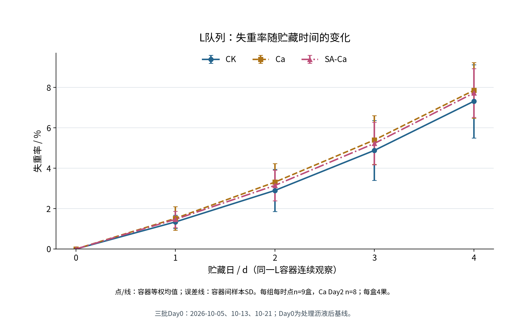
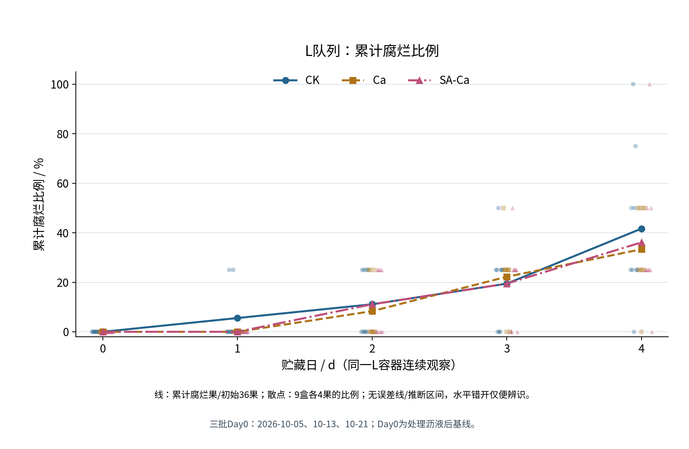
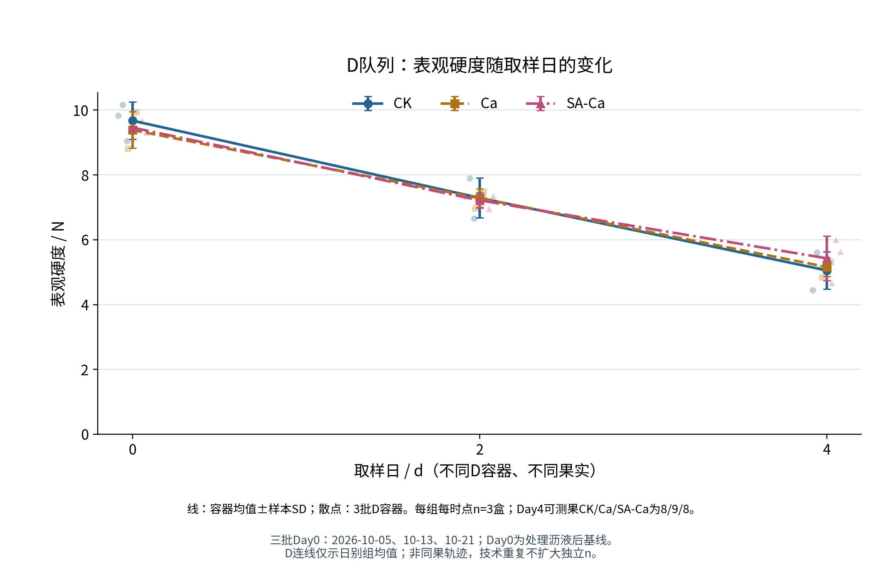
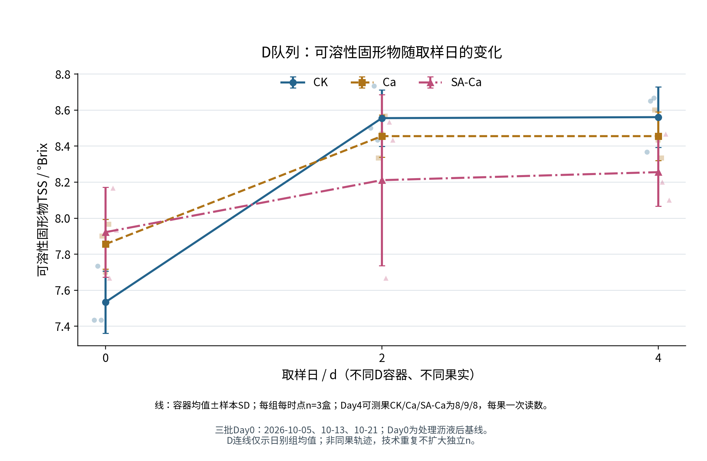
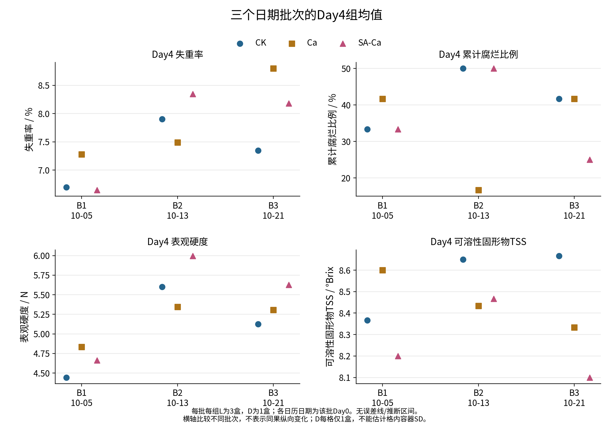
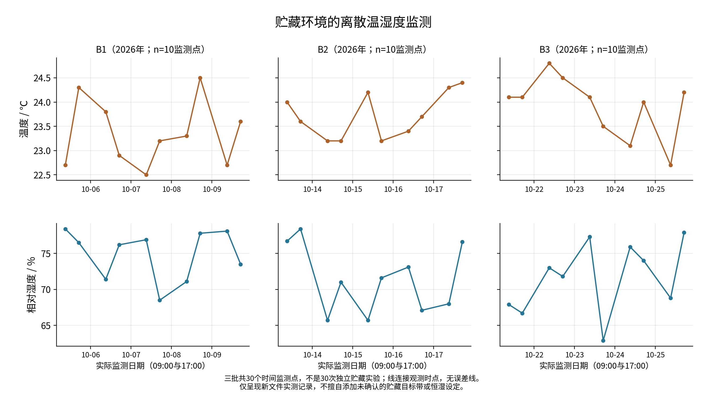

# Phase09I｜语言质量与防御性表达整改

审查日期：2026-11-13（UTC+8）。正式题目：《可食性海藻酸钠膜对草莓常温保鲜效果的研究》；四川工业科技学院。

基准：`ef3f9d92257eeec3319503565ae72062fdcabe99`；工作分支：`thesis/phase09i-comprehensive-quality-revision`。本轮只在`deliverables/phase09i/`新增独立版本，191个历史受保护文件逐一核哈希不变。指定主数据`实验记录.xlsx`的SHA-256为`a63c8b0e1a07724e861d4b9a379ab632b3c0d41038f77310db36fb3b6b9f66f6`。只读复用已核准统计包，不重算、不作新检验，未使用旧S1或辅助表18内容。AGENTS/项目档案中的历史阶段及S1记载不作为本轮现行配置。

本轮不以20000字作为编辑驱动力；删并重复文字与修订论证相互独立于分页调整。自检不是外部科研验收。所有页码均指本目录[替代字体PDF预览](../替代字体渲染预览.pdf)的物理页，Word正式字体环境重排后需要重新核对。

## 1. 编辑目标与实际处理

本轮不是同义词替换：第一章按指标与研究条件提出问题；第二章集中写已记录操作和统计层级；第三章保留结果数据、压缩重复提醒；第四章将文献按研究问题配对，系统局限集中4.3；结论缩为五段归纳。具体措辞取舍需要导师评价，自动计数仅用于发现反复表述。

|原表达/位置|实际改写|理由及保留边界|状态|
|---|---|---|---|
|原1.1逐项以“不能/不宜”收尾|新1.1按质量净变化、发生数量、力学响应、折光水平正面定义|研究对象明确后再提出问题，保留各指标不同含义|已修|
|原1.2.1每段重复“不能移作本研究”|新1.2.1¶3—6区分材料与应用两层证据|细节理论不展开egg-box；没有直接测膜性能的范围集中最后段|已修|
|原2.3.1强调不按文献冒称操作|新2.3.1直接给自身范围并引工艺出处|实际1.8—2.3min与18—30min保留|已修|
|原3.2多重机制否定句|新3.2聚焦均值方向、SD与范围|机制讨论移4.1；结果未获正式检验的边界保留2.5/4.3|已修|
|原4.2一篇一段并列免责声明|新4.2按鲜切/完整、喷涂、包装、浓度、TSS组织|保留正反结果、条件和必要问题公式排除；未抄结果章节所有数字|已修|
|原结论末段列全部未证机制|新结论末段直接提出记录、层级、取样与终点改进|实质适用范围保留在结论第4段、4.3末段|已修|

## 2. 真实篇幅与表达计量

只统计叙述自然段U+4E00—U+9FFF汉字；不含标题、文献、表格、公式、图题表题、注释、审计资料。不是Microsoft Word官方字数，也不据此评价本轮是否达标。新旧章节各只计一次。

|组成|原叙述汉字|新叙述汉字|原/新段数|
|---|---|---|---|
|第1章_绪论_精修稿.md|5057|3602|32/30|
|第2章_材料与方法_精修稿.md|3619|2512|33/32|
|第3章_结果与分析_精修稿.md|2540|1493|27/27|
|第4章_讨论_精修稿.md|6060|3720|34/26|
|结论_精修稿.md|657|475|5/5|

合计：17933→11802。减少主要来自重复限制、重复条件及重复数值解释；表中统计数据未删改，不以减少页数作为删文依据。

|检索表达|原出现次数|新出现次数|
|---|---|---|
|不能|98|2|
|不宜|11|0|
|不等于|6|1|
|不足以|2|0|
|不得|0|0|
|不将|12|0|
|并不|18|2|
|需要特别强调|0|0|
|值得注意的是|0|0|
|需要指出的是|0|0|

## 3. 仍保留的必要限制

2.1.2以“按实验记录”限定仪器，2.2.2保留共享母液，2.4保留技术层级与缺失，2.5明确描述统计；3.4/3.5保留不同D果与可测范围；4.3系统列原料/执行凭据、取样、独立性及四天窗口。减少“不能”没有转为强因果、显著性或综合最佳的断言。

## 4. 全部正文的可追溯修改差异

以下diff完整保留旧稿→独立精修稿的文字差异（包含引文重编号、图表注释简化和表3-2邻接段落调整），不是仅摘取有利改写。原件本身未修改。对照中的空白上下文行已去除行尾空格，仅供阅读，不作为可直接应用的补丁。


### 第1章_绪论_精修稿.md

```diff
--- 历史/第1章_绪论_新数据文献深化修订稿.md
+++ 精修/第1章_绪论_精修稿.md
@@ -4,15 +4,13 @@

-草莓采后品质维持面临失水、软化和可见腐坏等问题。果实组织细嫩，在采收后搬运、处理和贮藏中容易受到损伤，外观、力学状态及内部可溶性物质也可能以不同速度变化[1][2]。短期保鲜评价因而不能只看某一天是否出现霉斑，也不能仅凭外形完整推断食用品质已经得到保持。研究需要明确比较对象和观察期限，在同一条件下考察不同品质侧面，才能说明某种处理实际改善了什么，以及哪些问题仍未得到回答。
+草莓果实组织细嫩，采收后的搬运、处理和贮藏容易伴随失水、软化及可见腐坏。外观、力学状态和内部可溶性物质的变化并不同步[1][2]。短期保鲜评价需要同时说明样品保持了哪些品质，以及这些表现持续到什么时点。仅观察是否出现霉斑，或仅依据外形完整程度，均难以完整反映贮藏品质。

-失重率用于描述称重对象相对初始质量的净损失。已核读的草莓研究以贮藏起点质量为分母，但称重所得质量差并未自动分离蒸腾、呼吸及表面附着物变化[2][4]。因此，它适合反映样品质量保持情况，不宜直接称作果实蒸腾速率或膜阻水能力。若处理前后称量对象、沥液程度或基线建立阶段不同，同样的百分比也未必具有相同含义。把质量基线与处理过程说明清楚，是评价失重结果的前提。
+失重率、腐烂情况、硬度和可溶性固形物分别对应不同的评价对象。失重率以初始质量为基准，描述称重对象的质量净变化；称量基线、沥液程度和附着物状态会影响这一结果[2][3]。可见腐烂果数比例反映发生数量，等级加权腐烂指数还包含受损严重程度信息[4][5]。两者为评价果实外观状态提供了不同尺度，与微生物数量及食用安全评价也各有侧重。

-腐烂指标关注果实可见受损状态，其名称相近而定义可能不同。按发生腐烂的果数计算比例，回答的是发生数量；按受损等级加权的指数，还包含严重程度信息[3][6]。若采用累计发生口径，同一果实首次判为腐烂后持续计入，分母须保持为相应初始观察果数，不能把每日重复看到的腐烂果当作新的事件。累计比例能够反映观察期内的发生情况，却不等同于病斑面积、微生物数量或食用安全水平。
+硬度反映样品在指定测试条件下对外力的响应。完整果与切分样品、穿刺位置及探头条件的差别，会改变读数的含义[2][4]。以“表观硬度”表述穿刺力，可以将结果限定在实际检测方式之内。破坏性检测使用的果实在测定后退出，不同取样日的平均值描述各日样品，而非同一果实的连续软化过程。

-硬度则反映指定测试条件下样品对外力的响应。已有草莓研究使用穿刺等方法，但完整果、切分样品、测点位置和探头条件并不完全相同[2][3]。读数既受样品状态影响，也依赖检测方式。采用“表观硬度”有助于限定其含义，避免把穿刺力直接解释为果肉某一结构的强度。破坏性检测还会改变果实状态，不同贮藏日的均值通常需要结合取样方式理解，不能在没有对应设计的情况下当作单果连续软化轨迹。
+可溶性固形物（total soluble solids，TSS）通常以折光法测量，用°Brix表示[2]。它与化学方法测定的糖含量属于不同指标；已有草莓研究将折光可溶性固形物和蒽酮法可溶性糖分别测定[1]。TSS主要反映汁液折光特性所对应的可溶性固形物水平，风味评价还涉及酸度、香气和感官接受程度。因此，TSS宜与失重、硬度及腐烂情况共同解释，较高读数本身没有覆盖全部品质含义。

-可溶性固形物（total soluble solids，TSS）通常通过折光测量，以°Brix表示[2]。它与独立化学测定的糖含量不是同一指标；草莓研究也有将折光可溶性固形物和蒽酮法可溶性糖分别检测的安排[1]。TSS读数的变化不能单独说明具体糖组分如何转化，更不能覆盖酸度、香气和口感等全部风味信息。若以较高读数直接判断营养或保鲜更好，容易忽略初始水平、失水状态及取样组成的差别。
+时间和环境共同界定了品质变化的观察窗口。范鹏等在15 ℃、相对湿度90%下对完整草莓观察4 d，记录到质量损失总体增加、硬度总体降低，而可溶性固形物先升后降[6]。该研究采用空气负离子环境，为短窗口多指标评价提供了实例。相同的观察天数在不同温湿度和处理条件下可能对应不同品质阶段，研究终点需要与实际贮藏过程一并说明。

-观察时间与环境条件决定了这些指标能够呈现的过程。范鹏等在15℃、相对湿度90%下对完整草莓观察4 d，质量损失总体增加、硬度总体降低，而可溶性固形物呈先升后降的变化[LE24]。该研究采用空气负离子环境，并非海藻酸钠处理；其意义在于提供短窗口、多指标随时间变化的实测例证，不能据此解释涂膜机制。即使观察天数相同，不同温湿度和处理背景也可能记录到不同的品质阶段，终点比较不能脱离时间过程。
-
-可食性涂膜为调整果实表面与外界接触条件提供了一种研究途径。海藻酸钠具有成膜与凝胶化应用基础，但完整草莓试验中也存在处理后失水增加的报告[4]。由此提出的问题是：含海藻酸钠的某种具体流程，在完整草莓短期常温条件下，能否在多个品质指标上形成相互支持的表现？这一问题需要直接观测，不由材料名称预先作答。材料可食性应用的文献背景，也不能代替实际试剂规格及处理用途的安全性验证。
+可食性涂膜为调节果实表面与外界接触条件提供了一种研究途径。海藻酸钠具有成膜和凝胶化应用基础，但完整草莓试验也有处理后失水增加的报告[3]。本研究关注的具体问题是：给定海藻酸钠与钙液处理流程，在完整草莓短期常温贮藏中如何影响不同品质指标的表现？通过同一设计下的并列观察，可以识别各指标的比较方向，为评价具体流程提供依据。

@@ -22,15 +20,13 @@

-海藻酸钠（sodium alginate，SA）是一种可用于配制涂膜液的水溶性多糖。相关研究对基本凝胶原理的介绍指出，钙等二价离子能够在海藻酸盐链之间参与形成离子连接，使体系产生凝胶网络[2][4]。这一一般原理说明了海藻酸钠与钙盐配合使用的材料依据，但并不直接给出某一果面涂层的网络结构、交联程度或阻隔数值。对实际处理而言，材料发生凝胶化与果实品质得到改善仍是需要分别检查的两个问题。
+海藻酸钠（sodium alginate，SA）是一种可用于配制涂膜液的水溶性多糖。相关研究介绍的一般凝胶原理表明，钙等二价离子可在海藻酸盐链之间参与形成离子连接，构成凝胶网络[2][3]。这一原理为海藻酸钠与钙盐配合使用提供了材料依据；具体果面涂层的结构、交联程度和阻隔性能则取决于配方及施用条件，需要相应检测加以表征。

-钙液的使用方式也属于工艺设计的一部分。已有草莓研究采用海藻酸钠处理后再浸钙液，也有在这一流程前增加一次钙液浸渍，以改善特定对象表面附着状况的安排[2][4]。钙盐种类、施用次序、配方组成及沥液干燥条件不同，意味着果实接触到的处理过程不同，不能仅凭均含海藻酸钠和钙离子就视为同一工艺。这里以已发表处理方法说明设计思路，不将他文参数推定为本研究实际操作。
+钙盐种类与施用次序属于工艺设计的一部分。草莓研究既有先海藻酸钠、后钙液的处理，也有在此前增加钙液预浸渍的安排[2][3]。不同流程改变了果实接触材料的次序和时间，沥液及干燥条件也参与形成实际处理背景。因而，比较海藻酸钠—钙体系时，需要同时说明组分和步骤。

-独立膜与果面涂膜需要在材料应用层面加以区分。独立膜经流延、干燥后形成可单独取用的试样，用于覆盖或包装；果面涂膜则通过浸渍、喷涂等方式使液态材料直接附着于样品表面[1][4]。独立试样便于限定测试面积、厚度和环境，果面应用还涉及附着连续性、局部覆盖及表面形态。两类研究可以相互提供设计线索，但独立膜的性能参数不能直接替换涂膜果实的质量、腐烂或力学结果。
+独立膜与果面涂膜具有不同的应用形式。独立膜经流延、干燥形成可单独取用的试样，用于覆盖或包装；果面涂膜通过浸渍或喷涂使膜液直接附着于果实表面[1][3]。独立试样便于限定测试面积、厚度及环境，果面涂层还受到表面形态、附着连续性和局部覆盖情况的影响。材料试验提供性能信息，果实贮藏试验检验具体应用中的品质响应，两类证据分别承担不同任务。

-水蒸气透过性和水溶性尤其不宜混为一谈。前者考察在规定温湿度和两侧水蒸气压差下，水分穿过膜材料的传输；后者考察膜与液态水接触后可溶部分所占的程度[5]。两种试验的介质、过程和计算对象不同，膜不易溶解不等于一定具有较低的水蒸气传输。比较研究结果时，应核对材料状态及测试条件，而不是根据其中一项较好便概括全部水分阻隔性能。
+水蒸气透过性与水溶性也是不同的材料指标。前者考察规定温湿度及两侧水蒸气压差下水分穿过膜的传输，后者考察膜与液态水接触后的可溶部分[7]。二者的介质、过程和计算对象各不相同。汪秀妹等在魔芋葡甘聚糖/海藻酸钠独立膜中添加不同脂肪酸，测得水蒸气透过率与水溶性随添加量变化并非持续改善[7]。该结果说明，配方优化需要按具体性能指标进行评价。

-配方与环境还共同构成性能评价的边界。汪秀妹等在魔芋葡甘聚糖/海藻酸钠独立膜中加入不同脂肪酸，测得水蒸气透过率和水溶性随添加量变化并非持续改善[5]。这说明不能把某组分增加直接视为阻水增强。另有研究将独立膜的规定湿度梯度测试与果实贮藏试验分别安排[4]，也提示材料测试的温湿度不应当作果实贮藏条件。海藻酸盐体系具有亲水特征，评价其应用时仍需结合湿度、配方和实际施用方式，不能只引用一个材料参数进行效果预测。
+海藻酸盐体系的亲水特征，使湿度和配方成为水分阻隔评价的重要条件。已有研究分别安排独立膜的规定湿度梯度测试和果实贮藏试验[3]，两者的温湿度各有用途。王维先以水蒸气透过率及力学性能等响应优化海藻酸钠复合膜，再将含羧甲基纤维素钠和ε-聚赖氨酸盐酸盐的体系用于25 ℃芒果贮藏[8]。这种安排体现了从材料性能到果实应用的两层验证。其物种和复配条件与本研究不同，本文采用的是这一证据层次，而非其配方或保鲜效果。

-材料优化与果实应用验证的分层安排，在其他果实研究中也可见到。王维先以水蒸气透过率和力学性能等响应优化海藻酸钠复合膜，再将含羧甲基纤维素钠及ε-聚赖氨酸盐酸盐的体系用于25℃芒果贮藏观察[LE37]。该研究分别提供材料与果实两类证据，表明材料参数的优化还需要应用检测承接。它并非草莓钙交联试验，不能把其配方或果实表现移作本研究的最优方案；也不能由某项材料均值较低，直接宣称各性能均已得到可靠改善。
-
-本研究采用成膜与钙交联原理作为设置处理流程的理论背景，未直接测定膜厚、膜结构、水蒸气透过率或交联程度。因此，理论部分限于说明为什么可以研究这一材料组合，以及从材料到果实效果需要哪些不同层次的证据。不以分子模型推定本研究已经形成特定结构，也不把失重、腐烂等品质读数反推为膜层性质的实测结果。
+本研究以成膜及钙离子参与交联的一般原理作为处理设计背景，实际评价集中于四项果实品质指标。膜厚、微观结构、透湿性和交联程度不在测定范围内，相关理论用于提出研究问题，品质变化则依据直接观测回答。

@@ -38,15 +34,15 @@

-从研究对象看，鲜切与完整草莓提供的证据不能不加区分地合并。已有鲜切草莓研究在4℃下采用海藻酸钠—氯化钙依次处理，报告了较低失重和较好的质构保持[2]；完整草莓的另一项研究在10℃、相对湿度90%下采用海藻酸钠复配及乳酸钙流程，却观察到失水增加[4]。后者在鲜切甜瓜上得到不同方向，进一步说明对象和配方条件的重要性。这些原始观察使研究现状不能被概括为“海藻酸钠涂膜均能降低失重”，也不意味着任何完整果面处理都必然产生反向结果。
+研究对象的物理状态是理解既有结果的起点。鲜切草莓在4 ℃下采用海藻酸钠—氯化钙依次处理，已有较低失重和较好质构保持的报告[2]；另一项完整草莓研究在10 ℃、相对湿度90%下采用海藻酸钠复配与乳酸钙流程，却观察到失水增加[3]。后者对鲜切甜瓜得到不同方向的结果。支持性与反向观察共同说明，处理效果具有对象和条件依赖性。

-从配方看，单一海藻酸钠、钙参与的流程和额外活性组分复配代表不同问题。Gao等设置海藻酸钠单独组、茶多酚复配组及未处理对照，为区分基材与复配提供了设计例证，但其室温贮藏没有明确温度数值[6]。茶多糖梯度研究则显示，增加海藻酸钠浓度并未带来单调的硬度改善[7]。这类研究的共同启示是配方效果需要实际比较，不能把有利结果全部归于海藻酸钠，也不能脱离附加组分确定通用浓度。本研究涉及的双步流程并不等同于这些复配体系。
+配方与附加组分也改变了所研究的问题。Gao等设置海藻酸钠单独组、茶多酚复配组及未处理对照，为区分基材和复配处理提供了设计例证，其室温贮藏未给出明确温度数值[5]。茶多糖复配研究则显示，海藻酸钠浓度增加与硬度改善并非单调对应[9]。这些研究的对照关系提示，应将基础材料、活性组分和浓度置于同一流程中比较，再讨论某一组分所对应的变化。

-从施用方式看，浸渍和喷涂不只是操作名称的变化。已有喷涂草莓研究同时测量沉积效率、背面覆盖及品质，观察到覆盖方面较好的表现并未伴随作者检出的处理间失重差异[3]。这说明工艺评价与品质评价虽有关联，仍需要各自证据。浸渍研究也曾通过增加施液步骤改善涂层的均匀性[4]。对于研究现状，应关注哪些工作实际测过附着或覆盖，哪些只是依据配方推测成膜，而不能把工艺改善自动理解为所有品质终点同步改善。
+施用工艺的评价还包括材料能否充分接触果面。喷涂草莓研究同时测量了沉积效率、背面覆盖及品质，覆盖较好的处理未伴随作者检出的组间失重差异[4]。浸渍研究也通过增加施液步骤改善涂层均匀性[3]。覆盖、附着和品质属于相互联系但分别测量的终点，工艺性能与品质表现需要对应考察。

-果面处理与外围包装则形成另一条研究路径。果胶—海藻酸钠体系已有膜液处理、独立复合膜包装以及结合PE包装的比较[1]；大豆分离蛋白/海藻酸钠独立膜研究则在25℃下封装完整草莓，同时记录失重、可食率和盒内气体[LE31]。前者使施用方式和包装对照成为可检查因素，后者显示质量损失和可食状态可能给出不同评价。它们支持多指标研究的必要性，但并不等同于普通果面双步浸渍，也不能以可食率替代本研究的累计腐烂比例。
+包装是另一项影响对照关系的因素。果胶—海藻酸钠体系已有膜液处理、独立膜包装及结合PE包装的比较[1]；大豆分离蛋白/海藻酸钠独立膜研究在25 ℃下封装完整草莓，同时记录失重、可食率和盒内气体[10]。这些设计使果面处理与外围包装的作用背景得以区分，也显示质量保持和可食状态可能呈现不同评价方向。其封装形式与本研究双步浸渍有所区别。

-从温度和期限看，连续常温研究与低温保鲜应分别整理。桃胶浸蘸完整草莓已有20℃、5 d的观察，包含硬度、质量及可溶性固形物评价，但材料不是海藻酸钠，未采用相同钙处理步骤[LE34]。另有复合包装研究虽使用“常温”名称，实际记载为5—10℃[1]；还有先冷藏再转入较高温度模拟货架期的安排[9]。因而不能以文献中的名称分组后直接比较终点，应回到实际温湿度及此前的贮藏经历。已有常温相关研究的存在，也不支持把本研究表述为填补空白。
+实际温湿度比“常温”或“冷藏”的名称更能说明比较范围。桃胶浸蘸完整草莓已有20 ℃、5 d的硬度、质量及可溶性固形物观察[11]；一项复合包装研究虽使用“常温”表述，实际报告为5—10 ℃[1]；另有先冷藏再转入较高温度模拟货架期的安排[12]。这些不同程序覆盖了不同品质阶段，宜按温度、期限和此前经历整理研究现状。

-不同指标的时间响应同样影响现状判断。海藻酸钠—蒙脱土草莓研究和含纳米碳酸钙的复配研究均有可溶性固形物先升后降的观察，峰值时间和后期表现随条件而不同[8][9]。这意味着较短窗口可能只记录某一阶段，不宜把一次较高读数视为普遍优效。研究还需区分果面品质指标、独立膜性能与微生物检测，不能将他文实际测过的呼吸或材料抑菌结果，默认补足另一项研究没有开展的检测。
+可溶性固形物的时间响应进一步体现了条件差异。海藻酸钠—蒙脱土及含纳米碳酸钙的复配研究均记录到先升后降的变化，峰值时点随条件而异[13][12]。在约23 ℃、相对湿度约40%的海藻糖草莓研究中，同一贮藏环境下不同处理的可溶性固形物曲线也呈现不同的阶段方向[14]。海藻糖是另一类处理材料，这一例证仅用于说明折光指标的时间过程具有配方和窗口依赖性。海藻酸钠研究本身仍需按实际材料、工艺及检测结果评价。

-整体而言，草莓涂膜研究已提供材料、施用方式和品质终点的多种例证，其价值在于使具体处理问题可以被进一步检验。支持与反向结果应共同纳入研究依据；研究设计越接近，讨论相同终点才越有针对性。本研究据此将关注点收敛到完整果、给定双步流程与短期常温窗口中的四指标变化，不把已有复配体系的有利效果作为研究开始前必须达到的结论。
+已有研究为材料、施用方式和品质终点提供了多方面证据。对本课题更有针对性的问题，是在明确的完整果、双步处理和短期常温窗口内，检查四指标的比较方向及其跨批次表现，而非从不同复配体系中预先选择一种有利结果。

@@ -54,15 +50,15 @@

-跨研究比较首先要核对样品的物理状态。鲜切样品暴露内部组织，完整果保留的表面状态与之不同；不同品种、成熟度和采后经历也构成起始背景[2][4]。因此，结果适用范围应与实际对象共同呈现，不仅比较终点数值，还应确认起点、取样方式及处理之前的准备过程。相邻研究可以帮助提出问题，但对象相同本身并不能保证条件已经充分匹配。
+跨研究比较需要依次核对对象、流程、环境、指标及样本层级。鲜切样品暴露内部组织，完整果保留不同的表面状态；品种、成熟度和采后经历则构成起始背景[2][3]。同属草莓的研究仍应交代这些条件，使起点与终点之间的比较具有明确对象。

-材料相同也不能替代施用流程的核对。鲍若晗等在蓝莓上采用海藻酸钠与ε-聚赖氨酸交替浸渍，并比较先后次序，形成四步层层组装处理，于25℃、50%相对湿度下观察5 d[LE36]。这一例证用于说明含海藻酸钠的连续施液可以有不同材料组合和步骤，不是草莓效果的直接证据。该流程没有相同的钙盐步骤，不能与两步钙处理合称一种工艺；其附加组分的作用也不能简化为海藻酸钠的独立作用。
+相同材料可以形成不同施用程序。蓝莓研究采用海藻酸钠与ε-聚赖氨酸交替浸渍，比较次序，形成四步层层组装处理，在25 ℃、50%相对湿度下观察5 d[15]。这一程序与草莓的两步钙处理在组分和步骤上均有区别。它为描述工艺差异提供了例子，品质效果仍属于其对应物种及处理条件。

-环境比较需同时考虑温度、相对湿度、观察期限和取样间隔。连续低温、连续常温与冷藏后货架期是不同程序，即使最后一个测定温度相近，也不能忽略此前经历[2][9]。规定湿度的培养环境与每天有限次的离散记录所提供的信息也不相同。短窗口能够回答的是该期限内指标如何变化，不能由尚未达到某一判定阈值，就推算可以延长多少天货架期；没有设定阈值的研究也不宜按货架期天数直接排序。
+环境比较还涉及相对湿度、期限、间隔与此前贮藏经历。连续冷藏、连续常温和冷藏后模拟货架期是不同程序[2][12]。规定湿度的培养条件与每天有限次的离散记录，也提供不同密度的环境信息。短窗口评价应以该期限内实际观察为边界；若以货架期为终点，还需事先规定接受阈值及相应检测。

-指标定义应在数值比较前确认。腐烂果数比例、分级腐烂指数和按外观判断的可食率，分别涉及发生、严重程度及可食状态判断[6][7][LE31]。它们不能仅凭名称相近而相互换算。力学测量也需同时核对N、kg/cm²等单位与果实完整程度、探头及受力方式[2][LE24]。缺少必要对应条件时，不宜根据均值大小给不同研究的处理排名；这种限制来自检测问题不同，并不否定原研究在其自身条件下的用途。
+指标名称相近时，须进一步核对定义。腐烂果数比例、分级腐烂指数和外观可食率分别涉及发生、严重程度及可食状态[5][9][10]。力学结果则应同时核对N、kg/cm²等单位、探头和受力方式[2][6]。这些定义决定了哪些结果可以定性对照，哪些具备数值比较基础。

-质量基线和制样方式则是容易被指标名称掩盖的差别。处理后沥液样品与处理前样品的初始质量不宜混用，含容器质量和果实净质量也不是同一对象[2][4]。折光检测还可能采用单果取汁或多果混样。蓝莓层层组装研究采用同组多果混合制样[LE36]，所得样液读数不能理解为每一果实各有同样数值。比较TSS时应保留制样与汇总层级，而不是把不同来源的折光均值当作相同个体结构下的结果。
+质量基线与制样方式同样重要。处理后沥液样品和处理前样品属于不同称量阶段，果实净质量也有别于含容器质量[2][3]。折光检测可采用单果取汁或多果混样，例如蓝莓层层组装研究使用同组多果混合制样[15]。混合汁液的读数对应一次制样结果，单果读数则保留个体层次的信息，两类均值需要连同制样和汇总方法理解。

-重复结构关系到研究能够支持的判断。相同样品的连续称重、不同样品的破坏性检测，以及同果多个技术测点提供不同层次的信息[3]。共享处理液来源的多个容器也可能带有共同制备背景，分开放置并不自动消除这种关联。研究报告中应区分日期批次、配液来源、容器、果实和技术读数，避免只依据总果数或检测次数认定独立重复数量。对尚未明确的重复结构，应限定比较范围，不用他文的统计方法代替本研究的设计审查。
+重复结构决定了观测数量的含义。同一样品连续称重、不同果实破坏性取样和同果多个技术测点，分别提供时间、样品及检测层次的信息[4]。共享母液的多个容器还具有共同制备背景。日期批次、配液来源、容器和果实之间的关系应明确记录，使统计单位与实际设计相匹配。

-据已核读资料，可以提出的研究不足主要是：不同对象和工艺下的结果尚不能替代目标条件中的直接比较，材料性能与果实品质需要对应验证，多指标及样本层级需要共同说明。这些是本题选择研究范围的依据，并非断言全部已有研究缺少某种方法或检测。对完整草莓常温短期保鲜，更有针对性的工作是明确实际流程、时间与评价定义，在同一研究框架内保留各指标的不同响应，再据证据讨论可适用的范围。
+上述可比性问题指向本研究的范围：在同一研究框架中明确具体流程、时间窗口和指标定义，保留各项品质响应及批次差别。研究着重补充目标条件下的直接比较，而非对全部既有研究作统一优劣判断。

@@ -70,9 +66,8 @@

-本研究以完整草莓为对象，考察第0—4天短期常温贮藏的品质变化。设B1、B2、B3三个日期批次，分别于2026年10月5日、13日和21日开始，每批均含CK、Ca、SA-Ca三组。CK采用水与更换的新水两步处理，Ca采用水后接氯化钙溶液，SA-Ca采用海藻酸钠后接氯化钙溶液。具体配方、操作及环境监测见第2章。
+本研究以完整草莓为对象，考察第0—4天短期常温贮藏的品质变化。设置B1、B2、B3三个日期批次，分别于2026年10月5日、13日和21日开始，每批均含CK、Ca和SA-Ca三组。CK采用水—新水处理，Ca采用水—氯化钙溶液处理，SA-Ca采用海藻酸钠—氯化钙溶液处理。

-设置Ca对照，旨在比较给定钙处理条件下增加海藻酸钠步骤后的流程差别；与CK比较则考察相应处理流程与水处理之间的品质表现。未设置SA单独处理组，故研究问题不包含完整分解SA、Ca及其交互作用。常温范围以实际监测背景界定，不将其理解为所有样品始终处于恒定条件，也不预先设定某组应当在四指标中全面占优。
+Ca组用于比较给定钙处理流程中增加海藻酸钠步骤后的差别，CK组提供相应的水处理对照。该设计比较三种完整流程，未设置SA单独处理组，组分及其交互作用的完整分解不在研究范围内。

-样本分为L连续观察和D破坏性取样队列。L容器在第0—4天连续称重并逐果观察，用于整理失重率和累计腐烂比例；D队列在第0、2、4天使用不同容器、不同果实测定表观硬度和TSS。数据以容器为主要汇总层级，区分果实与技术读数，保留批次及母液来源关系。各项结果采用描述统计呈现，不把时间重复或同果多测点扩大为独立处理重复。
+L连续观察队列用于第0—4天的失重率和累计腐烂比例记录，D破坏性取样队列在第0、2、4天使用不同容器和果实测定表观硬度及TSS。数据以容器为主要汇总层级，保留批次、果实和技术读数的对应关系，采用描述统计呈现。

-本研究拟回答三个相互衔接的问题：四项指标在该短期窗口内如何变化，同一观察时点的三组比较方向如何，这些方向在不同日期批次中是否一致。研究按“明确流程与样本层级—整理实际观测—并列比较四指标—结合文献解释边界”的思路展开。其意义在于提供指定流程及记录范围内可复核的比较依据，并明确后续需要验证的问题，而非预先证明某材料优效、确定最优配方或确认未经检测的保鲜机制。
-
+本研究回答三个问题：四项指标在短期窗口中如何变化，同一时点三组的比较方向如何，这些方向在不同日期批次间是否一致。研究依次明确处理与样本结构、整理观测、并列比较四项指标，再结合文献讨论适用条件，为后续优化实验设计与品质评价提供具体依据。

```

### 第2章_材料与方法_精修稿.md

```diff
--- 历史/第2章_材料与方法_文献深化修订稿.md
+++ 精修/第2章_材料与方法_精修稿.md
@@ -6,5 +6,5 @@

-实验对象为完整草莓，筛除明显机械损伤及可见腐斑后，按日期批次、处理容器和果实分别编号。纳入果实共189颗，逐果登记到货质量、规格、成熟度档次及筛选状态。成熟度记录为7—9成熟，属于原料外观档次，不作为仪器测定的成熟度指标。到货质量用于描述原料状态，与处理后建立的贮藏质量基线分开使用。
+实验对象为完整草莓，筛除明显机械损伤及可见腐斑后，按日期批次、容器和果实编号。共纳入189果，逐果登记到货质量、规格、成熟度档次及筛选状态。外观成熟度记为7—9成熟；到货质量描述原料状态，处理沥液后的质量另用于建立贮藏基线。

-处理材料为海藻酸钠（sodium alginate，SA）、氯化钙（CaCl₂）和水。海藻酸钠及氯化钙配方浓度均按溶质质量占成品溶液总质量的质量分数（w/w）记录。处理用水与折光测量校零、清洁用水分别记述，不将仪器用水说明直接等同于全部处理用水的规格。
+处理材料为海藻酸钠（sodium alginate，SA）、氯化钙（CaCl₂）和水。配方浓度以溶质质量占成品溶液总质量的质量分数（w/w）表示。处理用水的具体规格尚未确认，与折光校零及清洁用水分别记述。

@@ -12,5 +12,5 @@

-仪器及测量条件按实验记录记述。质量记录使用电子天平YP30002；表观硬度使用穿刺质构仪TA.XTC-18，配P-2不锈钢圆柱探头；可溶性固形物使用PAL-1折光仪。三项记录单位分别为g、N和°Brix。天平的分辨率不由型号或质量记录的小数位数推定；折光原始读数按记录的0.1 °Brix显示步进登记，汇总均值可保留更多小数。
+按实验记录，质量测量使用电子天平YP30002，表观硬度使用TA.XTC-18穿刺质构仪及P-2不锈钢圆柱探头，TSS使用PAL-1折光仪。记录单位分别为g、N及°Brix。天平分辨率尚待设备资料确认；折光原始值按0.1 °Brix显示步进登记，汇总均值的小数位数与原始显示分辨率分别说明。

-贮藏环境通过温湿度测量设备记录，温度及相对湿度分别以℃和%表示。样品按独立容器存放，并登记架位位置。具体硬度参数与折光制样条件分别见2.4.3和2.4.4。设备的实际校核与操作执行尚需同期材料补充，现有型号和设置按实验记录所载范围使用。
+温湿度测量设备用于记录贮藏环境，单位分别为℃和%。样品按容器存放并登记架位。下述仪器参数和制样条件依据实验记录记述，实际校核及操作的同期凭据仍待补充。

@@ -20,5 +20,5 @@

-实验设置B1、B2和B3三个日期批次，观察日期分别为2026年10月5—9日、10月13—17日和10月21—25日。各批次以处理、沥液后的第0天为观察起点，持续至第4天。每批均设CK、Ca和SA-Ca三组，每组6个容器，三批共54个容器。统计时按相对贮藏日对齐，同时保留实际日期和批次，避免将三个日期批次当作同一次处理。
+实验设置B1、B2和B3三个日期批次，观察日期依次为2026年10月5—9日、10月13—17日及10月21—25日。各批以处理沥液后的第0天为起点，观察至第4天。每批设CK、Ca、SA-Ca三组，每组6容器，共54容器。数据按相对贮藏日对齐，同时保留实际日期和批次。

-三组采用双步浸渍，具体方案见表2-1。CK两步分别使用水和更换的新水；Ca组先水、后氯化钙溶液；SA-Ca组先海藻酸钠溶液、后氯化钙溶液。未设置SA单独处理组，因此SA-Ca与Ca的比较限于给定钙处理流程下增加海藻酸钠步骤后的差别，不用于完整分解两种组分及其交互作用。
+三组双步浸渍方案见表2-1。CK两步使用水和更换的新水；Ca先水后钙液；SA-Ca先海藻酸钠后钙液。SA-Ca与Ca比较给定钙处理背景下增加海藻酸钠步骤的流程差别，CK提供水处理对照。研究未设置SA单独组。

@@ -34,5 +34,5 @@

-处理记录按日期批次和处理组关联母液来源，母液分装至各处理容器后分别使用。结合实验执行者的说明，各容器分装液不循环用于其他容器。独立容器不等于独立配液，同组容器共享母液制备来源时，仍可能具有共同的处理背景。Ca组与SA-Ca组钙液是否来自同一次制备尚未确认，故不将54个容器视为54次完全独立的化学配制。
+母液来源按日期批次和处理组关联，分装至各容器分别使用。执行者说明各容器分装液不循环用于其他容器。同组容器可能共享制备来源，Ca与SA-Ca的钙液是否来自同一次制备尚待确认。容器数与独立配液次数因此分别理解。

-样本信息依次关联日期批次、处理组、容器、果实及测量时点。果实嵌套于容器，L队列不同日的记录来自同一容器，硬度的两个技术测点属于同一果实。容器是描述统计的主要汇总单位；批次数、容器数、果实数与技术读数分别报告，不能用容器内果实或技术测点扩大独立处理重复数。
+样本依次关联日期批次、处理组、容器、果实及测量时点。果实嵌套于容器，同一L容器的多日记录及同果硬度技术测点彼此关联。容器为描述统计的主要汇总单位，批次、容器、果实和技术读数数量分别报告。

@@ -40,3 +40,3 @@

-每批每组的6个容器分为L连续观察队列及D破坏性取样队列。L设3个容器，每容器4果；D0、D2和D4各设1个容器，每容器3果。每批每组21果，单批三组63果，三批共189果，分配及测量安排见表2-2。
+每批每组6容器分为L连续观察和D破坏性取样队列。L设3容器，每盒4果；D0、D2和D4各1容器，每盒3果。每批每组21果，单批63果，三批共189果，分配及测量安排见表2-2。

@@ -51,3 +51,3 @@

-三批L队列共27容器、108果，D队列共27容器、81果。D0、D2和D4使用不同容器中的不同果实，不构成同果纵向测量。D果的外观观察持续至其取样日，破坏性测定后退出；这些外观记录保留，但不纳入L队列累计腐烂比例的分母。
+L队列共27容器108果，D队列共27容器81果。D0、D2、D4使用不同容器和果实，检测后退出。D果外观观察保留至取样日，L累计腐烂比例则始终使用其自身初始果数为分母。

@@ -57,7 +57,7 @@

-果实筛选、编号并按容器分配后，依表2-1完成两次浸渍，再沥液风干，进入贮藏观察。海藻酸盐处理后接钙液浸渍是已有草莓涂膜研究采用的工艺之一[2][4]；本研究配方和实际时长依据自身实验记录，不沿用文献中的配液、包装或干燥参数。
+筛选、编号及容器分配后，按表2-1完成两次浸渍，沥液风干后进入贮藏观察。先海藻酸盐后钙液的处理见于既有草莓研究[2][3]，本研究浓度、时长及后续安排依据自身实验记录。

-逐盒记录第一次和第二次浸渍的时长，两步实际范围均为1.8—2.3 min，随后沥液风干18—30 min。处理起始、沥液及后续观察按相应时点关联；L队列在处理沥液后建立第0天净质量，D队列在对应取样日完成外观判定后测定品质。时间记录用于区分操作阶段，不将不同容器的实际时长统一改写为严格的2.00 min。
+两步浸渍逐盒登记，实际时长均在1.8—2.3 min，随后沥液风干18—30 min。处理起始、沥液和观察时点相互关联。L队列在处理沥液后建立Day0净质量；D队列在各自取样日完成外观判定及品质测定。

-局部处理液附着不均及个别容器沥液时间较长的记录均保留，相关容器继续进入描述汇总。处理前到货质量与处理后基线属于不同阶段的称量，不以二者差值直接代表膜层沉积量，也不据质量差倒推出成膜程度。
+局部附着不均和个别容器沥液时间较长的记录保留，相应观测继续参与描述汇总。处理前到货质量与处理后基线属于不同称量阶段。

@@ -65,5 +65,5 @@

-样品在实验室常温条件下观察，按日期批次登记容器架位。每批第0—4天每日09:00和17:00记录温度及相对湿度，每批10个时点，三批共30个监测时点。记录的实际温度范围为22.5—24.8℃，相对湿度范围为62.9%—78.4%。该范围描述实际监测值，不作为设备设定范围，也不据此认定全周期恒温或恒湿。
+样品在实验室常温下观察，按日期批次登记架位。第0—4天每日09:00和17:00监测温湿度，每批10时点，共30时点。实测温度22.5—24.8 ℃，相对湿度62.9%—78.4%，用于描述已记录的环境背景。

-环境数据按实际日期和批次单独整理，用于说明贮藏背景。离散测点不能代表每个容器内部的连续环境，30个监测时点也不是30次独立贮藏实验。容器架位记录与对应日期批次关联，用于保留位置背景。
+环境数据按实际日期和批次整理。每日两次离散监测提供贮藏背景信息，容器内部连续温湿度未单独测量。

@@ -73,3 +73,3 @@

-L队列对同一容器所含果实连续称量。按照实验记录的净质量定义，整盒称量扣除容器皮重后得到盒内4果总净质量，以处理沥液后的第0天净质量为固定基线。第1—4天继续记录同一容器果实的净质量，采用相对初始质量的损失定义[2][4]，按式（2-1）计算。
+连续称量同一L容器内果实。实验记录将整盒称量扣除容器皮重后的数值定义为盒内4果总净质量。以处理沥液后Day0净质量为固定基线，按式（2-1）计算各日相对质量损失[2][3]。

@@ -81,3 +81,3 @@

-先由原始质量全精度计算各容器失重率，再按同组同日有效容器等权汇总，舍入仅用于最终展示，不先将单容器失重率保留两位小数后作为主统计输入。该指标反映已有净质量记录的相对变化，未单独分离蒸腾、呼吸或表面残留物变化的贡献。
+先用原始质量全精度计算单容器失重率，再按同组同日有效容器等权汇总，最终展示时统一舍入。逐盒先保留两位小数的结果仅用于舍入口径对照。

@@ -85,3 +85,3 @@

-L队列在第0—4天逐果目视观察，按实验执行者说明，以可见霉斑或明显软腐作为判定依据。每果记录未见腐烂或已经腐烂的二元状态，并单列首次出现的时点。首次腐烂后持续计入后续累计状态，观察期内不提前移出，不将每日再次观察到同一腐烂果作为新的首次事件。累计腐烂比例按式（2-2）计算。
+L队列第0—4天逐果目视观察，依据执行者说明，以可见霉斑或明显软腐判为腐烂。每果记录二元状态及首次记录日，首次判为腐烂后持续计入累计数量，观察期内不提前移出。累计比例按式（2-2）计算，每果只计一次首次事件。

@@ -93,3 +93,3 @@

-各组同时保留累计腐烂数量、初始分母及逐盒比例。由于每盒初始均为4果且持续观察，9盒比例的等权均值与组总发生数量除以36所得比例一致，比例的离散仍按容器统计。按病害等级加权的腐烂指数[6]与本研究二元累计比例不同，不能直接互换；本指标也不等同于病斑面积或微生物菌落数。D队列只观察至其取样日，不改变L队列分母。
+同时报告累计数量、初始分母及逐盒比例。每盒初始4果且持续观察，9盒比例的等权均值与组总发生数量除以36所得比例一致，离散程度仍按容器计算。本指标描述发生数量；等级加权腐烂指数还包含严重程度信息[5]。D队列外观记录不进入L比例分母。

@@ -97,7 +97,7 @@

-第0、2、4天分别测定对应D容器中的果实，单位为N。实验记录列示的条件为穿刺模式，采用直径2 mm的P-2不锈钢圆柱探头；预测试速度2.0 mm/s、穿刺速度1.5 mm/s、后测试速度2.0 mm/s，穿刺深度5 mm、触发力0.05 N、采集速率200 pps。同果在两处不重叠的完好部位分别取得技术读数。
+第0、2、4天分别测定对应D果，单位N。记录的穿刺条件为直径2 mm的P-2不锈钢圆柱探头，预测试速度2.0 mm/s、穿刺速度1.5 mm/s、后测试速度2.0 mm/s，深度5 mm、触发力0.05 N及采集速率200 pps。同果在两处不重叠的完好部位取得技术读数。

-同一果实的两次有效技术读数先取平均，再对容器内可测果实的果均值等权平均，最后按有效容器汇总到处理组。两个测点不作为两个独立处理重复，不同日别D果亦不作同果配对比较。现有指标表述为“表观硬度”，不将穿刺力读数拆解成果皮、果肉或涂层的独立贡献。
+同果两次有效技术读数先平均，再对同容器可测果均值等权平均，最后按容器汇总至处理组。该穿刺力以“表观硬度”报告；两个测点形成同果结果，不增加处理重复数。

-按记录的检测资格，局部病斑果仅在保留完好检测部位时记录有效值；严重软烂而无法可靠测量的果实保持缺失。容器均值因此只覆盖实际可测果，不能因取平均而视为已经恢复全部初始果实的品质信息。
+按记录的检测资格，局部病斑果在仍有完好检测部位时保留有效读数，严重软烂而不可可靠测量的果实记缺失。容器均值覆盖实际可测部分，同时报告有效果数。

@@ -105,9 +105,9 @@

-可溶性固形物（total soluble solids，TSS）采用折光读数表征，以°Brix记录[2]。按实验记录的制样步骤，单果去萼后取果肉研磨，经4层纱布过滤，取2—3滴澄清汁测量，避开籽及果皮碎屑。记录的校零与清洁方式为测前以蒸馏水校零、测后以纯水清洁棱镜；测定条件记为室温22—25℃、使用设备自动温度补偿，不另对样品作恒温处理。该测定室温说明与贮藏环境范围分开使用。
+TSS以折光读数表征，单位°Brix[2]。按记录，单果去萼后取果肉研磨，经4层纱布过滤，取2—3滴澄清汁，避开籽及果皮碎屑。测前用蒸馏水校零，测后以纯水清洁棱镜；测定室温记为22—25 ℃，使用自动温度补偿，不另作样品恒温处理。该测定条件与贮藏监测分别记述。

-每颗D果安排1次TSS测量，以逐果记录为汇总起点，不将不同果实的读数作为同果技术重复。汇总时先保留单果读数，再对同容器可测果等权平均，随后按容器等权汇总。折光测得的可溶性固形物与另用化学方法测定的可溶性糖属于不同指标[1]，不将TSS直接写成总糖含量。
+每颗D果测量1次TSS，先对同容器可测果等权平均，再按容器等权汇总。折光可溶性固形物与化学测定的糖含量属于不同指标[1]。谢玉花等分别安排鲜榨果汁折光和蒽酮法可溶性糖测量，后者由蔗糖标准曲线得到对应质量，并结合提取液总体积、取用体积、稀释倍数及样品质量计算[16]。本研究的直接记录是单果°Brix值，结果以TSS报告。

-谢玉花等在贡柑研究中，将鲜榨果汁的折光测定与蒽酮法可溶性糖测定分开安排；后者由蔗糖标准曲线查得对应质量，再结合提取液总体积、取用体积、稀释倍数和样品质量计算糖含量[LE38]。这一化学结果的定量依据包含标准物质量及提取、分取与稀释关系，不能仅由折光仪的显示值获得。本研究以单果汁液的°Brix读数作为TSS记录，不将其直接代入化学糖含量公式，也不因两类结果均可用百分数形式表达而视为相同测量。

-严重过软或腐坏而未取得有效读数的果实保持缺失，其余可测果参与相应容器的汇总，并报告有效果数。缺失不以0 °Brix代替。
+
+严重过软或腐坏而未取得有效读数的果实记缺失，其余可测果参与相应容器均值计算，另列有效果数。

@@ -115,11 +115,10 @@

-以修订后的实验记录为唯一数值来源，从原始质量、逐果腐烂状态及品质读数独立计算描述统计。主结果以容器等权汇总：失重率不按初始质量加权；硬度按“技术测点—单果—容器—处理组”，TSS按“单果—容器—处理组”的顺序整理；累计腐烂同时报告组总发生数量与逐盒比例。各指标各时点列均值、容器间样本标准差、容器值的最小值和最大值、有效容器数，并另列有效果实数及适用的技术读数数量。
+从原始质量、逐果腐烂状态及品质读数计算描述统计，以容器等权作为主口径。失重率不按初始质量加权；硬度按“技术测点—单果—容器—处理组”，TSS按“单果—容器—处理组”汇总；累计腐烂同时报告组总数量及逐盒比例。各时点列均值、容器间样本标准差（SD）、容器值最小和最大值、有效容器数，并另列覆盖或可测果数及适用的技术读数数量。

-样本标准差由有效容器值的离均差平方和除以$n-1$后开平方计算，$n$为有效容器数；$n=1$时不估计容器间标准差，不记为0。设计上，跨三批每组每个L观察日9盒，每组每个D取样日3盒；每批每组每个D时点仅1盒。同一L容器的多日记录及同果技术测点均有关联，不能作为新增独立样本。图中硬度、TSS及失重率误差线为容器间样本标准差；累计腐烂曲线配合单盒比例展示，温湿度曲线呈现离散监测值，不将这些波动写成推断区间。
+SD为有效容器值离均差平方和除以$n-1$后开平方，$n$为有效容器数；$n=1$时不估计容器间SD。跨三批各L组日设计9盒，各D组日3盒，每批每组每个D时点仅1盒。失重率、硬度及TSS图的误差线为容器间样本SD；累计腐烂曲线配合逐盒比例，环境曲线连接离散监测值。

-漏测与不可测均保持缺失，不填0、不插补，也不使用旧记录补齐。1次L称重漏测只减少相应处理组该日的有效盒数，其他日的有效记录保留；2颗D果各缺少2次硬度及1次TSS读数，按容器内其余可测果计算均值，并注明有效果数。现有数据中，Ca第2天失重率有效盒数为8，其余L组时点为9；第4天硬度和TSS各组均为3盒，CK、Ca、SA-Ca对应可测果数为8、9、8。可测样品存在状态选择性，容器等权和可测果等权均不能恢复缺失信息。
+漏测与不可测均保留缺失，按有效记录计算，不填0或插补。Ca第2天失重率有效8盒，其余L组时点9盒；第4天各组D容器均为3盒，CK、Ca、SA-Ca可测果数分别8、9、8，对应硬度技术读数16、18、16及TSS读数8、9、8。漏测盒其他日期的记录保留，不可测D果所在盒使用其余可测果计算均值。

-批次比较先在各日期批次内汇总，再计算同批处理组间差，整理三批差值、平均差及其样本标准差。对第4天组间差另作留一批次整理，每次保留其余两批计算平均差；其范围只表示批次组成敏感性。失重率比较容器等权与日期批次等权，以及全精度和逐盒先保留两位小数两种口径；品质指标比较容器等权与可测果等权。主结果始终保留全精度失重率和容器等权原则，不因某种权重或舍入方式改变排序而切换。
+批次比较在同批内先汇总处理组，再计算组间差，报告三批差值、平均差及其样本SD。第4天另作留一批次整理，每次对其余两批差值取均值，范围表示批次组成敏感性。失重率比较容器等权与日期等权、全精度与逐盒先舍入两位小数；品质指标比较容器等权与可测果等权。各项对照均保留预定的全精度和容器等权主口径。

-描述统计采用Python完成，计算中保留原始精度，均值和标准差在最终展示时使用一致的小数位数。异常值筛查只作复核提示，已登记的处理、环境偏离及未被证实错误的数值均保留，不按结果方向删除容器或批次。本研究未开展正式假设检验，所得均值、标准差和批次差仅用于描述现有样本及观察条件下的变化。
-
+描述统计采用Python整理，底层计算保留原始精度，展示时统一均值及SD的小数位数。异常筛查仅提示复核，已登记的偏离及未证实错误的观测全部保留。本研究采用描述统计，未进行正式假设检验。

```

### 第3章_结果与分析_精修稿.md

```diff
--- 历史/第3章_结果与分析_新数据修订稿.md
+++ 精修/第3章_结果与分析_精修稿.md
@@ -4,9 +4,9 @@

-B1、B2和B3分别于2026年10月5日、13日和21日开始，各观察至第4天。每天09:00和17:00的离散监测共形成30个时点，记录温度为22.5—24.8℃、相对湿度为62.9%—78.4%。三批记录的平均温度分别为23.350、23.720和23.910℃，平均相对湿度分别为74.840%、71.390%和71.620%。这些数值说明日期批次的环境背景，并非设备设定范围，也不代表每个容器内部的连续环境或30次独立贮藏实验。
+B1、B2和B3依次于2026年10月5日、13日、21日开始，各观察至第4天。每天09:00和17:00共形成30个离散监测时点，温度为22.5—24.8 ℃，相对湿度为62.9%—78.4%。三批平均温度依次为23.350、23.720、23.910 ℃，平均相对湿度为74.840%、71.390%、71.620%，描述了各日期批次的环境背景。

-实验共纳入54个容器、189颗草莓。L队列27容器、108果，连续观察第0—4天的质量与累计腐烂；D队列27容器、81果，分别于第0、2、4天取不同容器测定表观硬度与TSS。跨三批每组每个L时点设计9盒，每组每个D取样日设计3盒。容器内果实、技术测点和L多日记录不作为额外独立处理重复，共享母液的层级限制也不因容器分开放置而消失。
+实验共54容器189果，其中L队列27容器108果，连续观察质量及腐烂；D队列27容器81果，在第0、2、4天取不同果实测定品质。跨三批各组每个L时点设计9盒，每个D时点3盒。结果按第二章所述容器层级整理。

-L队列计划称重135条，其中134条有效；Ca第2天缺1盒质量记录，有效盒数为8，其余组时点为9。L腐烂观察540条，来自108果在5个时点的重复记录，不是540个首次腐烂事件。D队列计划品质读数243条，其中237条有效，包括158条硬度技术读数和79条TSS读数。第4天CK和SA-Ca各1果严重过软或腐坏而不可测，各缺2条硬度和1条TSS；相应容器由其余2果形成均值，故各组有效D容器数仍为3。缺失保持为空，不填0或插补。
+L计划称重135条，134条有效，Ca第2天漏称1盒，有效8盒，其余组时点9盒。L腐烂观察540条来自108果的5次重复观察。D计划品质读数243条，237条有效，包括158条硬度技术读数和79条TSS读数。第4天CK和SA-Ca各1果不可测，各缺2条硬度及1条TSS；所在容器按其余2果计算，故各组仍有3个有效D容器。

-四项指标基线及终点的描述统计见表3-1。均值、SD和范围以有效容器为单位，硬度技术读数已先在果实内折叠；所列果数只说明覆盖范围，不替代容器层级的统计数量。主要统计值统一展示三位小数，底层计算保留原始精度，显示位数不表示仪器达到相同精度。
+基线与终点统计见表3-1。均值、SD及范围均以有效容器结果为基础，硬度技术读数已在果实内平均，覆盖或可测果数另列。主要结果展示三位小数，底层保留原始精度。

@@ -14,3 +14,3 @@

-|指标|天数|处理组|均值±SD|容器值范围|有效容器数|包含或可测果数|累计腐烂/初始果数|
+|指标|日|组|均值±SD|容器值范围|盒数|果数|累计/初始|
 |---|---|---|---|---|---|---|---|
@@ -41,3 +41,3 @@

-注：天数以各批处理沥液后的第0天为起点。SD为有效容器间样本标准差，范围为容器结果的最小值至最大值；D指标范围是容器均值范围。L称重的包含果数不是逐果独立称重数。累计腐烂按初始36果/组、4果/盒计；9盒比例均值与组总比例一致。第4天CK、Ca、SA-Ca的D可测果数分别为8、9、8；硬度相应有效技术读数为16、18、16，TSS为8、9、8；其余所列D时点均为9果。
+注：天数以各批处理沥液后的Day0为起点。SD为有效容器间样本标准差，范围为容器结果最小值至最大值；D范围为容器均值范围。盒数为有效容器数，果数为L覆盖果数或D可测果数。累计/初始列对应L腐烂数量，分母每组36果、每盒4果。Day4 CK/Ca/SA-Ca的D可测果数为8/9/8，硬度有效技术读数16/18/16；其余所列D时点均9果。

@@ -45,3 +45,3 @@

-三组L容器平均失重率均随贮藏日升高（图3-1）。第0天以同一容器处理沥液后的果实净质量为基线，失重率为0来自计算定义，不表示三组原料质量或品质完全相同，也不包含到货至处理完成前的质量变化。后续失重率由原始净质量全精度计算到单盒，再按有效容器等权汇总。
+三组L容器平均失重率随贮藏日升高（图3-1）。Day0以处理沥液后同盒果实净质量为基线，失重率按定义为0；后续由原始净质量全精度计算单盒结果，再按有效容器等权汇总。

@@ -49,7 +49,7 @@

-第4天Ca均值最高，SA-Ca居中，CK最低（表3-1）。SA-Ca相对Ca低0.130个百分点，相对CK高0.409个百分点；第1—4天其均值均高于CK，但均低于Ca。因而，对Ca和对CK的比较方向不同，不能把某一对照下的均值关系概括为稳定的低失重优势。上述只是本样本的描述排序。
+第4天Ca均值最高，SA-Ca居中，CK最低（表3-1）。SA-Ca比Ca低0.130个百分点，比CK高0.409个百分点，第1—4天均保持这一相对方向。其与两种对照的描述比较方向不同。

-终点CK的盒间SD为1.814个百分点，容器范围为5.455—11.085%，其离散大于另外两组。数值偏高或偏低的容器仍保留在汇总中，没有按方向删样。均值和误差线用于呈现盒间分布，误差线是否重叠不作为组间推断依据；净质量变化也不单独等同于蒸腾、呼吸或膜透湿性能。
+CK终点盒间SD为1.814个百分点，范围5.455—11.085%，离散程度大于另两组。各容器均保留在汇总中，图中误差线呈现容器间样本SD。

-
+

@@ -57,3 +57,3 @@

-注：纵轴单位为%；点和线为全精度单盒结果的容器等权均值，误差线为容器间样本SD。通常每组每时点n=9盒，Ca第2天n=8，每盒初始4果。同一L容器连续观察；三批第0天为2026年10月5日、13日、21日，横轴按相对贮藏日对齐。
+注：纵轴单位%；点、线为容器等权均值，误差线为容器间样本SD。每组每时点9盒（Ca第2天8盒），每盒初始4果；同一L容器连续观察。

@@ -63,9 +63,9 @@

-第1—4天首次新增腐烂数，CK依次为2、2、3、8果，Ca为0、3、5、4果，SA-Ca为0、4、3、6果。首次指第一次观察并记录到可见腐烂的日期，不定位两次观察之间的精确发生时刻。已腐烂果后续持续计入累计状态，未再次计作首次事件，也未提前移出初始分母。
+第1—4天首次新增腐烂，CK依次2、2、3、8果，Ca为0、3、5、4果，SA-Ca为0、4、3、6果。首次记录定位到观察日期，已腐烂果在后续累计状态中持续保留。

-第4天CK为15/36（41.667%），Ca为12/36（33.333%），SA-Ca为13/36（36.111%）。SA-Ca比CK少2果，比Ca多1果，Ca的终点累计比例最低。该比较使用三组各自初始36个L果，D队列外观观察不进入分子或分母，也不将重复果日观察数当作新的独立样本。
+第4天CK、Ca、SA-Ca依次为15/36（41.667%）、12/36（33.333%）及13/36（36.111%），Ca比例最低。SA-Ca比CK少2果，比Ca多1果，分母始终为各组初始36个L果。

-终点CK与SA-Ca的单盒累计比例均覆盖0—100%，Ca覆盖0—50%，盒间SD依次为30.619、17.678、28.260个百分点。每盒4果，比例以25个百分点递增，组总比例不能代表每盒都接近均值。这些结果是二元可见腐烂的累计发生情况，不是按严重度加权的腐烂指数、微生物抑菌率或货架期终点。
+终点CK及SA-Ca单盒比例范围均为0—100%，Ca为0—50%，盒间SD依次30.619、17.678和28.260个百分点。每盒4果，比例按25个百分点递增，显示组内容器差异较大。

-
+

@@ -73,3 +73,3 @@

-注：纵轴单位为%；线为累计腐烂果数/各组初始36果，散点为9盒各4果的比例，水平错开仅便辨识。图无SD误差线或推断区间，终点盒间SD见表3-1。第0—4天重复观察同一L果；三个日期批次按相对贮藏日对齐。
+注：线为累计腐烂果数/初始36果，散点为9盒（4果/盒）比例，水平错开便于辨识。无误差线；盒间SD见表3-1。

@@ -77,11 +77,11 @@

-三组表观硬度日别均值从第0天到第2天、第4天依次降低（图3-3）。第0天CK均值最高、SA-Ca次之、Ca最低，基线已有组间差别（表3-1）。这些基线值来自处理后的D0果，不能当作D4同一果实的处理前硬度，也不能假定三组从相同起始水平开始。
+三组表观硬度日别均值从第0天至第2天、第4天依次降低（图3-3）。Day0为CK最高、SA-Ca次之、Ca最低（表3-1），处理后基线已有组间差别。

-第2天CK、Ca和SA-Ca分别为（7.294±0.620）、（7.284±0.283）和（7.218±0.232） N，数值顺序为CK＞Ca＞SA-Ca。CK与Ca的均值间隔仅约0.011 N，这一细小数值差别不代表已确认的处理差异。该日每组3个D容器、9个可测果、18条硬度技术读数，两个测点先在同果内平均。
+第2天CK、Ca、SA-Ca分别为（7.294±0.620）、（7.284±0.283）、（7.218±0.232） N，顺序为CK＞Ca＞SA-Ca，CK与Ca均值相差约0.011 N。各组3个D容器9个可测果，共18条硬度技术读数，先在同果内平均。

-第4天SA-Ca均值最高、Ca次之、CK最低，终点均值及SD见表3-1。SA-Ca相对Ca和CK分别高0.268 N和0.373 N，但对Ca的批次内方向并不完全一致。D0、D2、D4使用不同容器和果实，曲线只是日别组均值的连接，不是同果硬度损失或保留率。
+Day4排序转为SA-Ca＞Ca＞CK，SA-Ca相对Ca和CK分别高0.268 N及0.373 N，其对Ca的批次内方向不完全一致。D0、D2、D4为不同果实，连线描述日别组均值。

-第4天CK与SA-Ca各8个可测果、16条有效技术读数，Ca为9果、18条；各组均为3个有效D容器。不可测果所在盒按其余2果形成均值，其余盒各含3个可测果。记录中局部受影响但仍有完好检测部位的果实也按资格保留，严重不可测果则保持缺失，不能将其当作普通低值或填为0 N。终点均值只代表可测部分，基线、可测果选择性及检测条件的证据边界仍限制解释。
+Day4 CK和SA-Ca各8个可测果16条技术读数，Ca为9果18条，各组3盒。不可测果所在盒以其余2果形成均值；局部受影响但有完好测点的果实按记录资格保留。终点结果覆盖实际可测部分，缺失值处理与第二章一致。

-
+

@@ -89,3 +89,3 @@

-注：纵轴单位N；线为容器等权均值，误差线为容器间样本SD，散点为三个日期批次对应D容器的均值。每组每时点n=3盒，第0、2天各9果，第4天CK/Ca/SA-Ca为8/9/8果。每果两次技术读数先平均，不扩大独立n；跨日不是同果重复测量。
+注：纵轴单位N；线为容器等权均值，误差线为容器间样本SD，散点为各批D容器均值。每组每时点3盒；Day0/2各9果，Day4 CK/Ca/SA-Ca为8/9/8果。跨日使用不同果实。

@@ -93,11 +93,11 @@

-三组TSS均值从第0天到第2天均升高，之后CK和SA-Ca略升，Ca组保持相同的组均值（图3-4）。第0天SA-Ca最高、CK最低；第2天CK、Ca和SA-Ca分别为（8.556±0.158）、（8.456±0.117）和（8.211±0.474） °Brix，排序已变为CK＞Ca＞SA-Ca。这里反映不同D取样日的样品组成，不是单果连续轨迹。
+三组TSS由第0天至第2天均升高，随后CK及SA-Ca略升，Ca组均值保持不变（图3-4）。Day0 SA-Ca最高、CK最低；Day2 CK、Ca、SA-Ca分别为（8.556±0.158）、（8.456±0.117）、（8.211±0.474） °Brix，转为CK＞Ca＞SA-Ca。

-第4天TSS为CK＞Ca＞SA-Ca，均值和SD见表3-1。CK和SA-Ca由第2天至第4天的均值只小幅上移，Ca两日均值均为8.456 °Brix；均值相同不等于各个容器、果实读数相同。各组在本观察窗口内呈升高后近于平台的变化，终点排序仅描述此次可测样本。
+Day4排序仍为CK＞Ca＞SA-Ca（表3-1）。CK和SA-Ca均值由Day2小幅上移，Ca两日均为8.456 °Brix。均值相同反映汇总水平，容器与果实读数仍有差异。

-TSS每果一次，第0、2天每组均为3盒9个有效读数；第4天CK、Ca、SA-Ca为8、9、8个有效读数，各组盒数仍为3。缺失与硬度涉及相同两果，按盒汇总没有恢复不可测果的TSS。图中多位小数的均值来自聚合，不表示单果读数具有同样分辨率；本指标为折光可溶性固形物，不直接等同总糖。
+TSS每果1次，Day0与Day2各组均为3盒9条有效读数，Day4 CK、Ca、SA-Ca依次8、9、8条，仍各3盒。缺失涉及与硬度相同的两果，汇总保留可测果数量。图示均值由折光原始值聚合形成。

-TSS的日别变化与硬度均值下降并不同步，终点处理排序也不与其他指标完全相同。四项指标未形成某组在全部评价方向上一致占优的表现，仅凭一次TSS较高不能判断口感、营养或总体保鲜效果更好。
+TSS变化与硬度均值下降呈现不同过程，终点排序也与其他指标不同。本文分别报告四项指标，不据其中一项确定总体品质排名。

-
+

@@ -105,3 +105,3 @@

-注：纵轴单位°Brix；线为容器等权均值，误差线为容器间样本SD，散点为各批次D容器均值。每组每时点n=3盒，每果一次读数；第0、2天各9果，第4天CK/Ca/SA-Ca为8/9/8果。三个批次按相对取样日对齐，D连线不表示同果纵向变化。
+注：纵轴单位°Brix；线为容器等权均值，误差线为容器间样本SD，散点为各批D容器均值。每组每时点3盒，每果1次；Day0/2各9果，Day4 CK/Ca/SA-Ca为8/9/8果。跨日使用不同果实。

@@ -109,3 +109,5 @@

-第4天的批次内组间差见表3-2，三批组均值分布见图3-5。SA-Ca相对Ca的失重率差为负、正、负，硬度差为负、正、正；与CK相比，失重率差在B1为负、B2和B3为正，硬度差则三批均为正。汇总排序和批次内方向应同时保留，不以有利批次代替完整三批结果。
+批次内终点差见表3-2，组均值见图3-5。SA-Ca相对Ca的失重差在三批依次为负、正、负，硬度差为负、正、正；相对CK的失重差为负、正、正，硬度差三批均为正。
+
+累计腐烂中，SA-Ca相对Ca在B1及B3较低、B2较高，相对CK前两批相同、B3较低。TSS相对Ca在B1和B3较低、B2略高，相对CK三批均低。汇总排序与单批方向因而需要分别呈现。

@@ -124,7 +126,7 @@

-注：差为前组减后组，B1/B2/B3分别于2026年10月5日、13日、21日开始。L指标每批每组3盒，D指标每批每组每取样日仅1盒；三批平均差及SD基于3个批次差值。百分点表示两个百分比之差，不是相对变化率；批次差值SD也不是同盒果实或技术测点的SD。
+注：差值为前组减后组；L每批组3盒，D每批组1盒。平均差及SD据三个批次差值计算。百分点表示两个百分比之差。

-累计腐烂比例中，SA-Ca相对Ca在B1和B3较低、B2较高；相对CK在前两批相同，B3较低。TSS相对Ca在B1、B3较低、B2略高，相对CK则三批均低。SA-Ca终点硬度均值较高和Ca累计腐烂比例较低等汇总观察，不能据此改写为每个批次都保持相同的处理排序。
+留一批次整理中，SA-Ca相对Ca终点失重平均差为−0.625至0.121个百分点，硬度为0.075—0.486 N。前者跨越正负，后者保持正值，B1硬度单批负差仍保留。范围表示每次保留两批所得的组成敏感性，不是置信区间。

-
+

@@ -132,13 +134,11 @@

-注：四分图依次为失重率（%）、累计腐烂比例（%）、表观硬度（N）及TSS（°Brix）。点为各批次各组有效容器的等权汇总均值；L每批组3盒，D每批组1盒，D第4天CK在B2、SA-Ca在B3仅2个可测果。无误差线；单批D格仅1盒，不能估计该格的容器间SD。横轴日期是各批第0天，不是终点检测日期。
+注：四分图单位依次为%、%、N、°Brix，点为各批各组容器均值。L每批组3盒，D每批组1盒；D4可测果数见表3-1。横轴日期为各批Day0；无误差线。

-留一批次整理中，SA-Ca相对Ca的终点失重率平均差为−0.625至0.121个百分点，范围跨越正负；硬度平均差为0.075—0.486 N，两端均为正。硬度留一均差为正并不抹去B1的负差，也不构成正式推断。这些范围仅由每次留出一批、对其余两批取均差得到，不是置信区间，更不是删除被留出批次的理由。
+Ca第2天失重率容器等权为3.310367%，日期等权为3.395082%，相差0.084715个百分点；其余L组时点两种口径在浮点精度内一致。逐盒失重率先保留两位小数时，15个组日均值与全精度口径的最大绝对差为0.001900个百分点，排序未变。主结果保持全精度、容器等权。

-日期批次等权与容器等权的区别主要出现在Ca第2天失重率：容器等权为3.310367%，日期等权为3.395082%，后者高0.084715个百分点，其余L组时点两种口径在浮点精度内一致。另按单盒失重率先保留两位小数再汇总时，15个组日均值与全精度主口径的最大绝对差为0.001900个百分点，各日排序未改变。这些对照不补回漏测质量，也不改变全精度、容器等权的主结果选择。
+Day4可测果等权相对容器等权，CK及SA-Ca硬度均值分别低0.067986、0.024792 N；TSS中CK低0.011111 °Brix、SA-Ca高0.019444 °Brix，Ca两指标在计算精度内不变。Day0及Day2每盒可测果数相同，两种权重均值一致。这些结果只比较已有可测果的汇总方式。

-第4天可测果等权相对容器等权，CK与SA-Ca的硬度均值分别低0.067986和0.024792 N；TSS中CK低0.011111 °Brix，SA-Ca高0.019444 °Brix，Ca两指标在计算精度内不变。D0与D2各盒可测果数相同，两种权重所得均值一致。改变权重只调整已可测果对均值的贡献，不能抵消过软或腐坏造成的样本选择性。
+7条偏离记录和15条组日异常提示对应的观测全部保留；后者不等于15个独立异常容器。B3第2天17:00相对湿度较低，与其他监测值一并呈现（图3-6）。

-7条偏离记录及15条组日异常提示对应的观测全部保留；提示数量不是15个独立异常容器，也不意味着这些数值已被证明错误。B3第2天17:00记录的相对湿度较低，与逐日监测一起如实呈现（图3-6），未据此删除批次或解释某组的品质变化。
-
-
+

@@ -146,4 +146,4 @@

-注：上排温度单位℃，下排相对湿度单位%；横轴为2026年实际日期，每日09:00和17:00各1个时点。每批10个时点、合计30个，连线仅连接记录值，无误差线，不代表30次独立实验或全周期连续恒定条件。
+注：上排温度（℃），下排相对湿度（%）。各批每日09:00、17:00各1次，共10时点；横轴为实际日期。连线表示离散监测，无误差线。

-以上均为已有记录范围内的描述统计。三批次环境、共享母液、L连续观察及D每批每组每时点仅1盒的结构不能被汇总消除，仪器及净质量操作的实际执行证据也未因结果一致而补足。本章据此报告观察到的差别，保留不一致与缺失，不作确定的处理因果、抑菌、膜阻隔或延长货架期结论。
+本章结果为现有样品和记录范围内的描述统计。批次、共享母液及取样层级的解释限制见4.3。

```

### 第4章_讨论_精修稿.md

```diff
--- 历史/第4章_讨论_新数据深化修订稿.md
+++ 精修/第4章_讨论_精修稿.md
@@ -4,21 +4,19 @@

-本研究四项品质指标未形成统一的处理排序。第4天SA-Ca组表观硬度均值为5.429 N，高于另两组；其失重率低于Ca而高于CK，累计腐烂比例也处于两组之间，TSS则低于另两组（表3-1）。因此，“硬度读数较高”与“失重或腐烂最少”不是同一个判断。前者涉及可测样品在特定条件下的力学响应，后两者分别反映L容器质量变化和可见腐烂累计发生情况。各指标对研究问题的回应应分别保留，不能由某一项的有利排序概括整体保鲜效果。
+本研究的四项品质指标呈现不同的处理排序。第4天SA-Ca组表观硬度均值为5.429 N，失重率与累计腐烂比例居CK和Ca之间，TSS低于另两组（表3-1）。硬度涉及可测果实在特定条件下的力学响应，失重和腐烂分别反映L容器质量变化及可见腐烂的累计发生。这些终点所回答的问题不同，SA-Ca的较高硬度没有同时伴随最低失重或最低腐烂比例。

-这种不一致也要求明确比较所用的对照。SA-Ca相对Ca的失重率均值较低，相对CK却较高；若只选择前一种比较，容易夸大涂膜的持水表现。CK、Ca、SA-Ca依次对应水—新水、水—钙液和海藻酸钠—钙液流程，比较的是这些实际处理安排。SA-Ca与Ca之间既有成膜材料步骤的差别，也可能包含与该步骤相伴的附着、沥液等过程差别。现有设计未设置SA单独组，不能据三组均值完整分解海藻酸钠、钙及其交互作用，更不能把其中一组的名次视为某个组分独立作用的证据。
+比较方向也随对照而变化。SA-Ca失重率低于Ca而高于CK，说明“相对于钙处理”和“相对于水处理”是两种不同的比较。三组对应完整的双步流程，SA-Ca与Ca的差别包含增加海藻酸钠步骤及其相关附着、沥液过程。现有结果适合评价流程之间的表现，单一组分的贡献还需增加相应对照。

-失重率按记录中的果实净质量相对处理沥液后基线计算，能够描述同盒样品的质量净变化，但没有把不同质量变化来源分开。附着液的残留、干燥状态以及果实自身的水分变化，都属于值得进一步核查的环节；本研究没有分别测定它们的贡献。由此可以提出“处理后表面状态可能影响早期称量”的问题，却不能直接认定SA-Ca失重较高由膜液蒸发造成。同样，称重曲线也不是膜水蒸气透过率或果实呼吸速率的替代测量，不能从失重差反推出膜层厚度和交联程度。
+失重率的解释应从质量基线出发。本研究以处理沥液后Day0净质量计算同盒样品的后续变化，所得质量差可能包含果实自身水分变化和表面残留状态变化。二者未被分别测量，因而“表面状态是否影响早期称量”是后续可验证的问题。将沥液终点标准化，并记录处理前后质量与容器皮重，有助于把称量过程和果实贮藏变化联系起来；膜层透湿性及呼吸速率则需要各自的检测。

-表观硬度需要结合检测对象理解。本研究采用穿刺读数，先将同果两个技术测点平均，再汇总到容器；读数并未分离果皮、果肉和可能附着层的贡献。第0天硬度顺序为CK、SA-Ca、Ca由高到低，第2天则为CK＞Ca＞SA-Ca，第4天才呈SA-Ca＞Ca＞CK（图3-3）。终点较高与全部取样日均较高并不相同。由于D0、D2、D4属于不同果实，起点均值也不能作为终点果实的逐果基线，故不宜把均值之差进一步写成同一果实的软化幅度或硬度保留率。
+硬度的时间表现与终点排序也不相同。三组日别均值逐次降低，但第0天为CK＞SA-Ca＞Ca，第2天为CK＞Ca＞SA-Ca，第4天才转为SA-Ca＞Ca＞CK（图3-3）。D0、D2和D4使用不同果实，终点较高描述的是该日可测样品。它与同果从起点至终点的硬度保留率有别。穿刺力还包含测试部位及整体受力状态的影响，果皮、果肉和可能附着层的贡献未被分别识别。

-腐烂结果提供的是另一类证据。第4天CK、Ca、SA-Ca分别累计15、12、13果，分母均为初始36个L果；Ca的终点比例最低，但第3天累计数量曾高于另两组。CK较早首次记录腐烂，也不意味着随后每一天均有相同的组间距离。二元累计指标不衡量已腐烂果的病斑大小、组织受损程度或微生物数量，且首次记录只定位到观察日期。因而较少可见腐烂值得作为独立发现讨论，却不足以说明钙液已经产生抑菌作用，也不能据此给出货架期延长天数。
+腐烂的时间信息补充了终点数量。Ca组第4天累计比例最低，第3天累计数量却曾高于另两组；CK首次记录较早，随后各组差距也发生变化。这表明处理比较需要同时保留出现时间与累计数量。二元判定记录了是否出现可见霉斑或明显软腐，对受损严重程度及微生物状态的评价仍需其他指标。由较少可见腐烂进一步解释为抑菌作用，需要直接的微生物证据。

-TSS的变化方向与硬度不同：三组从第0天到第2天均升高，此后CK和SA-Ca略升，Ca组均值近于平台；终点以CK最高（图3-4）。折光可溶性固形物不是总糖的单独化学测定，也没有直接覆盖酸度、香气和感官接受程度[1][2]。陈妮娜和曾稍俏曾把对照草莓后期固形物升高解释为失水引起的果汁浓缩[1]，但该解释不能直接套用于本研究。当前没有同一D果的连续质量、糖组分和呼吸测量，不能区分浓缩、物质转化与样品组成变化对读数的贡献。TSS升高或相对较低均不宜脱离这些条件评价为营养或风味更好。
+TSS在本研究中总体升高后趋于平台，终点以CK最高（图3-4）。这一变化与硬度下降对应不同品质侧面。已有研究将草莓后期固形物升高解释为失水浓缩[1]，该解释为进一步检测提供了线索。本研究未获得同一D果的连续质量、糖组分及呼吸数据，现有折光记录主要说明可测汁液的TSS水平，仍应与酸度、香气及感官结果区分[1][2]。

-四指标之间还存在测量队列的区别。质量和累计腐烂来自持续观察的L容器，硬度和TSS来自各日退出检测的D容器。组均值随时间的同步或不同步，不等于逐果关系已经建立；不能把某组较少腐烂和另一队列较高硬度拼接为同一果实受到多方面保护的证据。如要研究腐烂状态与力学读数的关系，后续应预先安排果实或容器的对应测量，并记录检测资格，而不是在事后把两个队列的曲线直接相关联。
+四指标的队列结构也影响联合解释。失重和腐烂来自持续观察的L容器，硬度和TSS来自各日退出的D容器。组均值的同步变化提供组层面的对照，而逐果关系需要对应测量。若进一步考察腐烂状态与力学响应，宜在设计中预先安排样品对应及检测资格记录。

-相邻研究说明，评价终点不同确实可能产生不同排序。杨昕妍在25℃下以大豆分离蛋白/海藻酸钠独立膜封装完整草莓，图中PE组失重最低，贮藏后期可食率却低于部分复合膜组[LE31]。该文还测量了盒内氧气、二氧化碳，因而能够将包装环境与品质变化并列考察；其冷凝水与变质的解释仍不等于单独验证了因果过程。这一例证支持同时检查失重和可食状态，但其中“可食率”不是本研究逐果首次判定后持续计数的累计腐烂比例，不能简单取其补数作为本研究的对应值。
+多指标出现不同评价方向，在包装研究中也有实例。杨昕妍以大豆分离蛋白/海藻酸钠独立膜封装完整草莓，在25 ℃下记录到PE组失重较低，但后期可食率低于部分复合膜组[10]。这使质量保持与外观可食状态成为并列考察的问题。其盒内气体测量属于实际增加的证据，而可食率的定义也与本研究累计腐烂比例不同。

-独立膜性能与实际果面效果也应分层理解。汪秀妹等对魔芋葡甘聚糖/海藻酸钠/脂肪酸独立膜测得，水蒸气透过率和水溶性随添加量变化并非持续下降[5]。这些是有明确试样和测试条件的材料结果，能够说明配方性能需要实测，不能由“能够成膜”直接推出“能够有效阻水”。果面涂层还需面对附着是否均匀、局部接触状态及贮藏环境等条件。本研究没有膜厚、覆盖率、透湿性或交联程度数据，因此既不能宣称形成了致密阻隔层，也不能把未获低失重优势归因于某种确定的膜结构缺陷。
-
-在多指标未预设权重和接受阈值的情况下，本研究不宜依据终点排序再构造综合得分。腐烂发生、质量保持、力学状态和折光读数并不具有可直接相加的量纲，且TSS没有在本研究中被确定为越高越好的单向目标。合理的评价是指出各组在哪些观测方面较高或较低，再考察这种关系是否跨批次、跨时点保持。现有结果的价值在于保留了品质响应的不一致，提示后续优化应先明确希望改善的实际终点，而非以选择权重的方式把不一致消除。
+材料性能同样需要与应用终点分层评价。魔芋葡甘聚糖/海藻酸钠/脂肪酸独立膜的水蒸气透过率和水溶性随添加量变化并非持续改善[7]。果面涂层还涉及均匀性和局部接触状态。本研究未测膜厚、覆盖率、透湿性及交联程度，因此对材料结构的解释保持为待检验问题。由于四指标量纲和评价意义不同，且未预设综合权重及接受阈值，本文保留各指标的实际比较方向，不建立事后综合排名。

@@ -26,29 +24,21 @@

-文献比较需要区分材料名称相近与实验条件相近。已有研究中的“海藻酸钠保鲜”包括鲜切果面涂层、完整果浸渍、活性成分喷涂及独立膜覆盖包装等不同形式。它们能够帮助判断本研究观察方向是否有相邻例证，以及需要检查哪些工艺条件，却不能合并为同一配方的重复试验。以下比较以各文实际方法和结果为依据，重点考察研究对象、施用方式和指标含义，不进行跨文献效应量排序。
+既有研究中的海藻酸钠应用包括鲜切果面涂层、完整果浸渍、活性成分喷涂及独立膜包装。与本研究对照时，首先要明确研究对象和工艺背景，再比较相同终点的方向。材料名称相近提供了研究联系，具体条件则决定结果能够比较到什么程度。

-Alharaty与Ramaswamy采用约1 cm厚的鲜切草莓，先后浸入2%海藻酸钠和2%氯化钙溶液，各浸渍5 min，置带孔PVC覆盖的容器中于4℃贮藏，观察至15 d，报告涂层样品失重较低、质构保持较好[2]。这一研究支持该材料组合在特定条件下的应用可能，但本研究为完整果、1.5%海藻酸钠和1.0%氯化钙、较短双步浸渍及四天常温窗口，不能只因材料同名而预期相同结果。鲜切暴露面与完整果表面的接触条件不同，低温及覆盖包装也使两者不是仅改变温度的一组平行比较。
+鲜切与完整果研究提供了方向不同的失重例证。Alharaty与Ramaswamy将约1 cm厚鲜切草莓依次浸入2%海藻酸钠和2%氯化钙，各5 min，使用带孔PVC覆盖容器，在4 ℃下观察至15 d，报告较低失重和较好的质构保持[2]。Senturk Parreidt等则采用含甘油、葵花油和表面活性剂的1.25%海藻酸钠体系，以乳酸钙交联并增加钙液预浸渍，在10 ℃、90%相对湿度下观察到完整草莓失水增加，而鲜切甜瓜的失重降低[3]。两项研究共同说明，果面状态、配方及覆盖条件与处理效果相联系。本研究为完整草莓、1.5%海藻酸钠与1.0%氯化钙的较短双步处理，其SA-Ca失重未低于CK，与完整果研究有方向上的相邻例证，但差异成因仍需针对本流程验证。

-完整果研究并非都得到低失重结果。Senturk Parreidt等采用含甘油、葵花油及表面活性剂的1.25%海藻酸钠体系，以乳酸钙交联，并在海藻酸钠处理前额外增加钙液浸渍；在10℃、90%相对湿度下，涂层降低了鲜切甜瓜失重，却增加了完整草莓失水[4]。其草莓结果与本研究SA-Ca未低于CK的方向具有比较价值，甜瓜结果则不能移作草莓效果的证据。该文实际检查了涂层均匀性、厚度和阻水特征，仍出现对象依赖的结果，说明工艺达到成膜目的与品质终点改善需要分别评价。
+施用方式的比较进一步说明了覆盖与品质的关系。Peretto使用含香芹酚和肉桂酸甲酯的海藻酸钠体系，比较静电和普通喷涂，完整草莓在7.5±0.5 ℃、90%相对湿度下贮藏13 d。作者测得覆盖、后期腐烂及硬度方面的有利表现，同时未检出处理间失重差异[4]。这里的覆盖是实际检测结果，品质终点也分别评价。对本研究而言，更具体的后续问题是涂层是否均匀及其与各品质指标有何对应，而非由浸渍步骤本身推定已获得相同性能。

-施用方式的研究可进一步说明“涂得上”与“各指标都改善”之间的距离。Peretto比较静电与普通喷涂时，在含香芹酚和肉桂酸甲酯的海藻酸钠体系中测量了沉积效率及背面覆盖情况；完整草莓于7.5±0.5℃、90%相对湿度下贮藏13 d，静电喷涂在覆盖、后期可见腐烂和硬度方面呈现有利表现，但作者未检出处理间失重差异[3]。这里保留了有利指标与失重结果不一致的事实，不能把“未检出”解释为任何条件下均无作用。其活性配方、喷涂设备和低温背景也均不同于本研究，所报告的覆盖改善不能用来证明本研究已获得相同膜层。
+包装对照有助于识别果面处理之外的影响。陈妮娜和曾稍俏在5—10 ℃、60%相对湿度下比较复合膜托盘、膜液处理及结合PE包装，膜液单独处理的失重改善有限，结合PE的表现较好[1]。侯秋月以相转变溶菌酶及其与ε-聚赖氨酸的组合附着于PE膜，设置不覆盖、PE及活性层PE等对照，在室温下观察7 d，PE本身已降低失重[17]。两项研究说明，附加涂层或活性组分的评价需要匹配载膜和包装对照。本研究的双步浸渍没有这些活性层及封装安排，相关文献主要用于明确比较基线。

-包装对照关系直接影响效果归因。陈妮娜和曾稍俏设置复合膜托盘包装、膜液单独处理、膜液结合PE等组，在5—10℃、60%相对湿度下观察草莓，膜液单独处理的失重改善有限，结合PE的表现较好[1]。原文虽使用“常温”表述，实际报告的温度仍应作为比较依据。该配方还含果胶、甘油和茶树油，与本研究海藻酸钠—氯化钙流程不同。从这些处理对照可以看出，应分别检查果面处理与外围包装；不能把二者共同存在时的全部差别归给海藻酸钠成分。
+短期常温研究可以在时间尺度上提供对照。桃胶浸蘸完整草莓在20 ℃下观察5 d，处理后硬度与可溶性固形物相对保持较高，失重图则呈现早期部分处理较高、后期较低的阶段差别[11]。作者以膜液水分蒸发解释早期现象，这属于针对该试验的解释性判断。原图前期存在回落，本文仅作阶段方向对照，不使用精确失重效应量。桃胶与本研究材料不同，硬度读数的单位和测试程序也不同，比较重点在多指标及时间过程，而非绝对均值排名。

-侯秋月的研究为载膜对照提供了补充。该研究以相转变溶菌酶及其与ε-聚赖氨酸的组合附着于PE膜，完整草莓置玻璃容器中，比较不覆盖、PE、附加活性层的PE等安排，在室温下观察7 d，图中PE本身已降低失重[LE12]。这说明讨论附加层贡献时需要同载膜对照，不能只比较复合包装和敞口样品。其30℃条件用于制膜干燥，果实贮藏的具体温度、湿度未明确；本文也不采用该文经稀释流程得到的糖度绝对值与本研究TSS相比较。该来源的用途是明确比较基线，而非证明本研究具备相同抑菌或阻水功能。
+浓度优化需要依托相同背景下的梯度设计。茶多糖固定为2%的草莓研究，在4 ℃下改变海藻酸钠浓度，硬度并未随浓度增加持续改善[9]。杏果实研究比较1.00%、1.50%和2.00%海藻酸钠，浸渍5 min后袋装，在约22 ℃下观察12 d，中间浓度的失重和硬度表现较好[18]。这两类结果说明适宜水平与对象、复配及包装条件有关。本研究只有一个海藻酸钠浓度，所得比较能够评价当前流程，浓度优化仍需要新的梯度试验。

-在更接近短期常温的条件下，于晴晴等采用桃胶浸蘸完整草莓，于20℃观察5 d，处理后硬度和可溶性固形物相对保持较高；失重图则呈现第1天部分桃胶组高于对照、后期较低的阶段差别[LE34]。作者把初期现象解释为膜液水分蒸发，属于其对称重过程的解释。该文图线存在前期回落，与累计失重的时间含义尚需谨慎对应，故本研究只比较阶段方向，不采用精确失重效应量。桃胶不是海藻酸钠，也没有相同钙液步骤；该文为g形式的硬度读数，探头和测试程序亦不同，不能与本研究N读数直接排名。
+复合材料的硬度及腐烂结果还带有附加组分背景。王清等用海藻酸钠、壳聚糖和纳米硒独立膜覆盖草莓，海藻酸钠与壳聚糖质量比1∶2的配方呈现较缓硬度下降及较低腐烂比例[19]。其温湿度未明确，硬度以kg/cm²形式报告，失重公式亦有疑点，本文仅比较已核实的硬度和腐烂方向。陈顺心等的葡萄封瓶研究中，海藻酸钠—壳聚糖—茶末膜的失重高于保鲜膜和封口膜，后期腐烂比例却较低[20]。该文的初始腐烂状态和重复结构仍有限制，适合作为指标表现不一致的补充例证。这些跨配方或跨物种结果均不用于判定本研究的最优处理。

-浓度比较应在同一配方背景下进行。李勇锋固定茶多糖为2%，改变海藻酸钠浓度，草莓于4℃贮藏，硬度图中最高海藻酸钠浓度组下降较快，较低浓度组的表现并非随浓度增加而持续改善[7]。该事实有助于反思“成膜物质越多效果越好”的简单推断，但作者以致密膜影响代谢解释高浓度结果，并不能替代本研究的结构和代谢测量。该文失重公式存在缺项疑点，本文不采用其公式或失重效应量，也不由其复配浓度判断本研究1.5%海藻酸钠过高或过低。
+TSS比较则应区分相对保持和绝对升高。Yan等的4 ℃海藻酸钠—蒙脱土草莓研究，以及朱金花的含海藻酸钠、羧甲基纤维素钠和纳米碳酸钙研究，均有先升后降的观察[13][12]。朱金花采用4 ℃、85%相对湿度冷藏后转20 ℃模拟货架期，与连续常温不同。桃胶研究中各组终点低于起点，处理组相对较高表示下降较少[11]；本研究则是各组相对起点升高。相同的“较高”在不同时间过程中具有不同含义。

-任艺彬等在完整杏果实上比较1.00%、1.50%和2.00%海藻酸钠，浸渍5 min后装保鲜袋，于约22℃观察12 d，图中中间浓度的失重和硬度表现较好[LE29]。这一结果与草莓浓度研究共同提示，梯度试验才有条件讨论给定流程下的适宜水平；不能因杏的较佳浓度与本研究数值同为1.5%，就认定本研究已经找到最优配方。该文物种、袋装、周期和未设钙处理的条件均不同，且其名为腐烂率的指标采用分级加权，不与本研究二元累计发生比例直接比较。文中关于膜厚和抗菌的解释也未用于补充本研究的机制证据。
+郝乾坤等在约23 ℃、相对湿度约40%下比较海藻糖处理，原文可溶性固形物图显示各浓度的阶段变化方向并不相同[14]。它提供了在相同环境中结合处理和时间解释折光指标的例子。该文采用海藻糖而非海藻酸钠，湿度也低于本研究，比较限定于TSS时间过程。本研究四天内升高后近于平台的现象，应在自身窗口内解释，较长周期中是否出现峰值仍需延长观察。

-复合膜的硬度与腐烂结果则需保留附加成分的作用背景。王清等用海藻酸钠、壳聚糖和纳米硒制备独立膜并用于草莓覆膜，海藻酸钠与壳聚糖质量比为1∶2的配方呈现较缓的硬度下降和较低的腐烂比例[10]。这些品质结果可与本研究分别讨论硬度、腐烂的做法对照，但不能拆解为海藻酸钠单独作用。该文果实贮藏温湿度未明确，硬度为kg/cm²形式，且失重公式存在疑点，因此不采用其失重效果、精确跨文硬度换算或所谓最佳配方迁移。其针对指示菌的材料测试也不能认证本研究钙处理组的可见腐烂差别来自抑菌。
-
-陈顺心等的葡萄封瓶研究补充了另一个比较角度：海藻酸钠—壳聚糖—茶末独立膜的失重高于保鲜膜和封口膜，而后期腐烂比例较低[LE35]。它与前述草莓包装研究共同说明，降低质量损失与降低腐烂不必由同一包装安排同时取得。不过，该文腐烂图的初期水平已存在组间差别，独立瓶重复也未充分明确，不能只比较终点就计算可靠的净处理效应。这里仅使用指标排序不一致的受限例证，不把葡萄、茶末活性配方及封瓶环境直接解释成本研究果面涂层的机制；原文把较低腐烂归于透气和抑菌的说法亦不作本研究定论。
-
-TSS应比较观察窗口和测量定义，不能只比较峰值大小。Yan等在4℃下研究海藻酸钠—蒙脱土涂层，SSC图呈先升后降，后期复配组高于对照[8]；朱金花在含海藻酸钠、羧甲基纤维素钠和纳米碳酸钙的体系中，也观察到SSC先升后降且峰值时间不同[9]。后者为4℃、85%相对湿度冷藏后转20℃模拟货架期，并非连续常温；图中终点日数与方法程序的对应仍不宜用作精确效应比较。本研究仅见四天内升高后近于平台，不能断言随后必然出现上述峰值，更不能因未见下降就判断保鲜优于这些较长周期研究。
-
-同样的可溶性固形物测定，较高数值也可能具有不同解释方向。桃胶草莓研究中，各处理终点均低于初始值，桃胶组的相对较高表示在其条件下下降较少[LE34]；本研究三组相对各自起点均升高，较高终点并不对应同一种“保持”。原料起始水平、温度与周期、制样及折光条件共同决定比较背景，不能从单位相近就推断物质变化完全相同。若要进一步评价食用品质，应将酸度、糖组分和感官结果与TSS对应，而不能把这些尚未测量的内容由折光曲线推导出来。
-
-由这些比较可以提出更具体的后续问题：果面处理是否均匀，包装对照是否匹配，初始基线如何建立，以及哪个品质终点需要优先改善。支持与反向研究并存，并不要求选择其中一类否定另一类，而是要求把结论限定到实际配方和条件。已有文献分别测得的膜性能、盒内气体或材料抑菌圈属于各自的证据层次，不能合并成证明本研究机制的一条完整链条。本研究能够贡献的是给定完整草莓、双步流程和常温短窗口中的多指标比较，以及需要进一步验证的条件性问题。
+这些比较使后续研究问题更加具体：完善果面覆盖与称量基线记录，匹配包装对照，在同一条件下安排浓度梯度，并根据品质目标选择评价终点。现有研究的正向和反向结果分别对应具体对象及条件。本研究的贡献是提供完整草莓给定双步流程下的多指标比较，显示终点、时点和对照选择会带来不同的评价方向。

@@ -56,21 +46,14 @@

-批次差异首先影响结果能否概括为稳定的处理方向。SA-Ca相对Ca的终点失重差在B1为负、B2为正、B3为负，硬度差为负、正、正；与CK比较，硬度三批均较高，但失重在B1较低、B2和B3较高（表3-2）。因此，汇总均值与每批观察应同时保留。三个日期批次同时包含原料、当天处理和环境背景的变化，现有设计不能把各自的贡献单独识别，也没有依据将某个方向不利的批次视为无效。
+批次变化影响处理方向的概括。SA-Ca相对Ca的终点失重差在B1、B2、B3为负、正、负，硬度差为负、正、正；相对CK，硬度三批均较高，失重则在B1较低、B2和B3较高（表3-2）。原料、当天处理和环境背景随日期共同变化，现有设计保留了这些批次差异，尚未将各因素的贡献分别识别。

-留一批次结果进一步区分了不同指标的敏感性。SA-Ca相对Ca的失重平均差范围为−0.625至0.121个百分点，随保留的两批组合改变方向；硬度范围为0.075—0.486 N，两端均为正，但这不抹去B1的负差。累计腐烂平均差的相应范围跨越正负，TSS范围则保持为负。这些是已有三批内部组合的描述，不是置信区间，也不代表从总体重复抽样得到的稳定性。应据此说明哪一比较对批次组成较敏感，而非从中挑选最有利的一组结果。
+留一批次结果描述了汇总对批次组成的敏感性。SA-Ca相对Ca的失重平均差为−0.625至0.121个百分点，随两批组合改变方向；硬度平均差为0.075—0.486 N，两端为正，但B1单批差为负。累计腐烂的留一范围跨越正负，TSS保持负值。上述范围由三批中的两批组合形成，属于描述性敏感性结果，与置信区间不同。

-处理单元的层级限制了进一步推断。每批同组母液分装至独立容器、分装液不循环使用，属于现有记录与执行者说明；它使容器分别处理，却不保证配液来源完全独立。54个容器不能写成54次独立化学制备，189颗果实也不能写成同层处理重复。Ca与SA-Ca钙液是否跨组共享制备来源尚未闭环。今后如需估计处理效应，应先明确每步配液、分装与容器的对应，在实际制备层级安排重复，单纯增加同盒果数不能解决共同来源造成的相关性。
+处理单元存在明确层级。每批同组母液分装到独立容器，分装液不循环使用，属于现有记录及执行者说明；多个容器仍可能共享制备来源，Ca与SA-Ca钙液是否跨组共享尚待确认。54容器和189果实因而代表不同层次的数量。L队列为同盒多日观察；D队列每批每组每个取样日仅1盒，同果两个硬度测点用于形成果均值。跨三批3盒的SD也包含批次背景，不能估计同批同日多盒之间的变异。后续正式推断需要在实际配液和取样层级安排独立重复。

-时间和检测层级也需要保留。L队列27盒、108果连续观察，记录之间具有关联；D队列27盒、81果在各时点使用不同果实，每批每组每个D日仅1盒。同果两个硬度技术测点经过折叠后有助于描述该果读数，却没有增加处理重复。跨三批的3盒SD与同批同日的容器变异并不相同，后者不能由单盒估计。现有均值、SD、批次差均属于描述统计，误差线的重叠与否也不替代统计检验；它们既不证明处理效应成立，也不证明处理不存在作用。
+起点与可测样品组成是另一项限制。D0检测在处理后进行，硬度与TSS已有组间差别，又与D4使用不同果实。第4天CK和SA-Ca各1果不可测，终点均值仅代表可测部分；Ca第2天漏称1盒则只减少该日称重数量。权重敏感性分析中排序未变，说明现有可测值在两种汇总下的方向一致，缺失样品的真实品质仍未恢复。后续宜加强平衡取样并预先规定不可测处理规则。

-第0天样品差别使“保持”这一表述需要限定。硬度起点为CK较高，TSS起点则为SA-Ca较高；基线检测又位于处理之后，缺少处理前同类品质读数，不能区分原料组成差别与处理即时反应。D0与D4并非同果，直接用两日均值相除并不能得到终点果实的个体保持比例。后续若要比较软化速度或对起点作适当调整，应在预先安排的平衡取样和合理模型基础上进行，不能把现有跨日平均曲线当作已经完成的纵向分析。
+三批30个离散环境监测点的温度为22.5—24.8 ℃，相对湿度为62.9%—78.4%，描述的是每日两次记录的背景。容器内部连续环境未被监测。架位随机分配及轮换有执行者说明，但现场对应记录仍不完整，位置影响尚需进一步核查。处理附着、浸渍及风干偏离保留在记录中，用于理解实际流程，不作事后确定归因。

-缺失对不同指标的含义不同。Ca第2天漏称1盒，仅降低该时点失重有效盒数，不影响其其他日及腐烂记录；第4天CK和SA-Ca各1颗D果严重过软或腐坏而不可测，则可能与品质状态有关。终点各组仍有3盒，但可测果数为8、9、8，均值只覆盖可检测部分。容器等权与果实等权改变了这些可测果的贡献，并未恢复缺失值。现有权重对照中终点硬度与TSS排序未变，也不能据此认定不可测选择性没有影响，更不能给缺失填0以构造完整样本。
+实验记录已列明天平YP30002、TA.XTC-18质构仪及P-2探头、PAL-1折光仪，并载有净质量定义、穿刺设置和折光制样、校零及温补说明。现阶段需要补充的是与样品编号对应的执行凭据，包括称重去皮及Day0对象、设备校核与实际程序、果实固定及取汁记录。还需核对17颗局部可测果及2颗不可测果的检测资格与测点记录。净质量对象若与所载定义不符，会直接影响失重解释。原料品种、采后间隔、试剂规格、实际配液质量、液果比和统一风干终点也仍缺完整资料。这些信息应由同期记录核实，计算一致性本身不替代操作与来源核验。

-环境记录界定了本研究的实际观察范围。三批共30个离散监测点，温度为22.5—24.8℃、相对湿度为62.9%—78.4%，每日两次记录并不代表各盒内部的连续温湿度。日期批次均值可以描述背景，却不能被直接认定为某组品质变化的原因。架位随机分配和轮换虽有执行者说明，仍缺完整的现场对应记录，不宜写成已经消除位置影响。处理附着、浸渍与风干时长的偏离均保留，未被分别操纵或定量分解的条件不作事后确定归因。
-
-测量方法的信息缺口应与已有记载分开。记录已列电子天平YP30002、TA.XTC-18质构仪及P-2探头、PAL-1折光仪，并记有净质量定义、穿刺设置和折光制样、校零及自动温补说明，不能再概括为设备型号完全缺失。与此同时，表内参数不等于实际执行已有同期凭据支持，仍需核对天平去皮与分辨率、质构程序及果实固定方式、折光校零和制样记录。若去皮或Day0对象与净质量定义不符，将直接影响失重解释，不能用数值可以复算来替代操作真实性的核实。
-
-可复现性还受原料和处理过程资料约束。新版记录未完整闭环原料品种、采后间隔、试剂规格、配液实际质量、液果比及统一风干终点；这些内容可能影响不同日期和容器之间的可比性，但不能从他文或设备型号补造。对17颗局部可测果及2颗严重不可测果，也需以同期记录核对检测资格和实际测点。后续完善应优先追回能对应样品编号的原册、仪器导出和操作记录，而不是仅增加更详细的文字说明。计算一致与实际来源的独立核实属于不同工作。
-
-本研究仅观察至第4天，未设置SA单独组，也未建立完整的感官、微生物和安全性终止标准。因而结论适用于现有流程及短期观察，不支持最优配方、完整SA×Ca交互、食用安全或货架期延长天数的判断。实际试剂的食品接触适用性也需依据标签和用途另行核实，不能由材料可食性研究背景代替。后续研究宜围绕具体目标安排必要对照、明确独立配液与取样、预先规定不可测处理规则，再按问题增加检测或延长观察。现阶段保留四项指标的不同响应和批次变化，比给出单一“最佳处理”更符合已有证据。
-
+研究范围限于第4天以内，未设SA单独组，未直接检测膜层性质、呼吸、微生物、感官及食品接触安全性。本文据此形成指定条件下的描述比较，而不确定最优配方、完整SA×Ca交互作用或货架期延长天数。后续工作宜先补足操作证据、明确制备与取样单元，再围绕实际品质目标增加必要对照和检测。

```

### 结论_精修稿.md

```diff
--- 历史/结论_新数据修订稿.md
+++ 精修/结论_精修稿.md
@@ -2,10 +2,10 @@

-本研究以完整草莓为对象，在三个日期批次中比较CK（水—新水）、Ca（水—氯化钙）和SA-Ca（海藻酸钠—氯化钙）三种双步浸渍流程。研究共设置54个容器、189颗果实，在第0—4天常温观察期内，通过L队列连续记录失重率和累计腐烂比例，通过D队列破坏性取样测定表观硬度和可溶性固形物（TSS），以容器为主要层级进行描述统计。离散监测温度为22.5—24.8℃，相对湿度为62.9%—78.4%。
+本研究以完整草莓为对象，在三个日期批次比较CK（水—新水）、Ca（水—氯化钙）和SA-Ca（海藻酸钠—氯化钙）三种双步浸渍流程。共设置54个容器、189颗草莓，在第0—4天常温观察期内，以L队列连续记录失重和累计腐烂，以D队列破坏性取样测定表观硬度和可溶性固形物（TSS），按容器层级进行描述统计。离散监测温度为22.5—24.8 ℃，相对湿度为62.9%—78.4%。

-结果显示，三组失重率均随贮藏日升高，第4天均值由高到低为Ca、SA-Ca、CK。同期累计腐烂分别为CK组15/36、Ca组12/36、SA-Ca组13/36，Ca组比例最低；可测D果的表观硬度均值以SA-Ca组最高，为5.429 N，Ca和CK依次较低。终点TSS均值则为CK、Ca、SA-Ca依次降低。三组TSS从第0天至第2天均升高，随后CK和SA-Ca略升，Ca组均值保持不变。不同D取样日的硬度均值均随日别降低，但不代表同果连续变化。
+三组失重率均随贮藏日升高，第4天均值由高到低为Ca、SA-Ca、CK。同期CK、Ca、SA-Ca累计腐烂分别为15/36、12/36、13/36，Ca比例最低；可测果中SA-Ca表观硬度均值最高，为5.429 N，终点TSS则为CK最高。三组TSS从第0天到第2天均升高，此后CK和SA-Ca略升，Ca均值保持不变。不同取样日的硬度均值依次降低，反映不同D果样品的日别表现。

-四项指标反映质量保持、可见腐坏、力学响应和折光可溶性物质等不同侧面，未形成某组全面占优的表现。SA-Ca相对Ca的终点失重率较低，相对CK却较高；其较高硬度也未同时对应最低腐烂比例。较高TSS不直接表示营养、风味或总体保鲜效果更好。因此，单项排序不足以确定综合最佳处理，现有记录更适合提供给定条件下的描述性比较。
+四项指标未形成某组全面占优的排序。SA-Ca相对Ca失重较低，相对CK却较高，其较高硬度也未伴随最低腐烂比例。质量保持、腐烂发生、力学响应和TSS应分别评价，现有记录提供的是给定条件下的多指标描述比较。

-部分组间差在三个日期批次中方向不一，共享母液也使容器具有共同制备背景。D0、D2、D4使用不同果实，起始水平已有差别，第4天另有两颗果实不可测，终点均值只覆盖可测部分。研究未设SA单独组，净称量、仪器设置及操作执行的同期凭据仍需补足。这些限制与仅至第4天的观察范围，共同约束了结果的推广和处理作用解释。
+部分组间差随日期批次改变方向，共享母液使容器具有共同制备背景；不同D取样日使用不同果实，第4天另有两果不可测。未设置SA单独组、操作及仪器执行凭据尚待补足，以及仅四天的观察范围，共同限定了结果解释。

-本研究提供了指定完整草莓、双步流程及短期常温条件下的多指标比较依据。后续应优先完善原始测量与操作记录，明确母液制备和容器的对应关系，安排合理的独立重复及平衡取样，并预先规定不可测处理和评价终点。进一步研究可据具体目标增加必要对照与检测，不能由本次品质记录认定已验证抑菌机制、膜层阻隔能力、食用安全性或货架期延长。
+本研究为指定双步流程的品质评价提供了比较依据。后续应完善同期测量及操作记录，明确母液与容器关系，安排合理独立重复和平衡取样，预先确定不可测处理规则及评价终点，再据研究目标增加对照和检测。

```
