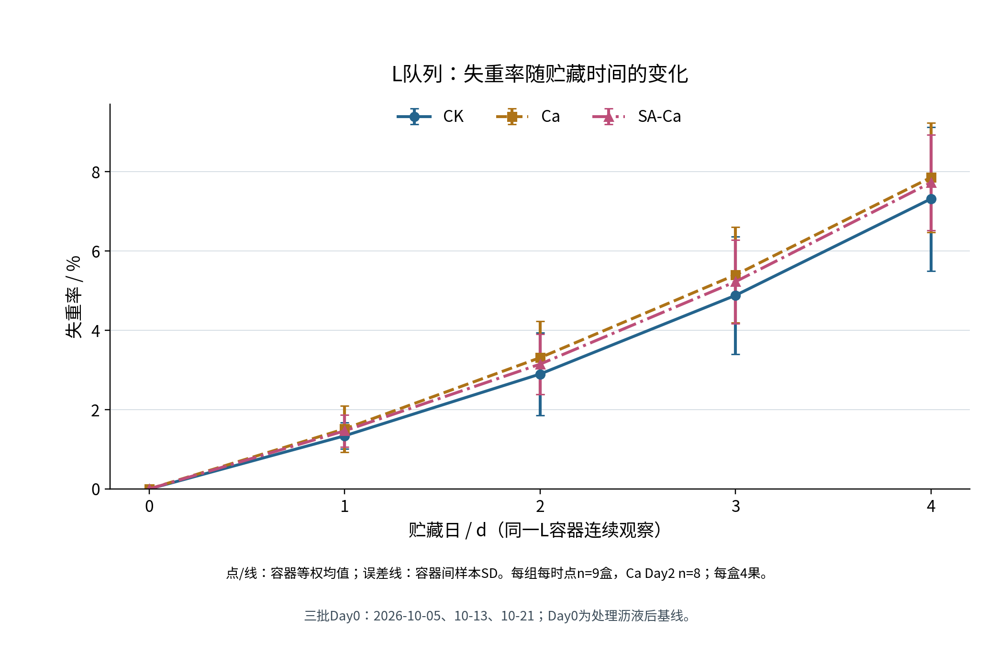
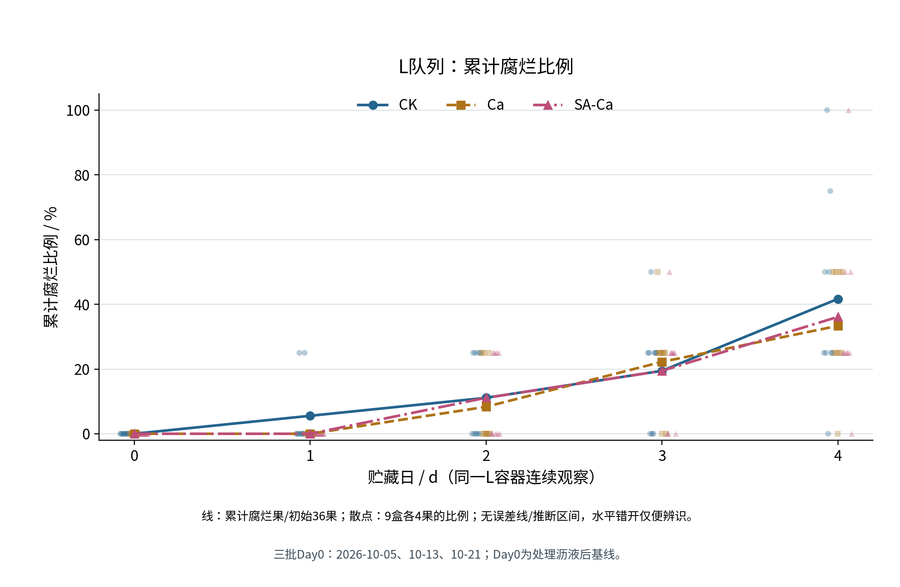
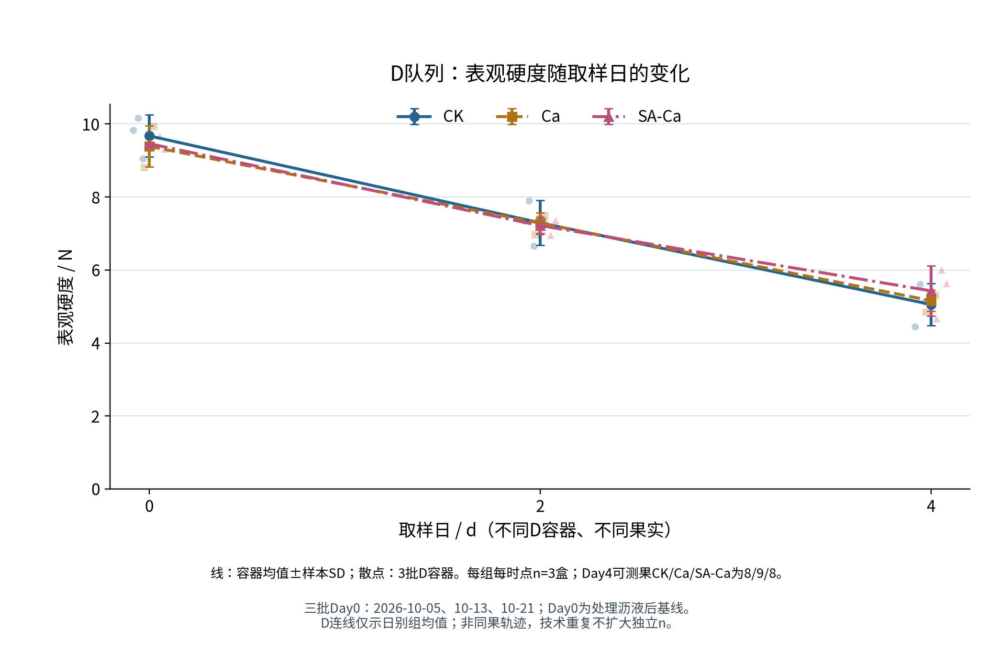
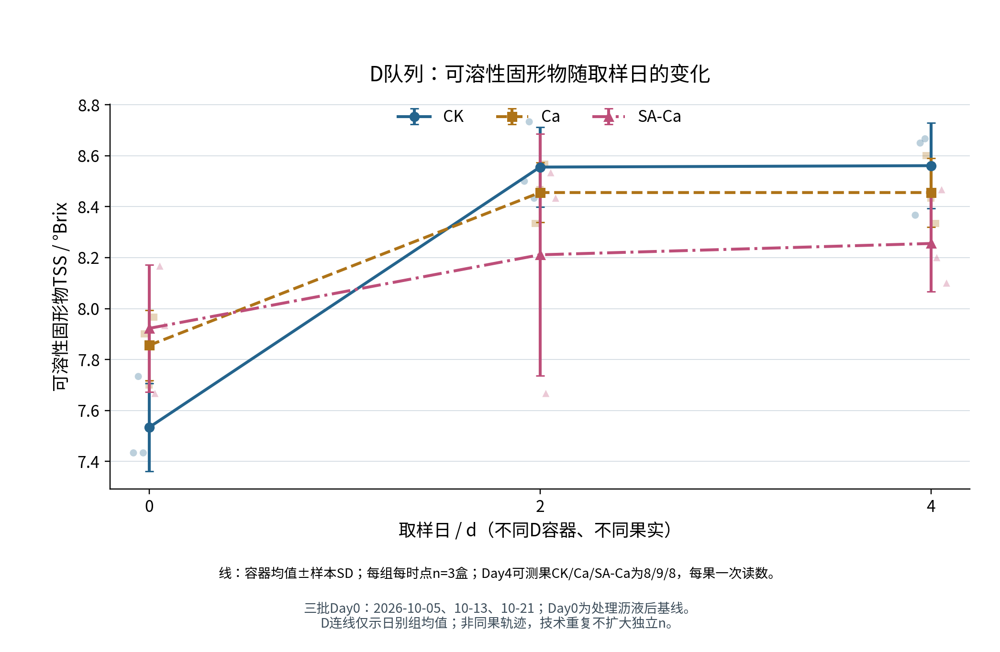
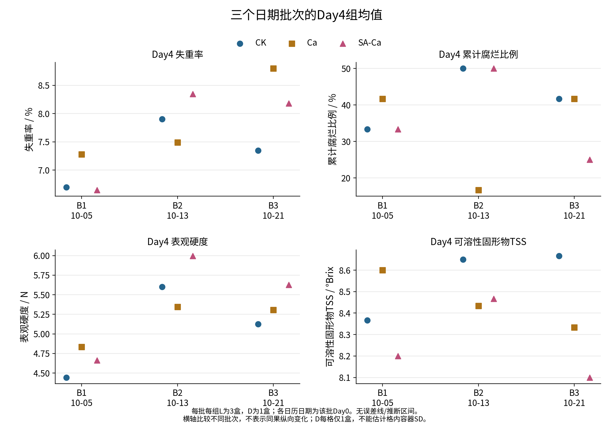
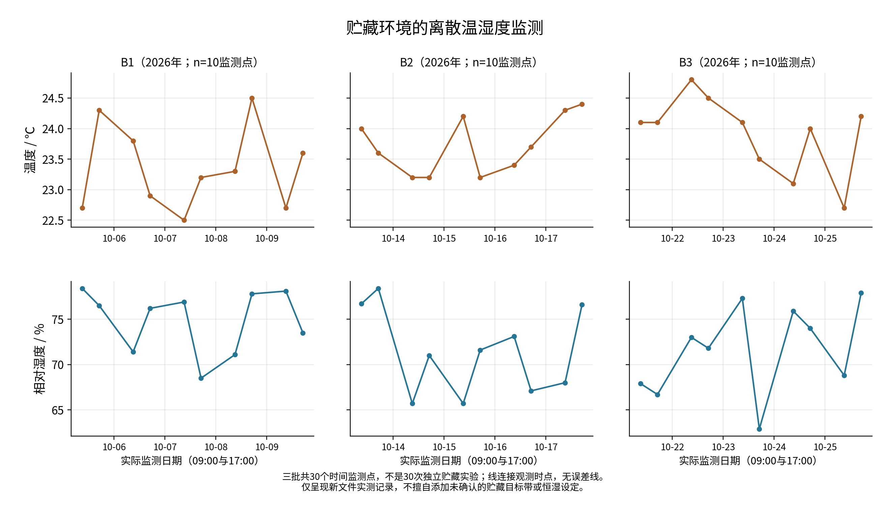

# 第3章 结果与分析

## 3.1 观测环境与有效样本概况

B1、B2和B3依次于2026年10月5日、13日、21日开始，各观察至第4天。每天09:00和17:00共形成30个离散监测时点，温度为22.5—24.8 ℃，相对湿度为62.9%—78.4%。三批平均温度依次为23.350、23.720、23.910 ℃，平均相对湿度为74.840%、71.390%、71.620%，描述了各日期批次的环境背景。

实验共54容器189果，其中L队列27容器108果，连续观察质量及腐烂；D队列27容器81果，在第0、2、4天取不同果实测定品质。跨三批各组每个L时点设计9盒，每个D时点3盒。结果按第二章所述容器层级整理。

L计划称重135条，134条有效，Ca第2天漏称1盒，有效8盒，其余组时点9盒。L腐烂观察540条来自108果的5次重复观察。D计划品质读数243条，237条有效，包括158条硬度技术读数和79条TSS读数。第4天CK和SA-Ca各1果不可测，各缺2条硬度及1条TSS；所在容器按其余2果计算，故各组仍有3个有效D容器。

基线与终点统计见表3-1。均值、SD及范围均以有效容器结果为基础，硬度技术读数已在果实内平均，覆盖或可测果数另列。主要结果展示三位小数，底层保留原始精度。

表3-1　各指标基线与终点的描述统计汇总

|指标|日|组|均值±SD|容器值范围|盒数|果数|累计/初始|
|---|---|---|---|---|---|---|---|
|失重率（%）|0|CK|0.000 ± 0.000|0.000—0.000|9|36|—|
|失重率（%）|0|Ca|0.000 ± 0.000|0.000—0.000|9|36|—|
|失重率（%）|0|SA-Ca|0.000 ± 0.000|0.000—0.000|9|36|—|
|失重率（%）|4|CK|7.315 ± 1.814|5.455—11.085|9|36|—|
|失重率（%）|4|Ca|7.855 ± 1.382|5.286—10.488|9|36|—|
|失重率（%）|4|SA-Ca|7.725 ± 1.206|5.158—9.615|9|36|—|
|累计腐烂比例（%）|0|CK|0.000 ± 0.000|0.000—0.000|9|36|0/36|
|累计腐烂比例（%）|0|Ca|0.000 ± 0.000|0.000—0.000|9|36|0/36|
|累计腐烂比例（%）|0|SA-Ca|0.000 ± 0.000|0.000—0.000|9|36|0/36|
|累计腐烂比例（%）|4|CK|41.667 ± 30.619|0.000—100.000|9|36|15/36|
|累计腐烂比例（%）|4|Ca|33.333 ± 17.678|0.000—50.000|9|36|12/36|
|累计腐烂比例（%）|4|SA-Ca|36.111 ± 28.260|0.000—100.000|9|36|13/36|
|表观硬度（N）|0|CK|9.677 ± 0.573|9.043—10.160|3|9|—|
|表观硬度（N）|0|Ca|9.388 ± 0.564|8.805—9.932|3|9|—|
|表观硬度（N）|0|SA-Ca|9.463 ± 0.184|9.307—9.665|3|9|—|
|表观硬度（N）|4|CK|5.056 ± 0.581|4.443—5.600|3|8|—|
|表观硬度（N）|4|Ca|5.162 ± 0.285|4.833—5.345|3|9|—|
|表观硬度（N）|4|SA-Ca|5.429 ± 0.688|4.663—5.997|3|8|—|
|TSS（°Brix）|0|CK|7.533 ± 0.173|7.433—7.733|3|9|—|
|TSS（°Brix）|0|Ca|7.856 ± 0.139|7.700—7.967|3|9|—|
|TSS（°Brix）|0|SA-Ca|7.922 ± 0.250|7.667—8.167|3|9|—|
|TSS（°Brix）|4|CK|8.561 ± 0.169|8.367—8.667|3|8|—|
|TSS（°Brix）|4|Ca|8.456 ± 0.135|8.333—8.600|3|9|—|
|TSS（°Brix）|4|SA-Ca|8.256 ± 0.190|8.100—8.467|3|8|—|

注：天数以各批处理沥液后的Day0为起点。SD为有效容器间样本标准差，范围为容器结果最小值至最大值；D范围为容器均值范围。盒数为有效容器数，果数为L覆盖果数或D可测果数。累计/初始列对应L腐烂数量，分母每组36果、每盒4果。Day4 CK/Ca/SA-Ca的D可测果数为8/9/8，硬度有效技术读数16/18/16；其余所列D时点均9果。

## 3.2 不同处理下失重率的变化

三组L容器平均失重率随贮藏日升高（图3-1）。Day0以处理沥液后同盒果实净质量为基线，失重率按定义为0；后续由原始净质量全精度计算单盒结果，再按有效容器等权汇总。

按CK、Ca、SA-Ca顺序，第1天失重率为（1.340±0.332）%、（1.516±0.585）%和（1.466±0.406）%；第2天为（2.898±1.041）%、（3.310±0.920）%和（3.147±0.762）%；第3天为（4.882±1.484）%、（5.399±1.210）%和（5.227±1.058）%。Ca第2天有效8盒、覆盖32果，其余上述组时点均为9盒、36果；单次漏测没有导致该容器其他日期记录被删除。

第4天Ca均值最高，SA-Ca居中，CK最低（表3-1）。SA-Ca比Ca低0.130个百分点，比CK高0.409个百分点，第1—4天均保持这一相对方向。其与两种对照的描述比较方向不同。

CK终点盒间SD为1.814个百分点，范围5.455—11.085%，离散程度大于另两组。各容器均保留在汇总中，图中误差线呈现容器间样本SD。

图3-1　三组L容器失重率随贮藏时间的变化

注：纵轴单位%；点、线为容器等权均值，误差线为容器间样本SD。每组每时点9盒（Ca第2天8盒），每盒初始4果；同一L容器连续观察。

## 3.3 不同处理下累计腐烂情况

三组第0天均未记录腐烂。CK在第1天首次记录2果，Ca和SA-Ca至第2天首次记录。第2天CK、Ca、SA-Ca累计分别为4、3、4果；第3天分别为7、8、7果，即19.444%、22.222%、19.444%（图3-2）。Ca第3天累计数高于另两组，而终点最低，说明中间时点的组间顺序不能代替全观察期结果。

第1—4天首次新增腐烂，CK依次2、2、3、8果，Ca为0、3、5、4果，SA-Ca为0、4、3、6果。首次记录定位到观察日期，已腐烂果在后续累计状态中持续保留。

第4天CK、Ca、SA-Ca依次为15/36（41.667%）、12/36（33.333%）及13/36（36.111%），Ca比例最低。SA-Ca比CK少2果，比Ca多1果，分母始终为各组初始36个L果。

终点CK及SA-Ca单盒比例范围均为0—100%，Ca为0—50%，盒间SD依次30.619、17.678和28.260个百分点。每盒4果，比例按25个百分点递增，显示组内容器差异较大。

图3-2　三组L队列累计腐烂比例随贮藏时间的变化

注：线为累计腐烂果数/初始36果，散点为9盒（4果/盒）比例，水平错开便于辨识。无误差线；盒间SD见表3-1。

## 3.4 不同处理下表观硬度的变化

三组表观硬度日别均值从第0天至第2天、第4天依次降低（图3-3）。Day0为CK最高、SA-Ca次之、Ca最低（表3-1），处理后基线已有组间差别。

第2天CK、Ca、SA-Ca分别为（7.294±0.620）、（7.284±0.283）、（7.218±0.232） N，顺序为CK＞Ca＞SA-Ca，CK与Ca均值相差约0.011 N。各组3个D容器9个可测果，共18条硬度技术读数，先在同果内平均。

Day4排序转为SA-Ca＞Ca＞CK，SA-Ca相对Ca和CK分别高0.268 N及0.373 N，其对Ca的批次内方向不完全一致。D0、D2、D4为不同果实，连线描述日别组均值。

Day4 CK和SA-Ca各8个可测果16条技术读数，Ca为9果18条，各组3盒。不可测果所在盒以其余2果形成均值；局部受影响但有完好测点的果实按记录资格保留。终点结果覆盖实际可测部分，缺失值处理与第二章一致。

图3-3　三组D队列表观硬度随取样日的变化

注：纵轴单位N；线为容器等权均值，误差线为容器间样本SD，散点为各批D容器均值。每组每时点3盒；Day0/2各9果，Day4 CK/Ca/SA-Ca为8/9/8果。跨日使用不同果实。

## 3.5 不同处理下可溶性固形物的变化

三组TSS由第0天至第2天均升高，随后CK及SA-Ca略升，Ca组均值保持不变（图3-4）。Day0 SA-Ca最高、CK最低；Day2 CK、Ca、SA-Ca分别为（8.556±0.158）、（8.456±0.117）、（8.211±0.474） °Brix，转为CK＞Ca＞SA-Ca。

Day4排序仍为CK＞Ca＞SA-Ca（表3-1）。CK和SA-Ca均值由Day2小幅上移，Ca两日均为8.456 °Brix。均值相同反映汇总水平，容器与果实读数仍有差异。

TSS每果1次，Day0与Day2各组均为3盒9条有效读数，Day4 CK、Ca、SA-Ca依次8、9、8条，仍各3盒。缺失涉及与硬度相同的两果，汇总保留可测果数量。图示均值由折光原始值聚合形成。

TSS变化与硬度均值下降呈现不同过程，终点排序也与其他指标不同。本文分别报告四项指标，不据其中一项确定总体品质排名。

图3-4　三组D队列可溶性固形物随取样日的变化

注：纵轴单位°Brix；线为容器等权均值，误差线为容器间样本SD，散点为各批D容器均值。每组每时点3盒，每果1次；Day0/2各9果，Day4 CK/Ca/SA-Ca为8/9/8果。跨日使用不同果实。

## 3.6 批次差异与汇总口径敏感性

批次内终点差见表3-2，组均值见图3-5。SA-Ca相对Ca的失重差在三批依次为负、正、负，硬度差为负、正、正；相对CK的失重差为负、正、正，硬度差三批均为正。

累计腐烂中，SA-Ca相对Ca在B1及B3较低、B2较高，相对CK前两批相同、B3较低。TSS相对Ca在B1和B3较低、B2略高，相对CK三批均低。汇总排序与单批方向因而需要分别呈现。

表3-2　第4天不同日期批次的组间描述性差异

|指标（差值单位）|对比|B1|B2|B3|三批平均差±批次差值SD|
|---|---|---|---|---|---|
|失重率（百分点）|SA-Ca−Ca|-0.633|0.859|-0.617|-0.130 ± 0.857|
|失重率（百分点）|SA-Ca−CK|-0.053|0.445|0.836|0.409 ± 0.445|
|累计腐烂比例（百分点）|SA-Ca−Ca|-8.333|33.333|-16.667|2.778 ± 26.788|
|累计腐烂比例（百分点）|SA-Ca−CK|0.000|0.000|-16.667|-5.556 ± 9.623|
|表观硬度（N）|SA-Ca−Ca|-0.170|0.652|0.321|0.268 ± 0.413|
|表观硬度（N）|SA-Ca−CK|0.220|0.397|0.502|0.373 ± 0.143|
|TSS（°Brix）|SA-Ca−Ca|-0.400|0.033|-0.233|-0.200 ± 0.219|
|TSS（°Brix）|SA-Ca−CK|-0.167|-0.183|-0.567|-0.306 ± 0.226|

注：差值为前组减后组；L每批组3盒，D每批组1盒。平均差及SD据三个批次差值计算。百分点表示两个百分比之差。

留一批次整理中，SA-Ca相对Ca终点失重平均差为−0.625至0.121个百分点，硬度为0.075—0.486 N。前者跨越正负，后者保持正值，B1硬度单批负差仍保留。范围表示每次保留两批所得的组成敏感性，不是置信区间。

图3-5　三日期批次第4天四项指标的组均值分布

注：四分图单位依次为%、%、N、°Brix，点为各批各组容器均值。L每批组3盒，D每批组1盒；D4可测果数见表3-1。横轴日期为各批Day0；无误差线。

Ca第2天失重率容器等权为3.310367%，日期等权为3.395082%，相差0.084715个百分点；其余L组时点两种口径在浮点精度内一致。逐盒失重率先保留两位小数时，15个组日均值与全精度口径的最大绝对差为0.001900个百分点，排序未变。主结果保持全精度、容器等权。

Day4可测果等权相对容器等权，CK及SA-Ca硬度均值分别低0.067986、0.024792 N；TSS中CK低0.011111 °Brix、SA-Ca高0.019444 °Brix，Ca两指标在计算精度内不变。Day0及Day2每盒可测果数相同，两种权重均值一致。这些结果只比较已有可测果的汇总方式。

7条偏离记录和15条组日异常提示对应的观测全部保留；后者不等于15个独立异常容器。B3第2天17:00相对湿度较低，与其他监测值一并呈现（图3-6）。

图3-6　三日期批次贮藏期间的离散温湿度监测

注：上排温度（℃），下排相对湿度（%）。各批每日09:00、17:00各1次，共10时点；横轴为实际日期。连线表示离散监测，无误差线。

本章结果为现有样品和记录范围内的描述统计。批次、共享母液及取样层级的解释限制见4.3。
