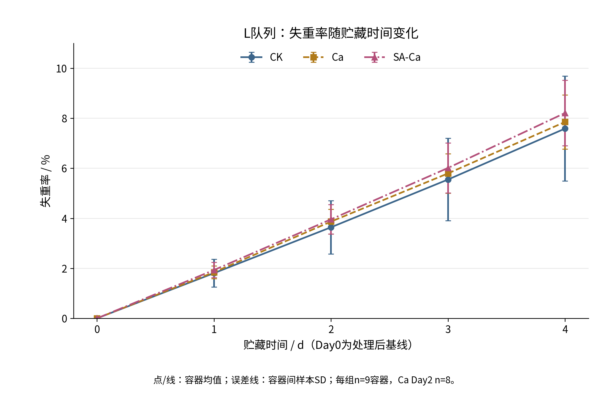
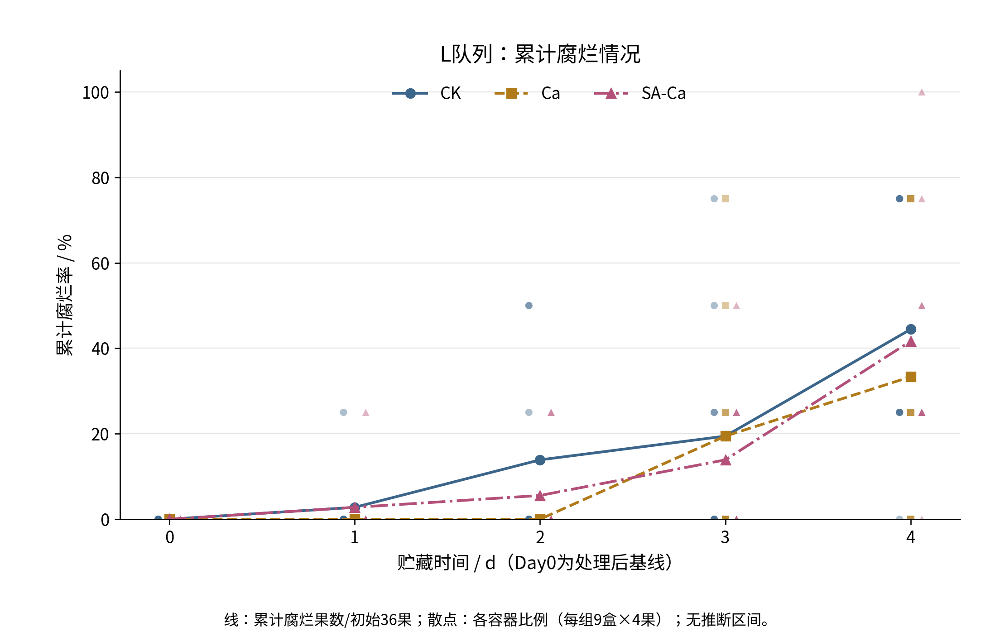
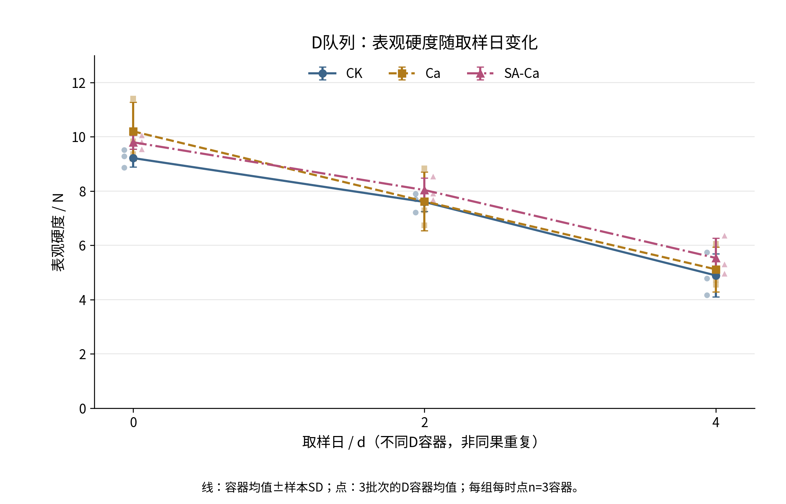
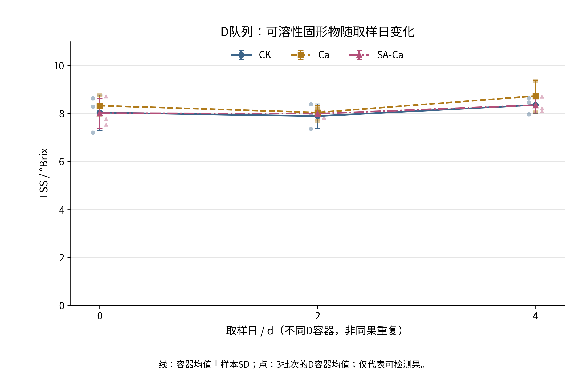

# 第3章 结果与分析

## 3.1 观测环境与有效样本概况

三个日期批次B1、B2和B3分别于2026年10月5日、13日和21日开始，各观察至第4天。贮藏目标温度为23—25℃，实际记录温度为22.2—25.2℃，相对湿度为62.8%—79.5%。每天09:00和17:00的监测共形成30条记录，其中6条温度记录位于目标范围之外：B1有5条低于23℃，B3有1条高于25℃。这些记录反映离散时点的环境状态，既不代表30次独立贮藏实验，也不能据此推定整个周期始终处于固定温湿度条件。

B1、B2和B3的平均记录温度分别为23.050、23.620和24.240℃，平均相对湿度分别为75.090%、73.720%和71.040%。不同日期批次的环境背景存在差别，后续组间比较同时保留批次信息，不将环境随日期的变化直接解释为品质差异的原因。

实验共纳入54个容器、189颗果实。其中L队列为27容器、108果，用于第0—4天连续称重与腐烂观察；D队列为27容器、81果，在第0、2、4天分别取不同容器检测表观硬度和TSS。三组各时点的L容器设计数为9，D容器设计数为3。容器内果实和技术读数均不作为额外独立处理重复，同组容器共享母液制备来源的层级关系仍需在解释时保留。

L队列计划质量记录135条，实际有效134条；Ca组第2天缺少1个容器的称重记录，该时点有效容器数为8，其余质量时点均为9。L队列腐烂记录共540条，为108果在5个时点的重复观察，不是540次独立腐烂事件。D队列计划品质原读数243条，实际有效237条，包括158条硬度读数和79条TSS读数。第4天CK与SA-Ca各有1果因过软或腐坏不可测，各缺2条硬度读数及1条TSS读数；相应容器仍可由其余2果形成均值，各组有效D容器数仍为3。缺失值未填0或插补，低失重、涂层不均等已有偏离记录对应的单位均予保留。

各指标基线及终点的描述统计见表3-1。表中SD表示有效容器之间的样本标准差；果实数说明实际覆盖范围，不替代容器层级的统计数量。

表3-1　各指标关键时点的描述统计汇总

|指标|天数|处理组|均值±SD|容器值范围|容器数|包含或可测果数|累计腐烂/初始果数|
|---|---:|---|---|---|---:|---:|---|
|失重率（%）|0|CK|0.000 ± 0.000|0.000—0.000|9|36|—|
|失重率（%）|0|Ca|0.000 ± 0.000|0.000—0.000|9|36|—|
|失重率（%）|0|SA-Ca|0.000 ± 0.000|0.000—0.000|9|36|—|
|失重率（%）|4|CK|7.588 ± 2.096|2.600—9.830|9|36|—|
|失重率（%）|4|Ca|7.853 ± 1.083|6.520—9.500|9|36|—|
|失重率（%）|4|SA-Ca|8.212 ± 1.309|6.220—10.200|9|36|—|
|累计腐烂比例（%）|0|CK|0.000 ± 0.000|0.000—0.000|9|36|0/36|
|累计腐烂比例（%）|0|Ca|0.000 ± 0.000|0.000—0.000|9|36|0/36|
|累计腐烂比例（%）|0|SA-Ca|0.000 ± 0.000|0.000—0.000|9|36|0/36|
|累计腐烂比例（%）|4|CK|44.444 ± 30.046|0.000—75.000|9|36|16/36|
|累计腐烂比例（%）|4|Ca|33.333 ± 33.072|0.000—75.000|9|36|12/36|
|累计腐烂比例（%）|4|SA-Ca|41.667 ± 30.619|0.000—100.000|9|36|15/36|
|表观硬度（N）|0|CK|9.218 ± 0.330|8.862—9.513|3|9|—|
|表观硬度（N）|0|Ca|10.203 ± 1.074|9.362—11.413|3|9|—|
|表观硬度（N）|0|SA-Ca|9.801 ± 0.256|9.542—10.053|3|9|—|
|表观硬度（N）|4|CK|4.894 ± 0.795|4.163—5.740|3|8|—|
|表观硬度（N）|4|Ca|5.118 ± 0.826|4.547—6.065|3|9|—|
|表观硬度（N）|4|SA-Ca|5.538 ± 0.730|4.957—6.357|3|8|—|
|TSS（°Brix）|0|CK|8.033 ± 0.745|7.197—8.627|3|9|—|
|TSS（°Brix）|0|Ca|8.323 ± 0.410|7.937—8.753|3|9|—|
|TSS（°Brix）|0|SA-Ca|8.011 ± 0.626|7.537—8.720|3|9|—|
|TSS（°Brix）|4|CK|8.352 ± 0.352|7.960—8.640|3|8|—|
|TSS（°Brix）|4|Ca|8.728 ± 0.659|8.050—9.367|3|9|—|
|TSS（°Brix）|4|SA-Ca|8.346 ± 0.324|8.100—8.713|3|8|—|

注：天数以各批处理、沥液后的第0天为起点。均值、SD及范围均基于容器水平；硬度和TSS范围为容器均值范围。L称重所含果数不表示单果独立称重。累计腐烂比例以每组初始36果为分母；因每容器初始4果，组总比例与9个容器比例的等权均值一致。硬度和TSS第4天CK、SA-Ca各为8个可测果，Ca为9个；其余所列D时点均为9个可测果。显示三位小数用于统计结果对照，不表示仪器具有相应精度。

## 3.2 不同处理下失重率的变化

三组L容器的平均失重率均随贮藏时间升高（图3-1）。第0天以同一容器处理、沥液后的质量为基线，因此失重率均为0。这是计算起点的定义，不意味着各组原料质量或品质完全相同，也不包含到货至处理完成前的质量变化。

按CK、Ca、SA-Ca顺序，第1天失重率为（1.808±0.557）%、（1.843±0.256）%和（1.932±0.305）%；第2天为（3.641±1.066）%、（3.869±0.490）%和（3.959±0.587）%；第3天为（5.551±1.649）%、（5.796±0.789）%和（6.013±0.997）%。除Ca第2天为8个有效容器、涵盖32果外，上述各组时点均为9个容器、涵盖36果。缺测容器在其他日期的有效记录继续使用，未因单次漏测删除其整条时间序列。

第4天各组均值继续升高，CK最低，Ca居中，SA-Ca最高（表3-1）。SA-Ca相对Ca高0.359个百分点，相对CK高0.624个百分点；其第1—4天均值也均高于CK。就现有记录而言，SA-Ca没有呈现一致的低失重优势。该排序描述的是容器均值，不构成已经证明的处理效应。

终点CK的容器间SD为2.096个百分点，大于另外两组，其容器值范围也较宽。已有低失重容器仍参与统计，没有为改变组均值而剔除。图中的离散表明总体均值不能替代各容器的实际表现；误差线的重叠与否也不作为组间推断的依据。本指标反映已有称重对象相对基线的净质量损失，不单独代表蒸腾、呼吸或膜透湿性能。

图3-1　三组L容器失重率随贮藏时间的变化

注：点和线为容器等权均值，误差线为容器间样本SD。各组各时点n=9个容器，Ca第2天n=8；每个L容器初始4果。第0天为处理、沥液后的基线，同一L容器连续观察。

## 3.3 不同处理下累计腐烂情况

三组第0天均未记录腐烂，此后累计比例逐步增加，但出现时间和增加过程不同（图3-2）。CK与SA-Ca在第1天各首次记录1果腐烂，Ca至第2天仍未记录腐烂。第2天CK和SA-Ca分别累计5果和2果；第3天CK、Ca和SA-Ca分别累计7果、7果和5果，对应19.444%、19.444%和13.889%。因此，中间时点与终点的组间顺序并非始终一致。

首次腐烂的日别记录进一步显示：CK在第1—4天分别新增1、4、2、9果，Ca分别新增0、0、7、5果，SA-Ca分别新增1、1、3、10果。这里的“首次”指首次观察并记录到可见腐烂的日期，不据此定位两次观察之间的精确起始时刻。已腐烂果在后续日期持续计入累计状态，未重复作为新事件，也未移出分母。

至第4天，CK为16/36（44.44%），Ca为12/36（33.33%），SA-Ca为15/36（41.67%）。Ca终点累计比例最低，SA-Ca仅比CK少1果，且高于Ca。SA-Ca第3天累计果数低于另外两组，但第4天新增果数较多，说明不能依据较早时点的排序概括整个观察期。Ca早期未记录腐烂，同样不意味着全期未发生腐烂。

容器间离散也较大。第4天CK与Ca的单容器累计比例均覆盖0—75%，SA-Ca覆盖0—100%，对应SD分别为30.046、33.072和30.619个百分点。每容器只有4果，其比例以25个百分点为步长变化；组总比例平滑了这种容器差别，不能理解为每个容器都有接近组均值的表现。上述结果属于可见腐烂发生情况，不是微生物计数或抑菌率；也未据此确定货架期终点。

图3-2　三组L队列累计腐烂比例随贮藏时间的变化

注：线为累计腐烂果数占各组初始36果的比例；散点为各容器比例，每组9个容器、每容器4果，水平错开仅便于辨识。图中无SD误差线或推断区间，终点容器比例SD见表3-1。每日观察共享同一批L果实。

## 3.4 不同处理下表观硬度的变化

三个处理的表观硬度组均值在第0、2、4天依次降低（图3-3），但各日取自不同D容器和不同果实。第0天CK、Ca和SA-Ca均值已分别为9.218、10.203和9.801 N，SD及范围见表3-1。Ca起始均值最高，表明终点比较存在需要考虑的基线差别，不能假定三组从相同硬度水平开始。

第2天CK、Ca和SA-Ca分别为（7.601±0.353）、（7.624±1.086）和（8.041±0.445）N。该日每组均有3个D容器、9个可测果及18条硬度原读数；技术读数先在果实内平均，再汇总为容器均值。第4天SA-Ca的容器均值最高，Ca次之，CK最低，三组分别为（5.538±0.730）、（5.118±0.826）和（4.894±0.795）N。SA-Ca相对Ca和CK分别高0.420和0.644 N，但该总体方向在不同批次中并不完全一致。

第4天CK和SA-Ca各有8个可测果、16条有效硬度原读数，Ca为9果、18条；各组仍为3个有效D容器。不可测果所属容器由余下2果汇总，其余容器由3果汇总，因此相同的容器数并不意味着覆盖了相同数量、相同状态的果实。终点均值仅代表实际可测果，不能把过软或腐坏造成的缺测视为普通低读数，更不能用0 N代替。

由不同取样日得到的均值下降，可以描述日别样品的整体变化，却不能换算为同一果实的硬度损失或个体保留率。图中连接各日均值用于展示组水平趋势，散点则保留各批次D容器的分布。现有基线差别、不可测果及检测参数信息的限制，使终点均值较高尚不足以单独证明海藻酸钠的硬度保护因果作用。

图3-3　三组D队列表观硬度随取样日的变化

注：单位N。线为容器均值，误差线为容器间样本SD，散点为3个批次对应D容器的均值。每组每时点n=3个容器；第0、2天各9个可测果，第4天CK、Ca、SA-Ca分别为8、9、8果。每果2次技术读数先平均，不作为独立n；跨日不是同果重复测量。

## 3.5 不同处理下可溶性固形物的变化

三组TSS的日别均值均呈先略降后回升的变化（图3-4）。第0天CK、Ca和SA-Ca分别为（8.033±0.745）、（8.323±0.410）和（8.011±0.626）°Brix；第2天分别为（7.888±0.516）、（8.039±0.303）和（7.988±0.137）°Brix。三组均值在第2天低于各自第0天，但下降幅度不同，且各日样本来自不同D容器，不能将这些变化解释为单果连续变化。

第4天三组均值均高于第2天，也高于各自第0天。Ca终点为（8.728±0.659）°Brix，高于CK的（8.352±0.352）°Brix及SA-Ca的（8.346±0.324）°Brix。SA-Ca与CK终点均值接近，按未四舍五入的既有汇总值比较，差为−0.006 °Brix；这种接近只描述数值，不能替代统计推断。Ca在第0、2天的均值也高于其他组，解释终点差别时不能忽略起始差异。

TSS每果测量1次，第0、2天各组为3个容器、9个果实读数；第4天CK、Ca和SA-Ca分别为8、9、8个有效读数，各组容器数仍为3。终点缺测与硬度涉及相同两果，容器均值仅覆盖可测部分。按容器汇总避免了将同容器果实作为独立处理重复，但不能恢复缺失果实的TSS，也不能消除缺失与果实状态相关的解释限制。

TSS的时间变化与表观硬度的持续下降并不同步，终点组间排序也未与失重率完全对应。四项指标分别呈现不同品质侧面，当前结果不支持只凭某一次TSS较高就判断整体保鲜更好。该折光读数不等同于直接测定总糖，亦不能据其变化单独判定口感、营养或糖代谢机制。

图3-4　三组D队列可溶性固形物随取样日的变化

注：单位°Brix。线为容器均值，误差线为容器间样本SD，散点为各批次D容器均值。每组每时点n=3个容器，每果1次读数；第0、2天各9果，第4天CK、Ca、SA-Ca分别为8、9、8个可测果。连线表示日别组均值变化，不是同果纵向轨迹。

## 3.6 批次差异与汇总口径敏感性

第4天的批次内组间差见表3-2。SA-Ca与Ca的失重率差在B1为负，在B2和B3为正；表观硬度差在B1、B3为正，在B2为负。虽然跨批汇总后SA-Ca失重率及硬度均值均高于Ca，批次内的差异并非稳定保持同一方向。SA-Ca相对CK的失重率在三批均较高，而硬度差在B2仍为负，说明方向一致性还取决于比较对象及指标，不能用单一平均排名替代批次结果。

表3-2　第4天不同批次的组间描述性差异

|指标（差值单位）|对比|B1|B2|B3|三批平均差±批次差值SD|
|---|---|---:|---:|---:|---|
|失重率（百分点）|SA-Ca−Ca|-0.767|0.530|1.313|0.359 ± 1.051|
|失重率（百分点）|SA-Ca−CK|1.450|0.240|0.183|0.624 ± 0.716|
|累计腐烂比例（百分点）|SA-Ca−Ca|25.000|8.333|-8.333|8.333 ± 16.667|
|累计腐烂比例（百分点）|SA-Ca−CK|0.000|0.000|-8.333|-2.778 ± 4.811|
|表观硬度（N）|SA-Ca−Ca|0.753|-1.108|1.614|0.420 ± 1.392|
|表观硬度（N）|SA-Ca−CK|1.137|-0.783|1.579|0.644 ± 1.256|
|TSS（°Brix）|SA-Ca−Ca|-1.267|-0.053|0.175|-0.382 ± 0.775|
|TSS（°Brix）|SA-Ca−CK|-0.540|0.753|-0.232|-0.006 ± 0.676|

注：差值均为前组减后组。B1、B2、B3分别对应2026年10月5日、13日、21日开始的批次。L指标每批每组3个容器，D指标每批每组仅1个容器；三批平均差及其SD基于3个批次差值，不是果实或技术重复层级的统计量。百分点表示两个百分比之差。

腐烂与TSS也存在批次差别。SA-Ca相对Ca的终点腐烂比例在B1、B2较高，在B3较低；相对CK则在前两批相同、B3较低。TSS相对Ca在B1、B2较低、B3较高，相对CK则在B2较高、其余两批较低。由此，SA-Ca的终点硬度均值较高、Ca的终点累计腐烂比例较低等汇总现象，应与各批次差值共同报告，而不据其中某一批次选择处理优劣。

已有留一批次整理显示，SA-Ca与Ca的第4天失重率平均差范围为−0.118—0.922个百分点，表观硬度平均差范围为−0.178—1.184 N，均涵盖正负方向。这里的范围来自每次留出一批、对其余两批差值取平均，不是置信区间，也不代表有依据剔除被留出的批次。完整三批始终保留为主结果；仅3个日期批次所显示的波动不足以确定其来源。

容器等权与日期等权的对照主要受单次质量漏测影响。Ca第2天失重率的容器等权均值为3.868750%，日期等权均值为3.855556%，后者减前者为−0.013194个百分点，其余组时点两种口径在计算精度内一致。数值差较小只反映当前可见记录的加权变化，不能证明缺测无偏或推定缺失容器的真实读数。

第4天品质指标还比较了容器等权与可测果等权。CK和SA-Ca表观硬度均值在果等权口径下分别为4.788125和5.435625 N，较容器等权分别低0.105764和0.102431 N；两组TSS果等权均值分别为8.401250和8.361250 °Brix，较容器等权分别高0.049028和0.015139 °Brix。改变权重会使有效果数不同的容器贡献发生变化，这两种口径仍只包含可测果，均不能补偿过软或腐坏果实的缺失。正文主结果保持容器等权，不因某种口径更有利而替换。

以上均为现有记录的描述性汇总与敏感性比较，未开展组间显著性推断。三组失重率升高、Ca终点累计腐烂比例较低、SA-Ca终点表观硬度均值较高及TSS先略降后回升共同构成本研究观察结果，但未形成所有指标方向一致的整体优势。批次波动、D队列基线差别和终点不可测果限定了这些结果的解释范围，不能据此给出已验证的保鲜机制或普遍适用的处理排序。
