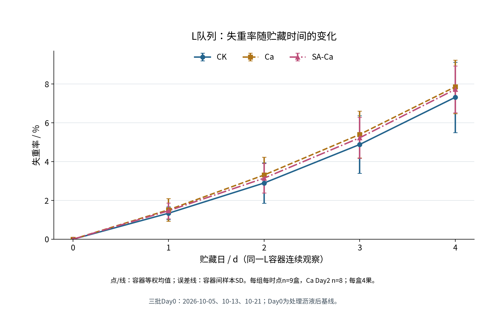
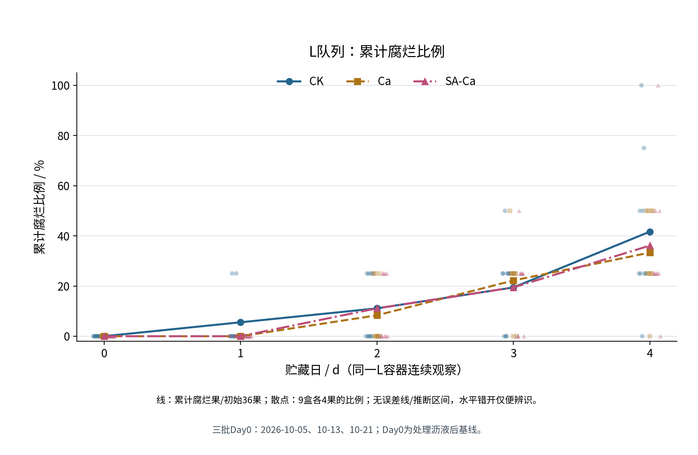
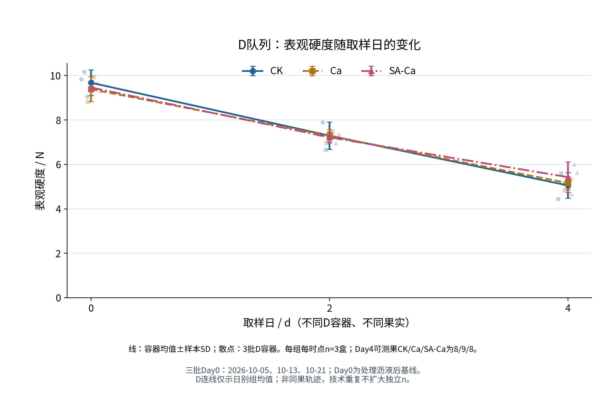
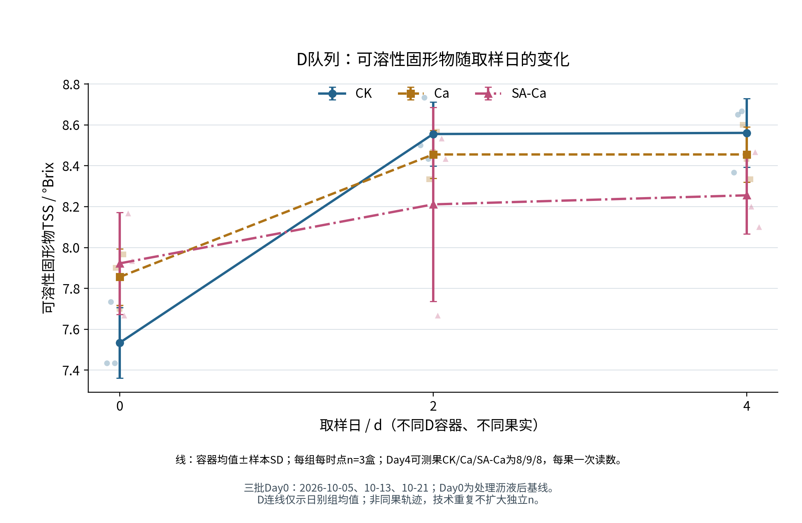
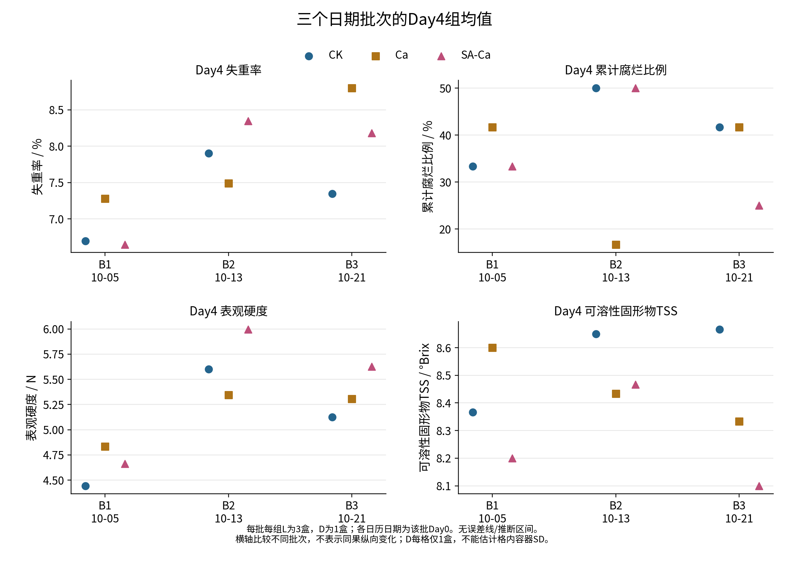
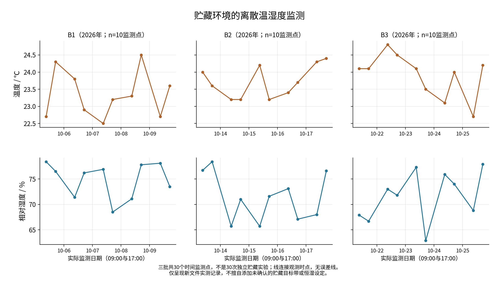

# 第3章 结果与分析

## 3.1 观测环境与有效样本概况

B1、B2和B3分别于2026年10月5日、13日和21日开始，各观察至第4天。每天09:00和17:00的离散监测共形成30个时点，记录温度为22.5—24.8℃、相对湿度为62.9%—78.4%。三批记录的平均温度分别为23.350、23.720和23.910℃，平均相对湿度分别为74.840%、71.390%和71.620%。这些数值说明日期批次的环境背景，并非设备设定范围，也不代表每个容器内部的连续环境或30次独立贮藏实验。

实验共纳入54个容器、189颗草莓。L队列27容器、108果，连续观察第0—4天的质量与累计腐烂；D队列27容器、81果，分别于第0、2、4天取不同容器测定表观硬度与TSS。跨三批每组每个L时点设计9盒，每组每个D取样日设计3盒。容器内果实、技术测点和L多日记录不作为额外独立处理重复，共享母液的层级限制也不因容器分开放置而消失。

L队列计划称重135条，其中134条有效；Ca第2天缺1盒质量记录，有效盒数为8，其余组时点为9。L腐烂观察540条，来自108果在5个时点的重复记录，不是540个首次腐烂事件。D队列计划品质读数243条，其中237条有效，包括158条硬度技术读数和79条TSS读数。第4天CK和SA-Ca各1果严重过软或腐坏而不可测，各缺2条硬度和1条TSS；相应容器由其余2果形成均值，故各组有效D容器数仍为3。缺失保持为空，不填0或插补。

四项指标基线及终点的描述统计见表3-1。均值、SD和范围以有效容器为单位，硬度技术读数已先在果实内折叠；所列果数只说明覆盖范围，不替代容器层级的统计数量。主要统计值统一展示三位小数，底层计算保留原始精度，显示位数不表示仪器达到相同精度。

表3-1　各指标基线与终点的描述统计汇总

|指标|天数|处理组|均值±SD|容器值范围|有效容器数|包含或可测果数|累计腐烂/初始果数|
|---|---|---|---|---|---|---|---|
|失重率（%）|0|CK|0.000 ± 0.000|0.000—0.000|9|36|—|
|失重率（%）|0|Ca|0.000 ± 0.000|0.000—0.000|9|36|—|
|失重率（%）|0|SA-Ca|0.000 ± 0.000|0.000—0.000|9|36|—|
|失重率（%）|4|CK|7.315 ± 1.814|5.455—11.085|9|36|—|
|失重率（%）|4|Ca|7.855 ± 1.382|5.286—10.488|9|36|—|
|失重率（%）|4|SA-Ca|7.725 ± 1.206|5.158—9.615|9|36|—|
|累计腐烂比例（%）|0|CK|0.000 ± 0.000|0.000—0.000|9|36|0/36|
|累计腐烂比例（%）|0|Ca|0.000 ± 0.000|0.000—0.000|9|36|0/36|
|累计腐烂比例（%）|0|SA-Ca|0.000 ± 0.000|0.000—0.000|9|36|0/36|
|累计腐烂比例（%）|4|CK|41.667 ± 30.619|0.000—100.000|9|36|15/36|
|累计腐烂比例（%）|4|Ca|33.333 ± 17.678|0.000—50.000|9|36|12/36|
|累计腐烂比例（%）|4|SA-Ca|36.111 ± 28.260|0.000—100.000|9|36|13/36|
|表观硬度（N）|0|CK|9.677 ± 0.573|9.043—10.160|3|9|—|
|表观硬度（N）|0|Ca|9.388 ± 0.564|8.805—9.932|3|9|—|
|表观硬度（N）|0|SA-Ca|9.463 ± 0.184|9.307—9.665|3|9|—|
|表观硬度（N）|4|CK|5.056 ± 0.581|4.443—5.600|3|8|—|
|表观硬度（N）|4|Ca|5.162 ± 0.285|4.833—5.345|3|9|—|
|表观硬度（N）|4|SA-Ca|5.429 ± 0.688|4.663—5.997|3|8|—|
|TSS（°Brix）|0|CK|7.533 ± 0.173|7.433—7.733|3|9|—|
|TSS（°Brix）|0|Ca|7.856 ± 0.139|7.700—7.967|3|9|—|
|TSS（°Brix）|0|SA-Ca|7.922 ± 0.250|7.667—8.167|3|9|—|
|TSS（°Brix）|4|CK|8.561 ± 0.169|8.367—8.667|3|8|—|
|TSS（°Brix）|4|Ca|8.456 ± 0.135|8.333—8.600|3|9|—|
|TSS（°Brix）|4|SA-Ca|8.256 ± 0.190|8.100—8.467|3|8|—|

注：天数以各批处理沥液后的第0天为起点。SD为有效容器间样本标准差，范围为容器结果的最小值至最大值；D指标范围是容器均值范围。L称重的包含果数不是逐果独立称重数。累计腐烂按初始36果/组、4果/盒计；9盒比例均值与组总比例一致。第4天CK、Ca、SA-Ca的D可测果数分别为8、9、8；硬度相应有效技术读数为16、18、16，TSS为8、9、8；其余所列D时点均为9果。

## 3.2 不同处理下失重率的变化

三组L容器平均失重率均随贮藏日升高（图3-1）。第0天以同一容器处理沥液后的果实净质量为基线，失重率为0来自计算定义，不表示三组原料质量或品质完全相同，也不包含到货至处理完成前的质量变化。后续失重率由原始净质量全精度计算到单盒，再按有效容器等权汇总。

按CK、Ca、SA-Ca顺序，第1天失重率为（1.340±0.332）%、（1.516±0.585）%和（1.466±0.406）%；第2天为（2.898±1.041）%、（3.310±0.920）%和（3.147±0.762）%；第3天为（4.882±1.484）%、（5.399±1.210）%和（5.227±1.058）%。Ca第2天有效8盒、覆盖32果，其余上述组时点均为9盒、36果；单次漏测没有导致该容器其他日期记录被删除。

第4天Ca均值最高，SA-Ca居中，CK最低（表3-1）。SA-Ca相对Ca低0.130个百分点，相对CK高0.409个百分点；第1—4天其均值均高于CK，但均低于Ca。因而，对Ca和对CK的比较方向不同，不能把某一对照下的均值关系概括为稳定的低失重优势。上述只是本样本的描述排序。

终点CK的盒间SD为1.814个百分点，容器范围为5.455—11.085%，其离散大于另外两组。数值偏高或偏低的容器仍保留在汇总中，没有按方向删样。均值和误差线用于呈现盒间分布，误差线是否重叠不作为组间推断依据；净质量变化也不单独等同于蒸腾、呼吸或膜透湿性能。

图3-1　三组L容器失重率随贮藏时间的变化

注：纵轴单位为%；点和线为全精度单盒结果的容器等权均值，误差线为容器间样本SD。通常每组每时点n=9盒，Ca第2天n=8，每盒初始4果。同一L容器连续观察；三批第0天为2026年10月5日、13日、21日，横轴按相对贮藏日对齐。

## 3.3 不同处理下累计腐烂情况

三组第0天均未记录腐烂。CK在第1天首次记录2果，Ca和SA-Ca至第2天首次记录。第2天CK、Ca、SA-Ca累计分别为4、3、4果；第3天分别为7、8、7果，即19.444%、22.222%、19.444%（图3-2）。Ca第3天累计数高于另两组，而终点最低，说明中间时点的组间顺序不能代替全观察期结果。

第1—4天首次新增腐烂数，CK依次为2、2、3、8果，Ca为0、3、5、4果，SA-Ca为0、4、3、6果。首次指第一次观察并记录到可见腐烂的日期，不定位两次观察之间的精确发生时刻。已腐烂果后续持续计入累计状态，未再次计作首次事件，也未提前移出初始分母。

第4天CK为15/36（41.667%），Ca为12/36（33.333%），SA-Ca为13/36（36.111%）。SA-Ca比CK少2果，比Ca多1果，Ca的终点累计比例最低。该比较使用三组各自初始36个L果，D队列外观观察不进入分子或分母，也不将重复果日观察数当作新的独立样本。

终点CK与SA-Ca的单盒累计比例均覆盖0—100%，Ca覆盖0—50%，盒间SD依次为30.619、17.678、28.260个百分点。每盒4果，比例以25个百分点递增，组总比例不能代表每盒都接近均值。这些结果是二元可见腐烂的累计发生情况，不是按严重度加权的腐烂指数、微生物抑菌率或货架期终点。

图3-2　三组L队列累计腐烂比例随贮藏时间的变化

注：纵轴单位为%；线为累计腐烂果数/各组初始36果，散点为9盒各4果的比例，水平错开仅便辨识。图无SD误差线或推断区间，终点盒间SD见表3-1。第0—4天重复观察同一L果；三个日期批次按相对贮藏日对齐。

## 3.4 不同处理下表观硬度的变化

三组表观硬度日别均值从第0天到第2天、第4天依次降低（图3-3）。第0天CK均值最高、SA-Ca次之、Ca最低，基线已有组间差别（表3-1）。这些基线值来自处理后的D0果，不能当作D4同一果实的处理前硬度，也不能假定三组从相同起始水平开始。

第2天CK、Ca和SA-Ca分别为（7.294±0.620）、（7.284±0.283）和（7.218±0.232） N，数值顺序为CK＞Ca＞SA-Ca。CK与Ca的均值间隔仅约0.011 N，这一细小数值差别不代表已确认的处理差异。该日每组3个D容器、9个可测果、18条硬度技术读数，两个测点先在同果内平均。

第4天SA-Ca均值最高、Ca次之、CK最低，终点均值及SD见表3-1。SA-Ca相对Ca和CK分别高0.268 N和0.373 N，但对Ca的批次内方向并不完全一致。D0、D2、D4使用不同容器和果实，曲线只是日别组均值的连接，不是同果硬度损失或保留率。

第4天CK与SA-Ca各8个可测果、16条有效技术读数，Ca为9果、18条；各组均为3个有效D容器。不可测果所在盒按其余2果形成均值，其余盒各含3个可测果。记录中局部受影响但仍有完好检测部位的果实也按资格保留，严重不可测果则保持缺失，不能将其当作普通低值或填为0 N。终点均值只代表可测部分，基线、可测果选择性及检测条件的证据边界仍限制解释。

图3-3　三组D队列表观硬度随取样日的变化

注：纵轴单位N；线为容器等权均值，误差线为容器间样本SD，散点为三个日期批次对应D容器的均值。每组每时点n=3盒，第0、2天各9果，第4天CK/Ca/SA-Ca为8/9/8果。每果两次技术读数先平均，不扩大独立n；跨日不是同果重复测量。

## 3.5 不同处理下可溶性固形物的变化

三组TSS均值从第0天到第2天均升高，之后CK和SA-Ca略升，Ca组保持相同的组均值（图3-4）。第0天SA-Ca最高、CK最低；第2天CK、Ca和SA-Ca分别为（8.556±0.158）、（8.456±0.117）和（8.211±0.474） °Brix，排序已变为CK＞Ca＞SA-Ca。这里反映不同D取样日的样品组成，不是单果连续轨迹。

第4天TSS为CK＞Ca＞SA-Ca，均值和SD见表3-1。CK和SA-Ca由第2天至第4天的均值只小幅上移，Ca两日均值均为8.456 °Brix；均值相同不等于各个容器、果实读数相同。各组在本观察窗口内呈升高后近于平台的变化，终点排序仅描述此次可测样本。

TSS每果一次，第0、2天每组均为3盒9个有效读数；第4天CK、Ca、SA-Ca为8、9、8个有效读数，各组盒数仍为3。缺失与硬度涉及相同两果，按盒汇总没有恢复不可测果的TSS。图中多位小数的均值来自聚合，不表示单果读数具有同样分辨率；本指标为折光可溶性固形物，不直接等同总糖。

TSS的日别变化与硬度均值下降并不同步，终点处理排序也不与其他指标完全相同。四项指标未形成某组在全部评价方向上一致占优的表现，仅凭一次TSS较高不能判断口感、营养或总体保鲜效果更好。

图3-4　三组D队列可溶性固形物随取样日的变化

注：纵轴单位°Brix；线为容器等权均值，误差线为容器间样本SD，散点为各批次D容器均值。每组每时点n=3盒，每果一次读数；第0、2天各9果，第4天CK/Ca/SA-Ca为8/9/8果。三个批次按相对取样日对齐，D连线不表示同果纵向变化。

## 3.6 批次差异与汇总口径敏感性

第4天的批次内组间差见表3-2，三批组均值分布见图3-5。SA-Ca相对Ca的失重率差为负、正、负，硬度差为负、正、正；与CK相比，失重率差在B1为负、B2和B3为正，硬度差则三批均为正。汇总排序和批次内方向应同时保留，不以有利批次代替完整三批结果。

表3-2　第4天不同日期批次的组间描述性差异

|指标（差值单位）|对比|B1|B2|B3|三批平均差±批次差值SD|
|---|---|---|---|---|---|
|失重率（百分点）|SA-Ca−Ca|-0.633|0.859|-0.617|-0.130 ± 0.857|
|失重率（百分点）|SA-Ca−CK|-0.053|0.445|0.836|0.409 ± 0.445|
|累计腐烂比例（百分点）|SA-Ca−Ca|-8.333|33.333|-16.667|2.778 ± 26.788|
|累计腐烂比例（百分点）|SA-Ca−CK|0.000|0.000|-16.667|-5.556 ± 9.623|
|表观硬度（N）|SA-Ca−Ca|-0.170|0.652|0.321|0.268 ± 0.413|
|表观硬度（N）|SA-Ca−CK|0.220|0.397|0.502|0.373 ± 0.143|
|TSS（°Brix）|SA-Ca−Ca|-0.400|0.033|-0.233|-0.200 ± 0.219|
|TSS（°Brix）|SA-Ca−CK|-0.167|-0.183|-0.567|-0.306 ± 0.226|

注：差为前组减后组，B1/B2/B3分别于2026年10月5日、13日、21日开始。L指标每批每组3盒，D指标每批每组每取样日仅1盒；三批平均差及SD基于3个批次差值。百分点表示两个百分比之差，不是相对变化率；批次差值SD也不是同盒果实或技术测点的SD。

累计腐烂比例中，SA-Ca相对Ca在B1和B3较低、B2较高；相对CK在前两批相同，B3较低。TSS相对Ca在B1、B3较低、B2略高，相对CK则三批均低。SA-Ca终点硬度均值较高和Ca累计腐烂比例较低等汇总观察，不能据此改写为每个批次都保持相同的处理排序。

图3-5　三日期批次第4天四项指标的组均值分布

注：四分图依次为失重率（%）、累计腐烂比例（%）、表观硬度（N）及TSS（°Brix）。点为各批次各组有效容器的等权汇总均值；L每批组3盒，D每批组1盒，D第4天CK在B2、SA-Ca在B3仅2个可测果。无误差线；单批D格仅1盒，不能估计该格的容器间SD。横轴日期是各批第0天，不是终点检测日期。

留一批次整理中，SA-Ca相对Ca的终点失重率平均差为−0.625至0.121个百分点，范围跨越正负；硬度平均差为0.075—0.486 N，两端均为正。硬度留一均差为正并不抹去B1的负差，也不构成正式推断。这些范围仅由每次留出一批、对其余两批取均差得到，不是置信区间，更不是删除被留出批次的理由。

日期批次等权与容器等权的区别主要出现在Ca第2天失重率：容器等权为3.310367%，日期等权为3.395082%，后者高0.084715个百分点，其余L组时点两种口径在浮点精度内一致。另按单盒失重率先保留两位小数再汇总时，15个组日均值与全精度主口径的最大绝对差为0.001900个百分点，各日排序未改变。这些对照不补回漏测质量，也不改变全精度、容器等权的主结果选择。

第4天可测果等权相对容器等权，CK与SA-Ca的硬度均值分别低0.067986和0.024792 N；TSS中CK低0.011111 °Brix，SA-Ca高0.019444 °Brix，Ca两指标在计算精度内不变。D0与D2各盒可测果数相同，两种权重所得均值一致。改变权重只调整已可测果对均值的贡献，不能抵消过软或腐坏造成的样本选择性。

7条偏离记录及15条组日异常提示对应的观测全部保留；提示数量不是15个独立异常容器，也不意味着这些数值已被证明错误。B3第2天17:00记录的相对湿度较低，与逐日监测一起如实呈现（图3-6），未据此删除批次或解释某组的品质变化。

图3-6　三日期批次贮藏期间的离散温湿度监测

注：上排温度单位℃，下排相对湿度单位%；横轴为2026年实际日期，每日09:00和17:00各1个时点。每批10个时点、合计30个，连线仅连接记录值，无误差线，不代表30次独立实验或全周期连续恒定条件。

以上均为已有记录范围内的描述统计。三批次环境、共享母液、L连续观察及D每批每组每时点仅1盒的结构不能被汇总消除，仪器及净质量操作的实际执行证据也未因结果一致而补足。本章据此报告观察到的差别，保留不一致与缺失，不作确定的处理因果、抑菌、膜阻隔或延长货架期结论。
